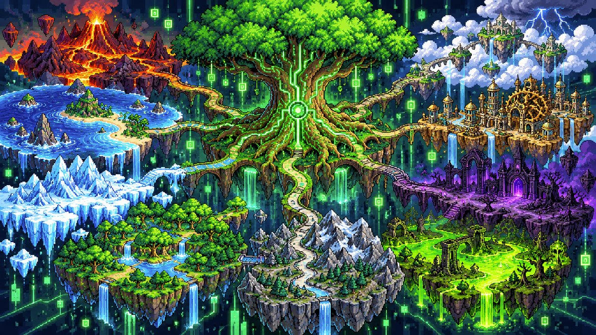
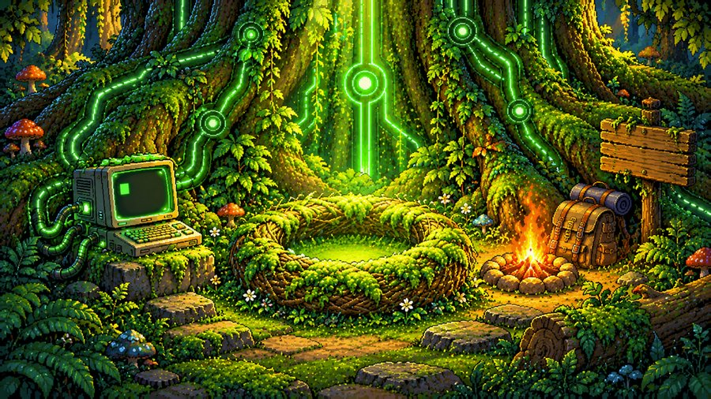
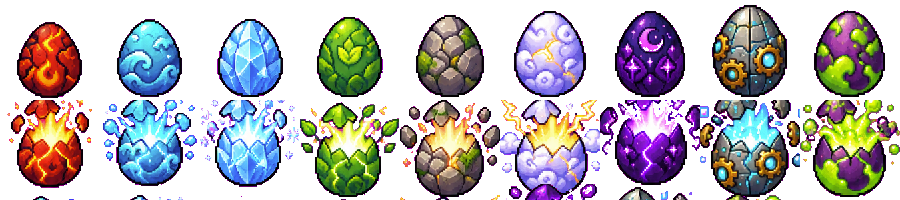
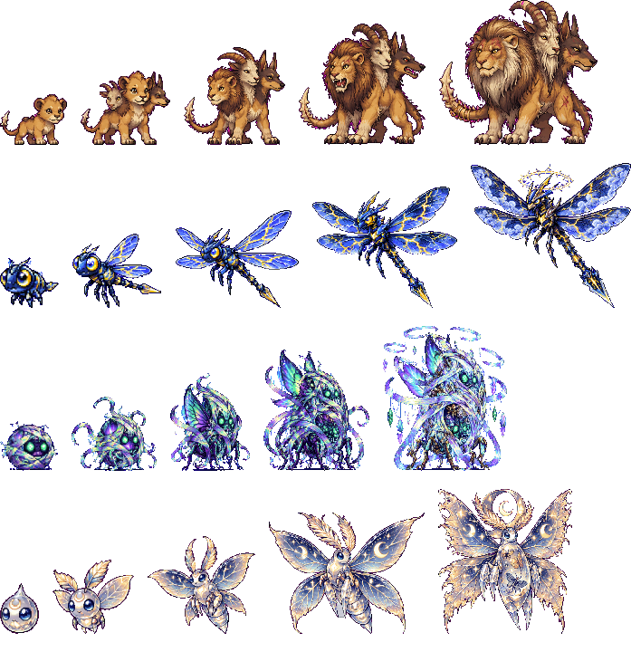

# Terminagotchi

**Un tamagotchi qui se nourrit des commandes que tu tapes, et qui t'apprend le terminal.**
Pour les enfants à partir de 7 ans… et pour tous les grands qui n'ont jamais osé ouvrir un terminal.



> 🚧 **Le jeu est en plein développement.** Les versions « essai » (voir plus bas) contiennent toutes les nouveautés,
> elles peuvent encore avoir des défauts. Les retours sont les bienvenus dans les *Issues*.

---

## L'histoire : l'éveil du Terminaworld

Le **Terminaworld** est un monde magique qui vit à l'intérieur de ton ordinateur. Au centre pousse un arbre immense,
**la Racine** (`/`), d'où partent tous les chemins. Mais le monde s'est endormi : tout est gris, figé.

Au camp de base, au pied de l'arbre, un vieux terminal clignote encore… et un œuf attend dans son nid.
Tape tes premières commandes : le monde se réveille, l'œuf éclot, et ta créature devient ton guide.



Chaque lieu du jeu est un **vrai dossier** de ton ordinateur, chaque objet un **vrai fichier**. Quand tu explores le
Terminaworld, tu apprends vraiment à te servir du terminal.

---

## Ce que le jeu offre

### 🥚 Un œuf, puis une créature à élever
- **9 œufs**, un par type (Feu, Eau, Glace, Plante, Roche, Ciel, Ombre, Machine, Poison).
- **Ta créature est unique et tirée au hasard** : personne ne choisit son œuf, pour personne. Deux enfants ne
  commencent jamais tout à fait avec la même compagne, et chacun découvre la sienne au moment où elle éclot.
  Elle prend le type de son œuf.
- Elle grandit en 5 stades (bébé → enfant → ado → adulte → ancien), avec de vrais changements de forme.
- Elle a **6 envies** : faim, jeu, curiosité, exploration, sommeil, propreté. Chaque envie se satisfait avec un type de
  commande différent.



### 🐾 Un bestiaire de 150 créatures
- 10 familles fantastiques (Démons, Élémentaires, Morts-vivants, Bêtes, Sylvestres, Arthropodes, Abyssaux, Célestes,
  Constructs, Aberrations) de 15 espèces chacune.
- Des **variantes selon l'habitat** (volcan, forêt, glacier, ruines, corail…) : plus de 680 au total, chacune dessinée
  dans ses 5 stades.
- La **rareté** dépend de chaque individu (ses forces et sa variante), et se voit à l'aura autour de sa silhouette.
- Les créatures sauvages apparaissent au hasard pendant que tu joues : chaque joueur croise les siennes.

### 🤝 Le dressage : gagner la confiance d'une créature
Ici, on n'attrape pas les créatures : on **crée un lien** avec elles.

Quand une créature sauvage apparaît, ta compagne et elle se retrouvent face à face, avec leurs forces affichées en
couleur. Pour l'approcher, il faut d'abord **enquêter avec le terminal** : l'examiner, chercher d'où elle vient,
fouiller les lieux où elle se cache… Puis vient l'épreuve : une petite suite de **vraies commandes** à réussir avant
la fin du temps. Chercher dans le lexique est permis : on apprend en jouant, pas en récitant.

Si tu réussis, la créature te fait confiance et **rejoint ta troupe** de son plein gré. Ce que ça apporte au jeu :
- chaque nouvelle créature est la **preuve d'une commande maîtrisée**, pas une affaire de chance ;
- plus les créatures sont rares, plus l'épreuve demande de savoir-faire : la collection grandit avec le niveau ;
- les créatures dressées peuvent devenir ton **guide**, vivent dans le **biome** de ton monde et t'accompagnent dans
  les épreuves ;
- on apprend aussi le respect du vivant : on gagne une amie, on ne l'enferme pas.



### 📚 Un vrai cours de terminal, du tout débutant à l'expert
- Des leçons pas à pas racontées par ta créature : se repérer, créer et ranger, lire et chercher, brancher les
  commandes entre elles, les jokers, les droits…
- Chaque explication existe en **trois niveaux** : la version enfant, une ligne « Pour les grands », et une ligne
  « 💻 Dans un vrai terminal… ».
- Le jeu vérifie que la commande **a vraiment marché** (pas seulement ce qui a été tapé), accepte les autres bonnes
  façons de faire, et donne des indices clairs (faute de frappe, majuscule, mauvais endroit).
- Pour ceux qui savent déjà : un **test de placement** et un mode **« défi sans aide »**.
- `carte` dessine ton vrai terrain en pixel art à côté de la sortie de `tree`, et se dévoile au fil des découvertes.
- Une **salle d'entraînement** avec des exercices chronométrés et des badges qui montent en grade comme chez les
  militaires : Bit → Octet → Kilo → Méga → Giga → Téra → Péta → Exa, avec galons et étoiles.

Après le tronc commun viennent des **mondes avancés**, ouverts selon ce qui t'intéresse : la Forge (programmation), la
Citadelle (cybersécurité défensive), le Port (réseaux), la Bibliothèque du Temps (git), la Salle des Données, le Poste
de Contrôle (administration), l'Atelier (robots) et l'Observatoire de l'IA. *(en cours de construction)*

### 🧭 Une équipe et des guides
Ta créature de départ te guide, puis celle que tu mets en tête d'équipe. Changer de guide a un intérêt : talents
selon le type, régions gardées, épreuves à type, fatigue.

### 🌍 Et aussi
- **14 langues** : français, anglais, espagnol, allemand, italien, portugais, chinois, russe, japonais, hindi, arabe,
  bengali, indonésien, ourdou.
- **Hors ligne** : le jeu se joue sans internet.
- **Sûr pour les enfants** : sur téléphone, le jeu ne peut rien abîmer en dehors de son camp de base, et la
  sauvegarde est protégée et copiée.

### 🌐 Le site du recensement
Adresse actuelle : **https://terminagotchi.grecdel.workers.dev** (bientôt **terminagotchi.com**).

Le jeu se suffit à lui-même et marche **sans internet**. Le site est un **bonus facultatif**, pour ceux qui veulent :
- **un profil** pour ta créature, ses badges, ses titres et sa troupe, créé en une commande depuis le jeu (`tg compte`),
  sans adresse mail ;
- **la même créature sur le PC et le téléphone**, synchronisée (`tg sync`), avec un code de secours si tu perds un
  appareil ;
- **le bestiaire complet** : les 150 espèces, leurs variantes et leurs évolutions ;
- **la galerie des dressages** (seulement si tu l'acceptes) et les **records de la salle d'entraînement**, avec la
  « Star de la semaine » ;
- **une chasse au trésor façon CTF** : des drapeaux cachés dans le site lui-même, à trouver avec de vraies commandes
  (`curl`, `grep`…), puis à valider dans le jeu ;
- **une navigation au terminal** : le site s'explore à la souris, ou au clavier avec `ls`, `cd`, `cat`, `tree`…
  comme dans le jeu.

Les résultats envoyés au site sont **vérifiés par le serveur** : pas de records truqués.

*Certaines de ces nouveautés (salle d'entraînement, navigation au terminal) arrivent avec la prochaine mise à jour du site.*

---

## Installer

Les fichiers se trouvent dans la page **[Releases](../../releases)** du dépôt :
- les versions **`v0.1.x`** sont les versions stables ;
- les **pré-versions `essai-N`** contiennent toutes les nouveautés (nouveau bestiaire, intro, œufs…).

### 📱 Sur Android
1. Ouvre la page **Releases** sur ton téléphone et télécharge le fichier `.apk`.
2. Ouvre-le. Android demande d'autoriser l'installation : c'est normal.
3. Appui long sur l'écran d'accueil → **Widgets** → **Terminagotchi**.
4. Touche **⌨ Terminal**, et laisse-toi guider.

### 💻 Sur PC (Linux, macOS, Windows)
Il faut seulement **Python 3** (déjà installé sur Linux et macOS).

1. Télécharge le fichier `.pyz` depuis la page **Releases**.
2. Dans un terminal, va dans le dossier du téléchargement et lance :
   ```
   python3 terminagotchi-essai.pyz
   ```
   (ou `terminagotchi.pyz` pour la version stable)
3. La créature propose de s'installer dans ton terminal. Ensuite, la commande `tg` suffit :
   `tg aide` montre tout ce qu'on peut faire, `tg carte` la carte, `tg entrainement` un exercice…

Depuis le code source : `git clone` ce dépôt, puis `python3 pc` dans le dossier.

---

## Pour les parents

- Au début, seuls l'œuf et quelques commandes sont visibles ; le reste se débloque petit à petit.
  Pour tout ouvrir d'un coup : `debloquer tout` (téléphone) ou `tg debloquer tout` (PC).
- Les commandes copiées-collées ne rapportent rien : il faut les taper.
- Aucun achat, aucune publicité.

## Contributions

Le code est public sur ce dépôt. Les idées, retours d'enfants et corrections de traduction sont les bienvenus dans les *Issues*.
