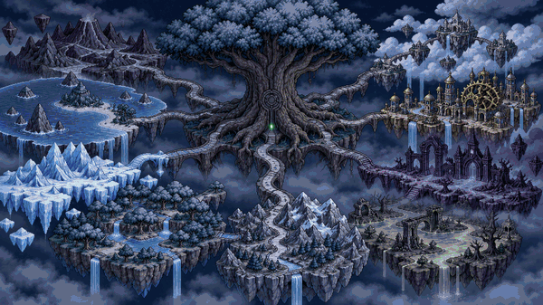
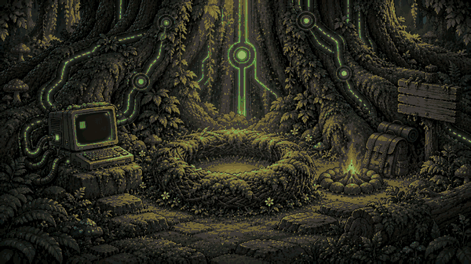
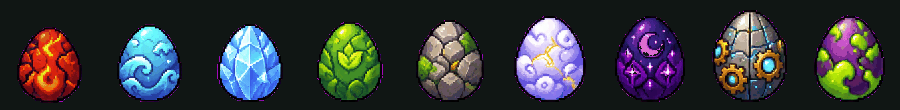
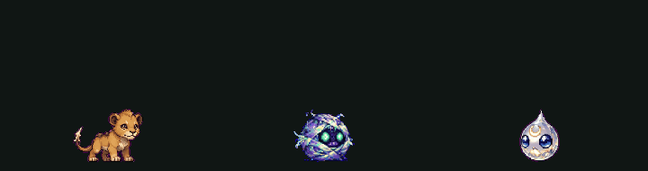

# Terminagotchi

**Une créature à élever, un monde à réveiller… et le terminal pour seul outil.**

Terminagotchi est un jeu où ta créature se nourrit des **vraies commandes** que tu tapes. En prenant soin d'elle,
tu apprends le terminal, l'outil des informaticiens, des administrateurs, des développeurs et des hackers éthiques,
du tout premier `ls` jusqu'aux réseaux, à la cybersécurité, à la cryptographie et à l'IA.



> 🚧 **En plein développement.** Les versions « essai » contiennent toutes les nouveautés et peuvent encore avoir
> des défauts. Tes retours sont les bienvenus dans les *Issues*.

---

## Pour qui ?

| | |
|---|---|
| 🧒 **Les enfants, dès 7 ans** | Une créature à nourrir, un monde magique à explorer, des créatures à rencontrer. On joue… et sans s'en rendre compte, on tape de vraies commandes. |
| 🧑‍💻 **Les ados et les adultes qui débutent** | Le terminal fait peur ? Ici, chaque commande est expliquée en trois niveaux : l'image simple, l'explication exacte et ce que fait un vrai terminal. Un test de placement saute ce que tu sais déjà. |
| 🛠 **Les curieux et les passionnés** | Réseaux et protocoles, ondes radio et LoRa, matériel et machines virtuelles, cybersécurité en « boîtes » simulées, cryptographie, blockchain expliquée de l'intérieur, IA, open source : on va loin, et toujours en pratique. |
| 🏫 **Les écoles et les clubs** | Un parcours structuré, rigoureux et vérifié, qui marche hors ligne, sans compte et sans données personnelles. Un mode classe et des fiches de séance sont prévus. |

---

## L'histoire : l'éveil du Terminaworld

Le **Terminaworld** est un monde qui vit à l'intérieur de ton ordinateur. Au centre pousse un arbre immense,
**la Racine** (`/`), d'où partent tous les chemins. Mais le monde s'est endormi : tout est gris, figé.

Au camp de base, au pied de l'arbre, un vieil ordinateur est encore branché aux racines… et un œuf attend dans
son nid. Tape ta première commande : la lumière remonte dans l'arbre, le monde se réveille, et l'œuf commence à
bouger.



Chaque lieu du jeu est un **vrai dossier** de ton ordinateur, chaque objet un **vrai fichier**. Explorer le
Terminaworld, c'est apprendre pour de vrai à se servir de son ordinateur.

---

## Ta créature

**Ton œuf est tiré au hasard**, pour tout le monde : personne ne le choisit, et chacun découvre sa créature quand
elle éclot. Il existe 9 œufs, un par type (Feu, Eau, Glace, Plante, Roche, Ciel, Ombre, Machine, Poison). Chaque
commande que tu tapes le fait bouger, le fêle… jusqu'à l'éclosion.



Ta créature grandit en **5 stades** (bébé, enfant, ado, adulte, ancien), avec de vrais changements de forme. Elle
a **6 envies** (faim, jeu, curiosité, exploration, sommeil, propreté), et chaque envie se satisfait avec un type de
commande différent. Elle te guide, t'explique, te félicite, et apprend avec toi.



---

## 150 créatures à rencontrer, et un lien à créer

- **10 familles** : Démons, Élémentaires, Morts-vivants, Bêtes, Sylvestres, Arthropodes, Abyssaux, Célestes,
  Constructs, Aberrations, de 15 espèces chacune.
- **Plus de 680 variantes** selon l'habitat (volcan, forêt, glacier, ruines, corail…), chacune dessinée dans ses
  5 stades. Les créatures sauvages apparaissent au hasard pendant que tu joues.
- La **rareté** dépend de chaque individu, et se voit à l'aura autour de sa silhouette.

### 🤝 Le dressage : gagner la confiance d'une créature

Ici, on n'attrape pas les créatures : on **crée un lien** avec elles. Quand une créature sauvage apparaît, ta
compagne et elle se retrouvent face à face. Pour l'approcher, il faut **enquêter avec le terminal** : l'examiner,
chercher d'où elle vient, fouiller les lieux où elle se cache. Vient ensuite l'épreuve : une petite suite de
**vraies commandes** à réussir à temps. Chercher dans le lexique est permis : on apprend en jouant.

Si tu réussis, elle te fait confiance et **rejoint ta troupe**. Chaque créature est la preuve d'une commande
maîtrisée, les plus rares demandent le plus de savoir-faire, et elles peuvent devenir ton guide.

---

## Ce que tu vas apprendre

Tout passe par **le terminal**, l'outil principal du jeu : lancer des programmes, explorer, chercher, protéger,
construire. Les animations montrent ce que font les commandes, elles ne les remplacent jamais.

**Le tronc commun** (✅ jouable) : se repérer, créer et ranger, lire et chercher, brancher les commandes entre
elles, les jokers, les droits. Chaque étape est expliquée pour les enfants, pour les grands et « dans un vrai
terminal », et le jeu vérifie que la commande **a vraiment marché**.

**Puis les mondes avancés**, ouverts selon ce qui t'intéresse (🚧 en construction) :

| Monde | Ce qu'on y apprend |
|---|---|
| ⚓ Le Port | les réseaux : adresses, ports, TCP et UDP, routage, box, HTTPS |
| 📡 La Tour des Ondes | les ondes radio, le Wi-Fi et le Bluetooth, LoRa et les réseaux maillés (Meshtastic) |
| 🛡 La Citadelle | la cybersécurité défensive : attaques simulées, et des « boîtes » à percer puis à réparer |
| 🗝 La Crypte des Codes | la cryptographie (des codes anciens au chiffrement moderne) et la blockchain construite à la main |
| ⚙ La Salle des Machines | le matériel, le démarrage, le système, les machines virtuelles, les serveurs et le cloud |
| 🔨 La Forge | la programmation, les scripts, son premier jeu, son site web, le multimédia |
| 🛠 La Guilde des Bâtisseurs Libres | l'open source, compiler, contribuer (à Terminagotchi lui-même !), l'impression 3D |
| 🔭 L'Observatoire de l'IA | comment une IA apprend et se trompe, et comment piloter des assistants |
| 📊 La Salle des Données | trier, compter, chercher, et les bases de données (SQL) |
| 🎛 Le Poste de Contrôle | administrer un système Linux de A à Z |
| ⏳ La Bibliothèque du Temps | git : remonter le temps de ses fichiers |
| 🤖 L'Atelier | Raspberry Pi, robots, électronique embarquée |
| 🔢 Les Ponts des Nombres | les maths dont tu as besoin, au moment où tu en as besoin |

Les exploits dans chaque monde font rencontrer de nouvelles créatures et des variantes rares.

---

## Et aussi

- 🏋 **Une salle d'entraînement** avec des exercices chronométrés et des badges qui montent en grade : Bit, Octet,
  Kilo, Méga, Giga, Téra, Péta, Exa, avec galons et étoiles.
- 🗺 **La carte qui pousse** : ton vrai terrain dessiné en pixel art, qui se dévoile au fil de tes découvertes.
- 🌍 **14 langues** : français, anglais, espagnol, allemand, italien, portugais, chinois, russe, japonais, hindi,
  arabe, bengali, indonésien, ourdou.
- 📴 **Hors ligne** : le jeu se joue sans internet.
- 🔒 **Sans risque** : sur téléphone, le jeu ne peut rien abîmer en dehors de son terrain de jeu ; la sauvegarde
  est protégée.
- 🚫 **Aucun achat, aucune publicité.**

### 🌐 Le site du recensement (facultatif)

Adresse actuelle : **https://terminagotchi.grecdel.workers.dev** (bientôt **terminagotchi.com**). Pour ceux qui le
veulent : un profil créé en une commande (sans adresse mail), la même créature sur PC et téléphone, le bestiaire
complet, la galerie des dressages (si tu l'acceptes), les records et la « Star de la semaine », une chasse au
trésor façon CTF, et une navigation au clavier comme dans le jeu. Les résultats sont vérifiés par le serveur.

---

## Bientôt

- 🖥 **L'espace de travail** : terminal, carte, créature en direct et « cerveau » de la créature (son code qui
  s'allume pendant qu'elle vit) dans une seule fenêtre.
- 🔍 **La vue déployée** : chaque commande se décompose, chaque morceau s'allume à son tour, les tuyaux s'animent.
- 🐾 **Ta créature sur ton bureau** et dans une petite île en haut de l'écran, avec son menu (PC et Android).
- 🥚 **L'œuf physique** : un projet open source pour transférer ta créature dans un vrai œuf imprimé en 3D, avec
  un petit écran.

---

## Installer

Les fichiers se trouvent dans la page **[Releases](../../releases)** :
- les versions **`v0.1.x`** sont les versions stables ;
- les **pré-versions `essai-N`** contiennent toutes les nouveautés.

### 📱 Sur Android
1. Ouvre la page **Releases** sur ton téléphone et télécharge le fichier `.apk`.
2. Ouvre-le. Android demande d'autoriser l'installation : c'est normal.
3. Appui long sur l'écran d'accueil → **Widgets** → **Terminagotchi**.
4. Touche **⌨ Terminal**, et laisse-toi guider.

### 💻 Sur PC (Linux, macOS, Windows)
Il faut seulement **Python 3** (déjà installé sur Linux et macOS).

1. Télécharge le fichier `.pyz` depuis la page **Releases**.
2. Dans un terminal, va dans le dossier du téléchargement et lance :
   ```
   python3 terminagotchi-essai.pyz
   ```
   (ou `terminagotchi.pyz` pour la version stable)
3. La créature propose de s'installer dans ton terminal. Ensuite, `tg` suffit : `tg aide` montre tout ce qu'on peut
   faire.

Depuis le code source : `git clone` ce dépôt, puis `python3 pc` dans le dossier.

**Bon à savoir** : au début, seuls l'œuf et quelques commandes sont visibles, le reste se débloque petit à petit.
Pour tout ouvrir d'un coup : `debloquer tout` (téléphone) ou `tg debloquer tout` (PC). Les commandes copiées-collées
ne rapportent rien : il faut les taper.

---

## Contribuer

Le code est public. Idées, retours de joueurs de tous âges, corrections de traduction et relectures par des
enseignants ou des spécialistes sont les bienvenus dans les *Issues*.
