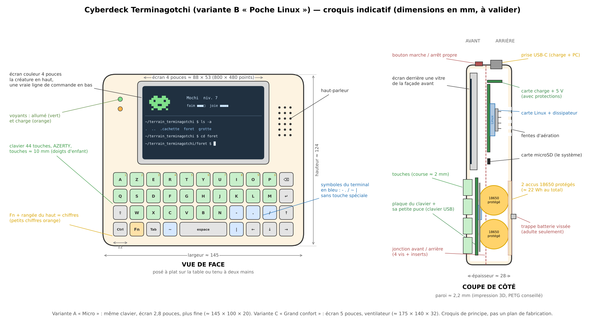

# Le cyberdeck Terminagotchi — proposition à valider

> **Statut : proposition (2 novembre 2026), rien n'est fabriqué ni acheté.** C'est la **deuxième forme physique**
> décidée par le propriétaire (voir `proposition.md`, « Décisions du propriétaire ») : à côté de l'**œuf** (petit,
> 3 boutons), un **petit ordinateur de poche** avec un plus grand écran et un **vrai petit clavier**. Le propriétaire
> choisit, corrige ou refuse chaque point (voir « Questions à trancher » à la fin). Aucune marque imposée, aucun lien
> d'achat. Prix et autonomies = **ordres de grandeur**, à revérifier au moment de l'achat.

## 1. En une phrase

Un **petit ordinateur de poche** (environ 14,5 × 12,5 cm, la taille d'une console portable), avec un **écran couleur
de 4 pouces** et un **clavier de 44 touches à la taille des doigts d'enfant**, sur lequel l'enfant tape **de vraies
commandes Linux** pour faire vivre **sa vraie créature** Terminagotchi, sans Internet et sans compte.

## 2. Ce que fait le cyberdeck

### 2.1 Vrai terminal Linux ou terminal du jeu ?

Il y a deux façons de construire un cyberdeck :

| | **Carte Linux** (proposée) | **Microcontrôleur** (comme l'œuf) |
|---|---|---|
| Ce qui tourne dedans | un **vrai petit Linux** et la **version PC du jeu, telle quelle**, dans un **vrai shell** (bash) | un programme unique écrit pour l'appareil, qui **imite** un terminal |
| Les commandes | **les vraies** : `ls`, `cd`, `cat`, `grep`, les tubes `|`, les vrais fichiers, tous les mondes du jeu | une **trentaine de commandes imitées** (comme la Salle d'entraînement) ; pas de vrais fichiers, pas de vrais tubes |
| Le jeu | **le même code que sur PC** (le jeu n'utilise que Python, déjà prévu pour les petits terminaux : le mini-terminal « créature en haut, ligne de commande en bas ») | **tout à réécrire** dans un autre langage, et à garder identique aux règles du jeu (vecteurs de test communs) |
| Allumage | 20 à 40 secondes (comme un petit PC) ; il faut l'**éteindre proprement** | instantané, comme une calculatrice |
| Autonomie | **quelques heures** d'utilisation (on l'éteint quand on le range) | **plusieurs jours**, avec une vraie veille |
| Prix | plus cher (les cartes Linux ont beaucoup augmenté en 2026 à cause du prix de la mémoire) | moins cher |
| Chaleur | tiède : petit dissipateur et aérations | quasi rien |

**Proposition : la carte Linux.** Le cœur de Terminagotchi, c'est d'apprendre **les vraies commandes** ; un
terminal imité serait une deuxième version du jeu à maintenir, et l'enfant sentirait la différence. L'option
microcontrôleur reste décrite (variante A) pour qui veut un appareil pas cher, robuste, qui tient des jours.

### 2.2 Un vrai Linux… mais seulement un terrain de jeu

- L'enfant a **son propre compte sur l'appareil, sans droits d'administrateur** (pas de `sudo`) : il peut tout
  essayer dans son dossier et dans `terrain_terminagotchi`, mais **ne peut pas casser le système**.
- Au démarrage, le cyberdeck ouvre directement le **mini-terminal du jeu** : la créature en haut, la ligne de
  commande en bas. Chaque commande tapée est exécutée pour de vrai, et la créature la mange.
- Les règles du jeu restent celles du PC : rien hors du terrain, rien de dangereux sans prévenir, sauvegardes
  régulières de la partie.
- **Remise à zéro facile** : si quelque chose ne va plus, un adulte recopie l'**image prête** sur la carte microSD
  (fichier fourni dans le dépôt, comme on installe un jeu) ; la partie de l'enfant est sauvegardée à part.
- L'adulte garde un **compte administrateur** (mot de passe choisi par lui) pour les mises à jour.

### 2.3 Le lien avec le jeu et avec l'œuf

Mêmes règles que l'œuf (décisions du 2 novembre 2026) :

- **La créature est déplacée, pas copiée.** Le cyberdeck a sa propre partie ; on y fait **voyager** une créature
  depuis le PC ou le téléphone, et pendant ce temps le jeu affiche « Mochi est en balade dans le cyberdeck ».
  Retour avec son XP, ses envies, son journal.
- **Câble USB-C d'abord** (`tg deck envoie` / `tg deck reprend` depuis le PC), **Bluetooth ensuite** pour le
  téléphone. Les noms exacts des commandes seront choisis au moment du code.
- **Avec l'œuf** : on peut brancher l'œuf au cyberdeck par USB-C : il passe en **mode compagnon** (la créature de
  l'œuf réagit aux commandes tapées au clavier du cyberdeck), exactement comme avec le PC.
- **Wi-Fi éteint par défaut**, coupé dans le système. **Aucun compte** en ligne, **aucune donnée personnelle**
  (pas de nom réel, pas de position, rien n'est envoyé). Les mises à jour se font par câble ou par la carte microSD ;
  un adulte peut allumer le Wi-Fi exprès pour une mise à jour, puis l'éteindre.
- **Éteint, la créature dort** : le temps éteint ne compte pas (aucune faim), comme la veille du jeu et de l'œuf.
- XP : **les mêmes règles que sur PC** (c'est le même jeu, avec de vraies commandes), donc pas de plafond spécial.

### 2.4 L'écran, le clavier, le son, l'énergie

- **Écran** (variante B) : couleur IPS **4 pouces, 800 × 480 points** (zone visible ≈ 88 × 53 mm), branché par une
  liaison vidéo directe (pas un petit écran lent). Avec une police assez grosse : environ **50 colonnes × 18
  lignes**, lisible pour un enfant de 7 ans. Luminosité réglable, écran éteint après 2 minutes sans touche.
- **Clavier** : voir § 4.1 (doigts d'enfant).
- **Son** : petit haut-parleur (cris de la créature, bips) ; volume limité, mode silencieux, **jamais de son la nuit**.
- **Bouton marche / arrêt** sur le dessus : appui court = allumer ou **arrêt propre** (le système s'éteint
  correctement, sans abîmer la carte microSD) ; si la batterie devient trop faible, le cyberdeck **sauvegarde et
  s'éteint tout seul**. Deux voyants : allumé (vert) et charge (orange).
- **Énergie** : accus rechargeables **protégés**, recharge par **USB-C** (n'importe quel chargeur de téléphone de
  bonne qualité, 5 V 2 A ou plus).

## 3. Trois variantes

| | **A. « Micro »** | **B. « Poche Linux »** (proposée) | **C. « Grand confort »** |
|---|---|---|---|
| Pour qui | petit budget, atelier, appareil qui tient des jours | le cyberdeck « normal » : vrai Linux dans la poche d'un manteau | grand écran, plus rapide, à poser sur la table (classe, club) |
| Ce qui tourne | **terminal imité** par le jeu (≈ 30 commandes) | **vrai Linux + jeu PC** dans un vrai shell | **vrai Linux + jeu PC**, plus fluide (et le jeu en fenêtre possible) |
| Contenu | carte microcontrôleur ESP32-S3, écran 2,8 pouces 320 × 240, clavier 44 touches, buzzer, LiPo 2000 mAh | petite carte Linux (4 cœurs, 512 Mo à 1 Go de mémoire), écran 4 pouces 800 × 480, clavier 44 touches, haut-parleur, 2 accus 18650 | carte Linux plus puissante (1 à 2 Go), écran 5 pouces 1280 × 720, clavier 55 touches avec rangée de chiffres, haut-parleur, petit ventilateur, 2 accus 18650 (ou 4) |
| Taille (L × H × épaisseur) | ≈ 145 × 100 × 20 mm | ≈ 145 × 124 × 28 mm | ≈ 175 × 140 × 32 mm |
| Poids estimé | ≈ 150 g | ≈ 280 g | ≈ 450 g |
| Difficulté | ★☆☆ à ★★☆ : le clavier demande 44 petites soudures (ou une plaque toute faite) | ★★☆ moyenne : préparation du système, gestion de l'énergie, aérations | ★★★ plus délicate : alimentation plus forte, ventilation, plus de place à gérer |
| Consommation en marche | ≈ 0,45 W (≈ 120 mA sous 3,7 V) | ≈ 1,7 W (carte ≈ 0,8 W, écran ≈ 0,8 W, clavier ≈ 0,1 W) | ≈ 5 W (carte ≈ 3 W, écran ≈ 1,5 W, ventilateur ≈ 0,3 W) |
| Veille | vraie veille ≈ 1,5 mA | pas de vraie veille : écran éteint ≈ 0,9 W, donc **on l'éteint** | idem B, ≈ 2,5 W écran éteint |
| **Autonomie estimée** | **≈ 13 h** d'utilisation, **≈ 10 jours** à 1 h par jour | **≈ 9 h** d'utilisation continue | **≈ 3 h** (2 accus) / **≈ 6 h** (4 accus) |
| Prix estimé des pièces (fin 2026) | **≈ 35 à 60 €** | **≈ 80 à 130 €** | **≈ 160 à 250 €** |

**Comment l'autonomie est estimée** (80 % de la batterie utilisable ; pour B et C, 85 % de rendement pour
fabriquer le 5 V à partir des accus) :
- A : batterie 2000 mAh × 80 % = 1600 mAh. En continu : 1600 / 120 ≈ **13 h**. À 1 h par jour :
  120 mAh + 23 h × 1,5 mA ≈ 35 mAh → ≈ 155 mAh par jour → 1600 / 155 ≈ **10 jours**.
- B : 2 accus 18650 de 3000 mAh côte à côte = 6000 mAh × 3,7 V ≈ **22 Wh** ; × 80 % × 85 % ≈ **15 Wh** utiles ;
  15 / 1,7 ≈ **9 h**. Si on le laisse allumé écran éteint : 15 / 0,9 ≈ 16 h, d'où l'arrêt propre quand on range.
  Éteint, il ne consomme presque rien : à 1 h par jour, **une charge par semaine** environ.
- C : 15 Wh / 5 W ≈ **3 h** ; avec 4 accus (≈ 30 Wh utiles) ≈ **6 h**, mais plus lourd et plus épais.
- **Attention** : ce sont des calculs sur le papier. La vraie consommation dépend de la carte, de l'écran et de la
  luminosité ; on la **mesure** au premier prototype (multimètre USB) et on corrige ce tableau.

**Pourquoi ces prix** (pièces neuves, petites quantités, en ligne, fin 2026) : les cartes Linux ont augmenté
plusieurs fois en 2026 (la mémoire coûte plus cher) ; une petite carte « format zéro » reste vers 15 à 25 €, mais une
carte puissante avec 1 à 2 Go dépasse souvent 50 à 80 €. Les modèles disponibles changent vite : on choisira au
moment d'acheter.

## 4. Liste des composants (génériques)

Pas de marque imposée, pas de lien d'achat. **Prix = estimations**, à revérifier.

| Composant | Description simple | A | B | C | Prix estimé |
|---|---|:-:|:-:|:-:|---|
| Carte **microcontrôleur ESP32-S3** (8 Mo de mémoire « flash » ou plus, chargeur LiPo intégré si possible) | le cerveau de la variante A | ✓ | | | 6 à 12 € |
| **Petite carte Linux** « format zéro » (≈ 65 × 30 mm, 4 cœurs 64 bits, 512 Mo à 1 Go, Bluetooth intégré, faible consommation) | le cerveau de B | | ✓ | | 15 à 25 € |
| **Carte Linux plus puissante** (1 à 2 Go) + **dissipateur avec petit ventilateur** | le cerveau de C | | | ✓ | 50 à 90 € |
| **Carte microSD** 16 à 32 Go, de bonne qualité | le disque : système + jeu + partie | | ✓ | ✓ | 5 à 10 € |
| **Écran IPS** 2,8 pouces 320 × 240 (A) / 4 pouces 800 × 480 (B) / 5 pouces 1280 × 720 (C), liaison adaptée à la carte | la fenêtre du terminal | ✓ | ✓ | ✓ | 6 à 12 € / 15 à 30 € / 30 à 50 € |
| **Clavier** : 44 (ou 55) **boutons tactiles** à course franche + **capuchons imprimés** ≈ 10 mm + **plaque de circuit** (commandée d'après nos plans, ou plaque à trous) | les touches | ✓ | ✓ | ✓ | 10 à 25 € |
| **Petite puce de clavier** (microcontrôleur avec USB, type RP2040 ou équivalent), avec un **programme de clavier libre** existant | transforme la grille de touches en « clavier USB » que Linux reconnaît | | ✓ | ✓ | 3 à 6 € |
| **Batterie LiPo 3,7 V 2000 mAh avec circuit de protection** | énergie de A | ✓ | | | 6 à 10 € |
| **2 (ou 4) accus 18650 avec circuit de protection intégré**, identiques, neufs, du même lot + **support solide** | énergie de B et C | | ✓ | ✓ | 10 à 25 € (×2 pour 4 accus) |
| **Carte d'alimentation** : charge USB-C + sortie 5 V (2,5 A pour B, 5 A pour C) + protections (surcharge, décharge profonde, court-circuit, température si possible) + signal « batterie faible » pour l'arrêt propre | la recharge et l'arrêt sans danger | (sur la carte) | ✓ | ✓ | 5 à 15 € / 10 à 25 € |
| **Bouton marche / arrêt** + 2 voyants | allumer, éteindre proprement | ✓ | ✓ | ✓ | 1 à 2 € |
| **Buzzer piézo** (A) / **petit ampli audio + haut-parleur 8 Ω ≈ 20 mm** (B, C) | le son | ✓ | ✓ | ✓ | 1 € / 3 à 6 € |
| **Filament PETG** (tient mieux la chaleur que le PLA), ≈ 80 à 150 g | la coque | ✓ | ✓ | ✓ | 2 à 5 € |
| Visserie : **4 vis + inserts laiton**, 1 vis de trappe, fils fins, gaine thermo, ruban isolant (Kapton) | assemblage, isolation | ✓ | ✓ | ✓ | 2 à 4 € |
| Façade avant transparente (fine plaque acrylique ou impression transparente) | protège l'écran | ✓ | ✓ | ✓ | 1 à 3 € |

Outils (déjà présents ou à emprunter) : imprimante 3D, fer à souder, multimètre (idéalement un **testeur USB**
pour mesurer la consommation), lecteur de carte microSD, câble USB-C.

### 4.1 Un clavier pour des doigts d'enfant

- **Touches ≈ 10 mm, espacées de 12 mm** (un clavier de téléphone en a 5 ou 6 mm) ; **grille droite**, sans
  décalage, plus facile à viser. Course franche avec un petit **clic** : on sent qu'on a appuyé.
- **AZERTY** (le propriétaire est français) ; **QWERTY** disponible dans les plans, même plaque, autres capuchons.
- **Les symboles du terminal ont leur propre touche, en bleu** : `-` `.` `/` `~` `|`. Pas besoin de touche
  spéciale pour taper `cd ..`, `ls -a`, `cat a.txt | grep chat`.
- **Touches de commande en gris** : Effacer, Entrée, Maj, Ctrl (pour **Ctrl + C** qui arrête une commande), Tab
  (complétion automatique, très utile aux petits), flèches (↑ = rappeler la commande précédente).
- **Fn (orange)** + rangée du haut = **chiffres** (petits chiffres orange imprimés sur les touches), et Fn donne les
  symboles plus rares (`_`, `*`, `>`, `"`…). La variante C a une **vraie rangée de chiffres** (55 touches).
- Lettres **en relief ou gravées** sur les capuchons imprimés (pas d'autocollants qui se décollent) ; capuchons
  **bien emboîtés**.
- Le **même dessin de clavier** sert aux trois variantes (fichiers communs) ; il se branche dans la coque, il n'est
  pas interchangeable entre l'œuf et le cyberdeck (pas de modularité, décision du 2 novembre).

Disposition proposée (variante B, 4 rangées × 11) :

| | | | | | | | | | | |
|---|---|---|---|---|---|---|---|---|---|---|
| A | Z | E | R | T | Y | U | I | O | P | ⌫ |
| Q | S | D | F | G | H | J | K | L | M | ↵ |
| ⇧ | W | X | C | V | B | N | **-** | **.** | **/** | ↑ |
| Ctrl | Fn | Tab | **~** | espace | (espace) | (espace) | **\|** | ← | ↓ | → |

## 5. Sécurité

### 5.1 Les accus (18650 ou LiPo)

- **Toujours des accus avec circuit de protection** (coupe si trop chargé, trop vide ou court-circuit) **et** une
  carte de charge dédiée (4,2 V maximum par accu). Pour les 18650 : **jamais d'accus nus récupérés** dans de vieux
  appareils, **jamais** de mélange vieux / neufs ou de modèles différents.
- Accus **tenus dans un support solide**, séparés de l'électronique par une **paroi isolante**, loin des vis et des
  arêtes ; fils gainés. Rien ne peut les percer si le cyberdeck tombe.
- **Trappe batterie fermée par une vis** : l'enfant n'atteint pas les accus sans tournevis.
- **Charger sur une surface dure**, pas sous un oreiller ni au soleil, de préférence en présence d'un adulte.
- Jamais d'accu gonflé, cabossé, chaud ou à la gaine abîmée : on le remplace. Fin de vie : bac de recyclage des
  piles et batteries.
- Souder **accus débranchés**.

### 5.2 La chaleur

- La carte Linux chauffe un peu : **petit dissipateur** et **fentes d'aération** à l'arrière (B), **ventilateur**
  (C). Objectif : **coque tiède**, jamais chaude au toucher (moins de ≈ 40 °C dehors), à vérifier au prototype avec
  un thermomètre après une heure de jeu.
- Le système **ralentit tout seul** s'il chauffe ; le jeu affiche « le cyberdeck a chaud, pause » au-delà d'un seuil.
- Coque en **PETG** (le PLA se déforme vers 55 à 60 °C, par exemple dans une voiture au soleil).
- Ne pas utiliser sous une couverture ni sur un lit (aérations bouchées).

### 5.3 Les enfants

- **Montage et soudure par un adulte.** L'enfant peut choisir les couleurs, poser les capuchons du clavier,
  installer le jeu ou taper ses premières commandes sur l'appareil qu'il a vu naître.
- Coque **sans arêtes vives**, pas de petites pièces détachables pour les moins de 3 ans, pas d'aimant accessible.
- **Volume limité** par le logiciel ; pas de son la nuit ; luminosité automatique le soir.
- **Pas d'Internet** par défaut, pas de navigateur installé, pas de messagerie.
- Honnêteté : un cyberdeck fait maison **n'est pas un jouet certifié**. On le donne en connaissance de cause et
  sous surveillance. **Vendre** des cyberdecks montés demanderait les règles européennes des jouets, des appareils
  électriques et radio (marquage CE, tests) : **ce n'est pas l'objectif** ; on partage **les plans**, chacun
  fabrique le sien.

## 6. Ce qui est open source

Mêmes licences que l'œuf (validées le 2 novembre 2026) :

| Partie | Licence | En simple |
|---|---|---|
| **Code** : le jeu, le programme du clavier, les scripts qui préparent l'image du système, le programme de la variante A | **GPL-3.0-or-later** | tout le monde peut lire, modifier et partager, à condition de partager ses modifications pareil |
| **Dessins, sons, textes**, motifs décoratifs de la coque | **CC BY-NC-SA 4.0** | réutilisation en citant Terminagotchi, sans usage commercial, partage à l'identique |
| **Matériel** : coque (STL + fichiers sources), plaque du clavier, schéma électrique, liste des pièces, notice | **CERN-OHL-S-2.0** | chacun peut fabriquer et modifier, mais doit publier ses plans modifiés sous la même licence |

Le système Linux et les logiciels déjà présents dans l'image (shell, outils) gardent **leurs propres licences
libres** ; la liste sera écrite avec l'image. Le programme de clavier libre réutilisé garde aussi la sienne (en
général GPL, compatible).

## 7. Comment on avancerait (après validation)

1. **Maquettes d'abord** (règle du propriétaire) : images du cyberdeck de face et de côté, écrans du mini-terminal
   à 50 colonnes avec la créature, écran « Mochi est en balade dans le cyberdeck » dans le jeu PC et téléphone ;
   **maquette en carton ou imprimée vide** pour tester la prise en main et la taille des touches avec un enfant.
2. **Essai sans matériel** : faire tourner le jeu dans une fenêtre de terminal réglée à 50 × 18 (taille de l'écran
   B) pour vérifier que tout reste lisible ; corriger le jeu si besoin.
3. **Prototype sur table** : carte Linux + écran + un clavier USB ordinaire, image du système préparée (compte
   enfant sans droits, Wi-Fi coupé, démarrage direct sur le mini-terminal, arrêt propre).
4. **Clavier v1** : plaque de 44 touches + capuchons, essais de frappe par des enfants de 7, 12 et 15 ans.
5. **Énergie** : carte de charge, accus protégés, arrêt propre sur batterie faible ; **mesures** de consommation et
   de température, tableau du § 3 corrigé.
6. **Coque v1** (OpenSCAD ou FreeCAD, fichiers ouverts) : aérations, trappe vissée, façade transparente.
7. **Lien avec le jeu** : déplacer une créature par câble (`tg deck envoie / reprend`), puis Bluetooth ; œuf
   branché en mode compagnon.
8. Dossier de fabrication complet (notice pas à pas pour un parent et son enfant). Variante A ou C ensuite, si
   le propriétaire le souhaite.

## 8. Questions à trancher par le propriétaire

| # | Question | Ma proposition |
|---|---|---|
| 1 | Vrai Linux ou terminal imité ? | **Vrai Linux** (vraies commandes, même jeu que sur PC) ; terminal imité seulement pour la variante A économique. |
| 2 | Quelle variante viser ? | **B « Poche Linux »** ; A et C plus tard, si l'envie est là. |
| 3 | La taille ? | **≈ 145 × 124 × 28 mm**, ≈ 280 g (taille d'une console portable ; se tient à deux mains ou se pose sur la table). |
| 4 | Forme « tablette » ou « à clapet » (écran qui se replie sur le clavier) ? | **Tablette** (d'un seul bloc) : plus solide, plus simple ; une **housse ou un couvercle clipsé** protège l'écran dans le sac. |
| 5 | Le clavier : AZERTY ou QWERTY, et combien de touches ? | **AZERTY, 44 touches de ≈ 10 mm**, symboles du terminal en accès direct, chiffres avec Fn ; QWERTY disponible dans les plans. |
| 6 | Le cyberdeck a-t-il sa propre partie, ou seulement des créatures en visite ? | **Sa propre partie** (c'est un vrai petit PC), et les créatures y voyagent **déplacées** (jamais copiées), comme dans l'œuf. |
| 7 | L'enfant a-t-il les droits d'administrateur ? | **Non** : compte enfant sans `sudo` ; l'adulte garde un compte administrateur pour les mises à jour. |
| 8 | Wi-Fi ? | **Éteint par défaut** ; un adulte peut l'allumer pour une mise à jour, puis l'éteindre. Sinon mise à jour par câble ou microSD. |
| 9 | 18650 ou batterie LiPo plate ? | **2 accus 18650 protégés** pour B (robustes, faciles à remplacer, ≈ 22 Wh) ; LiPo plate protégée pour A. |
| 10 | Que se passe-t-il quand la batterie est presque vide ? | **Sauvegarde automatique puis arrêt propre**, avec un message de la créature (« je vais dormir, recharge-moi »). |
| 11 | Le cyberdeck fait-il aussi « compagnon » de l'œuf ? | **Oui** : l'œuf branché en USB-C au cyberdeck réagit aux commandes tapées, comme avec le PC. |
| 12 | Matière de la coque ? | **PETG** (supporte mieux la chaleur que le PLA) ; couleurs au choix de l'enfant, motifs des biomes en relief possibles (sans accessoires sur la créature). |
| 13 | Où ranger le projet ? | Un dossier `materiel/cyberdeck/` dans ce dépôt (coque, clavier, schéma, scripts de l'image), cette proposition restant dans `docs/oeuf/`. |

## Fichiers de ce dossier (cyberdeck)

- `cyberdeck.md` — ce document.
- `croquis_cyberdeck.py` → `croquis_cyberdeck.svg` / `.png` (matplotlib : `python3 croquis_cyberdeck.py`).
