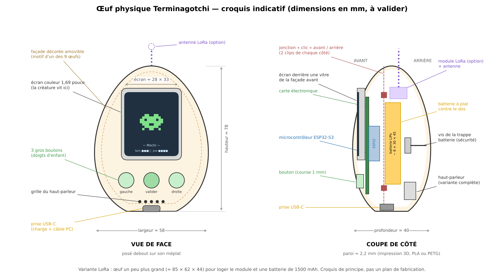
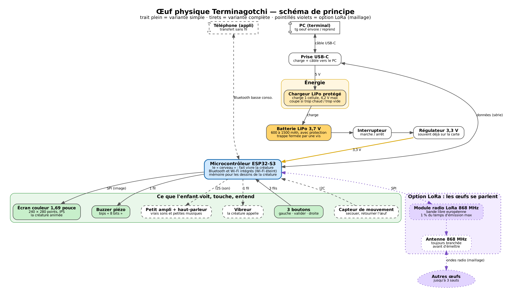

# L'œuf physique Terminagotchi — proposition à valider

> **Statut : proposition (1er novembre 2026), rien n'est fabriqué ni acheté.** Le propriétaire choisit, corrige ou
> refuse chaque point (voir « Questions à trancher » à la fin). C'est la phase finale du plan
> (`docs/plan_de_bataille.md`, « Phase finale — L'œuf physique ») et le prolongement de la Tour des Ondes
> (`docs/programme.md`, § 7.11, palier W5) et de l'atelier « L'embarqué et le temps réel » (§ 7.13).
> Toutes les estimations (prix, autonomie) sont des **ordres de grandeur**, à vérifier au moment de l'achat.

## 1. En une phrase

Un **œuf de la taille d'une paume** (environ 8 cm de haut), imprimé en 3D d'après les 9 œufs du jeu, avec un **petit
écran couleur** où vit **ta vraie créature** Terminagotchi : tu l'envoies depuis le PC (ou le téléphone), elle part
en balade avec toi, puis elle revient dans le jeu avec ce qu'elle a vécu.

## 2. Ce que fait l'œuf

### 2.1 La créature qui vit dedans

- **Une seule créature à la fois** voyage dans l'œuf. Elle est **déplacée**, pas copiée : pendant qu'elle est dans
  l'œuf, le jeu PC / téléphone affiche « Mochi est en balade dans l'œuf » (pas de doublon, pas de triche).
- Elle garde son **apparence** (ses dessins, envoyés avec elle), son **nom**, son **niveau**, ses **envies** et sa
  **satiété**. L'œuf applique **les mêmes règles** que le jeu : il reprend les vecteurs de test communs
  (`donnees/satiete/vecteurs.json`), donc pas de mort, pas de corvée ; si on l'oublie, elle se met en veille et se
  réveille quand on revient.
- **Elle dort la nuit** (21 h - 7 h, comme dans le jeu) : écran éteint, presque aucune consommation. L'heure est remise
  à l'heure à chaque branchement au PC.
- Dans l'œuf, pas de clavier : la créature est nourrie par de **petits défis à 3 boutons** (« quelle commande pour
  voir les fichiers cachés ? » `ls` / `ls -a` / `cd`), uniquement avec des commandes **déjà tapées** dans le jeu
  (même règle que la Salle d'entraînement). Elle réagit aussi quand on la secoue ou la retourne (variante complète).
- L'XP gagnée dans l'œuf est **plafonnée par jour** (petit bonus, jamais plus intéressant que de jouer au terminal).

### 2.2 Le lien avec le jeu

| Mode | Comment | Ce qui se passe |
|---|---|---|
| **Compagnon de bureau** | œuf branché au PC par le câble USB-C | la créature **réagit en direct** aux commandes tapées dans le terminal (elle saute quand tu fais `ls`, s'endort avec `sleep`…) ; l'œuf se recharge en même temps |
| **Envoyer** | `tg oeuf envoie` (PC) ou bouton « Envoyer dans l'œuf » (téléphone) | la créature et ses dessins passent dans l'œuf |
| **Reprendre** | `tg oeuf reprend` ou bouton du téléphone | la créature revient avec son XP, ses envies, son journal de balade |
| **Balade** | œuf sur batterie, dans la poche | la créature vit, appelle de temps en temps (bip, vibreur), petits défis |

- PC : par **câble USB-C** (variante simple). Bon exercice pour l'atelier embarqué : `screen /dev/ttyACM0 115200`
  montre ce que l'œuf raconte.
- Téléphone : par **Bluetooth basse consommation** (variante complète) ; sans Bluetooth, le câble USB-C fonctionne
  aussi sur la plupart des téléphones Android.
- **Wi-Fi éteint** : aucun compte, aucun Internet, aucune donnée personnelle (même règle que le reste du jeu).
- Mettre à jour l'œuf : par câble, depuis le terminal (`esptool.py` ou `arduino-cli upload`), ou depuis une page web
  du site qui sait programmer l'œuf par le câble (avec un adulte).

### 2.3 L'écran, les boutons, le son, la batterie

- **Écran** : couleur, 1,69 pouce (environ 28 × 33 mm), 240 × 280 points, lisible de côté (IPS). Assez pour la
  créature en pixel-art, ses jauges et une phrase. Éteint au bout de 20 secondes sans toucher.
- **Boutons** : **3 gros boutons** (gauche · valider · droite), comme les tamagotchis d'origine ; faciles pour des
  doigts d'enfant. Appui long sur « valider » = menu ; appui sur n'importe quel bouton = réveiller l'écran.
  Un petit **interrupteur marche / arrêt** caché sous l'œuf (pour le ranger ou le transporter).
- **Son** : variante simple = **buzzer** (bips « 8 bits », comme les vieux jeux) ; variante complète = **petit
  haut-parleur** (vrais petits sons, cris de la créature, petite musique d'éclosion). Volume réglable, mode
  silencieux (école), et **jamais de son la nuit**.
- **Batterie** : LiPo rechargeable par la prise **USB-C** (n'importe quel chargeur de téléphone). Voyant de charge
  visible. Autonomie : voir le tableau des variantes.

### 2.4 Option LoRa : les œufs se parlent (maillage)

Avec un petit module radio **LoRa** (868 MHz, bande libre en Europe, voir Tour des Ondes W2 à W5), les œufs se
parlent **sans Internet ni antenne-relais** : chaque œuf relaie les messages des autres (jusqu'à 3 sauts).

- **Ce que ça fait** : savoir combien d'œufs sont autour de toi et quelles créatures y vivent ; **visites** (ta
  créature apparaît chez l'autre pour une petite animation et laisse une « carte de visite ») ; **messages tout
  faits** (« coucou », « on joue ? », « bonne nuit », émoticônes de créatures) ; pour une classe, une **carte des
  œufs** comme au palier W5.
- **Pas de texte libre** entre enfants : seulement des phrases choisies dans une liste, pour la sécurité. Aucune
  donnée personnelle (pas de pseudo, pas de position), comme dans le reste du jeu.
- **Respect de la loi radio** : bande 868 MHz, puissance limitée, **1 % du temps d'émission maximum** (36 secondes par
  heure) — l'œuf compte lui-même son temps d'émission et se tait s'il atteint la limite. On n'émet **jamais sans
  antenne branchée** (cela peut abîmer le module).
- **Portée** : quelques centaines de mètres en ville, plusieurs kilomètres en terrain dégagé (à vérifier sur place).

## 3. Trois variantes

| | **A. Simple** | **B. Complète** (proposée) | **C. Avec LoRa** |
|---|---|---|---|
| Pour qui | premier prototype, atelier d'un après-midi | l'œuf « normal » à offrir | les clubs, classes, familles avec plusieurs œufs |
| Contenu | ESP32-S3, écran, 3 boutons, buzzer, batterie 600 mAh | A + haut-parleur, capteur de mouvement, vibreur, Bluetooth vers le téléphone, batterie 1000 mAh | B + module LoRa 868 MHz et antenne, batterie 1500 mAh |
| Taille (H × L × P) | ≈ 78 × 58 × 40 mm | ≈ 78 × 58 × 40 mm | ≈ 85 × 62 × 44 mm |
| Avantages | pas cher, peu de soudures, marche tout de suite | l'expérience complète, toujours sans Internet | le maillage entre œufs, lien direct avec la Tour des Ondes |
| Difficulté | ★☆☆ facile : 6 modules à relier, pas de composant minuscule | ★★☆ moyenne : 9 modules, plus de fils dans peu de place | ★★★ plus délicate : réglage radio, antenne, règles d'émission ; plus simple si l'on prend une carte ESP32 avec LoRa **déjà intégré** |
| Consommation écran allumé | ≈ 90 mA | ≈ 110 mA | ≈ 115 mA (+ ≈ 40 à 120 mA pendant les courtes émissions) |
| Consommation en veille | ≈ 0,5 mA | ≈ 0,7 mA | ≈ 2 mA en écoute « par rendez-vous », ≈ 6 mA en écoute permanente |
| **Autonomie estimée** | **≈ 1 semaine** | **≈ 10 jours** | **≈ 10 jours** (écoute par rendez-vous) / **≈ 5 jours** (écoute permanente) |
| Prix estimé des pièces | **≈ 20 à 35 €** | **≈ 35 à 55 €** | **≈ 50 à 75 €** |

**Comment l'autonomie est estimée** (hypothèse : 30 minutes d'écran allumé par jour, 80 % de la batterie utilisable) :
- A : 30 min × 90 mA = 45 mAh + 23,5 h × 0,5 mA ≈ 12 mAh → ≈ 57 mAh par jour → 480 / 57 ≈ **8 jours**.
- B : 30 min × 110 mA = 55 mAh + 23,5 h × 0,7 mA ≈ 16 mAh → ≈ 71 mAh par jour → 800 / 71 ≈ **11 jours**.
- C : B + écoute radio ≈ 1,5 mA × 24 h ≈ 36 mAh → ≈ 110 mAh par jour → 1200 / 110 ≈ **11 jours** ; en écoute
  permanente (≈ 6 mA × 24 h ≈ 144 mAh) → ≈ 220 mAh par jour → **≈ 5 jours**.
- **Attention** : beaucoup de cartes de développement gaspillent plusieurs mA en veille (voyant, régulateur). Il faut
  choisir une carte annoncée « faible consommation en sommeil profond » et mesurer au multimètre ; sinon l'autonomie
  peut tomber à 2 ou 3 jours. Branché au PC (mode compagnon), la question ne se pose pas.

*Trait plein = variante A ; tirets = ajouts de la variante B ; pointillés violets = option LoRa (variante C).*

## 4. Liste des composants (génériques)

Pas de marque imposée, pas de lien d'achat. **Prix = estimations** pour une pièce achetée en ligne en petite quantité
(fin 2026), à revérifier.

| Composant | Description simple | A | B | C | Prix estimé |
|---|---|:-:|:-:|:-:|---|
| Carte microcontrôleur **ESP32-S3** | le cerveau ; prise USB-C intégrée ; au moins 8 Mo de mémoire (« flash ») pour les dessins ; idéalement avec chargeur LiPo intégré et faible consommation en veille | ✓ | ✓ | | 6 à 12 € |
| Carte **ESP32-S3 + LoRa 868 MHz intégré** (puce de type SX1262) | remplace la carte ci-dessus en variante C ; souvent avec chargeur et prise d'antenne | | | ✓ | 20 à 30 € |
| Écran **TFT IPS 1,69 pouce, 240 × 280**, liaison SPI | la fenêtre de la créature | ✓ | ✓ | ✓ | 4 à 8 € |
| 3 **boutons poussoirs** 6 × 6 mm + capuchons imprimés | gauche · valider · droite | ✓ | ✓ | ✓ | 1 à 2 € |
| **Interrupteur** à glissière miniature | marche / arrêt | ✓ | ✓ | ✓ | 0,5 € |
| **Batterie LiPo 3,7 V 1 cellule avec circuit de protection** (600 / 1000 / 1500 mAh) | l'énergie ; fils + petit connecteur | ✓ | ✓ | ✓ | 4 à 10 € |
| **Chargeur LiPo USB-C avec protection** (si la carte n'en a pas) | recharge sans danger | ✓ | ✓ | (intégré) | 1 à 3 € |
| **Buzzer piézo passif** | bips | ✓ | | | 0,5 à 1 € |
| **Petit ampli audio I2S** + **haut-parleur 8 Ω, 1 W, ≈ 20 mm** | vrais sons | | ✓ | ✓ | 3 à 6 € |
| **Accéléromètre** (capteur de mouvement I2C) | secouer, retourner | | ✓ | ✓ | 1 à 3 € |
| **Vibreur** miniature + transistor | la créature appelle | | ✓ | ✓ | 1 à 2 € |
| **Antenne 868 MHz** (petit ressort interne ou antenne externe) | parler loin | | | ✓ | 2 à 5 € |
| **Filament** (PLA ou PETG), ≈ 40 g | la coque et la façade décorée | ✓ | ✓ | ✓ | 1 à 2 € |
| Visserie : 1 vis + 1 insert laiton, fils fins, gaine | trappe batterie, câblage | ✓ | ✓ | ✓ | 1 à 2 € |

Outils (déjà présents chez le propriétaire ou à emprunter) : imprimante 3D, fer à souder, multimètre, câble USB-C.

## 5. Sécurité

### 5.1 La batterie LiPo

- Toujours une batterie **avec circuit de protection** (coupe si trop chargée, trop vide ou court-circuit) **et** un
  chargeur dédié LiPo (4,2 V maximum). Jamais de batterie gonflée, percée ou chaude : on la remplace.
- La batterie est **calée** dans un logement de la coque arrière, **sans pression** dessus, **loin des vis et des
  bords coupants**, fils isolés (gaine). Rien qui puisse la percer si l'œuf tombe.
- **Charger sur une surface dure, pas sous un oreiller**, pas au soleil, pas en voiture l'été, et de préférence en
  présence d'un adulte. L'œuf refuse de charger s'il fait trop chaud ou trop froid (si le chargeur choisi le permet).
- Ne jamais court-circuiter les fils pendant le montage ; souder batterie **débranchée**.
- Fin de vie : à déposer dans un bac de recyclage de piles et batteries, jamais à la poubelle.

### 5.2 Les enfants

- **Trappe batterie fermée par une vis** (comme sur les jouets du commerce) : l'enfant ouvre la façade décorée par
  « clic » pour la changer, mais **n'atteint pas la batterie** sans tournevis.
- Pas de petites pièces détachables pour les moins de 3 ans (capuchons de boutons bien emboîtés, pas d'aimant
  accessible). Coque sans arêtes vives (bords arrondis, ponçage).
- **Volume limité** par le logiciel ; vibreur et sons **coupés la nuit**.
- **Montage et soudure par un adulte** ; l'enfant peut participer au choix des couleurs, à l'assemblage de la coque,
  au téléversement du programme depuis le terminal.
- Honnêteté : un œuf fait maison **n'est pas un jouet certifié**. On le donne en connaissance de cause et sous
  surveillance. **Vendre** des œufs montés demanderait de respecter les règles européennes des jouets et des
  appareils radio (marquage CE, tests) : ce n'est pas l'objectif ; on partage **les plans**, chacun fabrique le sien.
- Radio : seulement la bande libre 868 MHz, dans ses limites (puissance, 1 % du temps).

## 6. Ce qui est open source

| Partie | Licence | En simple |
|---|---|---|
| **Programme de l'œuf** (le « micrologiciel ») | **GPL-3.0-or-later** (déjà choisie pour le jeu) | tout le monde peut lire, modifier et partager le code, à condition de partager ses modifications sous la même licence |
| **Dessins, sons, textes**, motifs décoratifs des 9 façades | **CC BY-NC-SA 4.0** (déjà choisie) | on peut réutiliser en citant Terminagotchi, **sans usage commercial**, et en partageant pareil |
| **Matériel** : fichiers de la coque (STL + fichiers sources modifiables), schéma électrique, liste des pièces, notice de montage | proposé : **CERN-OHL-S-2.0** | c'est l'équivalent de la GPL pour les objets : chacun peut fabriquer, modifier et même vendre l'œuf, **mais** doit publier ses plans modifiés sous la même licence ; on ne peut pas « refermer » le projet |

Pourquoi **CERN-OHL-S** (S = *strongly reciprocal*, « fortement réciproque ») : écrite par le CERN pour le matériel,
elle reconnaît les plans, les schémas et les fichiers 3D, et elle va dans le même esprit que la GPL du code.
Équivalent possible si le propriétaire préfère : **CERN-OHL-W** (moins stricte) ou **CERN-OHL-P** (très permissive).
Note : une licence « sans usage commercial » (NC) n'est **pas** reconnue comme « matériel open source » ; c'est pour
cela que les **décors** gardent CC BY-NC-SA mais que la **coque et l'électronique** passeraient en CERN-OHL-S
(voir question 8).

Les bibliothèques utilisées par l'œuf (cadre de programmation de l'ESP32, affichage, radio) sont sous licences libres
compatibles avec la GPL ; la liste exacte sera écrite dans le dépôt au moment du code.

## 7. Comment on avancerait (après validation)

1. **Maquette d'intégration** (règle du propriétaire) : images de l'œuf avec chacune des 9 façades, écrans de
   la créature dans l'œuf, écran « Mochi est en balade » dans le jeu.
2. **Prototype sur table** (variante A, fils et plaque d'essai) : écran + boutons + créature qui bouge.
3. **Coque v1** en OpenSCAD ou FreeCAD (fichiers sources ouverts, paramètres simples : taille, épaisseur, motif).
4. **Lien avec le jeu** : commandes `tg oeuf envoie / reprend`, mode compagnon, puis le téléphone.
5. **Mesure de la consommation** au multimètre, autonomie réelle notée dans ce dossier.
6. **Variante C** : deux puis trois œufs LoRa, test du relais avec un œuf éteint (lien avec le palier W4).
7. Dossier de fabrication complet (notice illustrée pas à pas pour un parent et son enfant).

## 8. Questions à trancher par le propriétaire

| # | Question | Ma proposition |
|---|---|---|
| 1 | Quelle variante viser ? | **B (complète)** comme œuf « normal », en passant d'abord par un prototype **A** ; **C** plus tard, avec la même coque un peu agrandie. |
| 2 | La taille ? | **≈ 78 × 58 × 40 mm** (tient dans la main d'un enfant, assez grand pour l'écran et la batterie). |
| 3 | Combien de boutons, et leur rôle ? | **3 boutons** : gauche · valider · droite ; appui long « valider » = menu ; tout bouton réveille l'écran. |
| 4 | La créature est-elle **déplacée** ou **copiée** dans l'œuf ? | **Déplacée** (une seule créature vivante à la fois, pas de triche, plus facile à comprendre). |
| 5 | Comment l'œuf parle au téléphone ? | **Câble USB-C d'abord** (simple et sûr), **Bluetooth** ensuite (variante B). |
| 6 | Wi-Fi dans l'œuf ? | **Éteint** : aucun Internet, mises à jour par câble seulement. |
| 7 | Ouverture de la coque ? | Façade décorée **« clic »** (changeable par l'enfant) + **trappe batterie vissée** (adulte). |
| 8 | Licence du matériel ? | **CERN-OHL-S-2.0** pour la coque et l'électronique ; **CC BY-NC-SA** reste pour les décors et dessins. |
| 9 | Les 9 œufs : comment les décorer ? | **Façades avant interchangeables** imprimées avec le motif en relief (feu, eau, glace, plante, roche, ciel, ombre, machine, poison), à peindre ou en impression multicolore. |
| 10 | LoRa : notre propre petit protocole ou Meshtastic ? | **Notre propre protocole simple** (visites, messages tout faits) dans le programme de l'œuf ; pour le palier W5, on peut **reprogrammer** l'œuf C avec Meshtastic (c'est un autre programme, à remettre ensuite). |
| 11 | Messages entre œufs ? | **Seulement des phrases toutes faites** et des émoticônes, jamais de texte libre. |
| 12 | Son : buzzer ou haut-parleur ? | **Haut-parleur** dans la variante B (les cris des créatures), buzzer seulement dans le prototype A. |
| 13 | Que fait la créature pendant que l'œuf est éteint (interrupteur) ? | Elle **dort** : le temps éteint ne compte pas (aucune faim), comme la veille du jeu. |
| 14 | Où ranger le projet ? | Un dossier `materiel/oeuf/` dans ce dépôt (coque, schéma, programme), cette proposition restant dans `docs/oeuf/`. |

## Fichiers de ce dossier

- `proposition.md` — ce document.
- `schema_de_principe.dot` → `schema_de_principe.svg` / `.png` (Graphviz : `dot -Tsvg …`).
- `croquis.py` → `croquis_oeuf.svg` / `.png` (matplotlib : `python3 croquis.py`).
