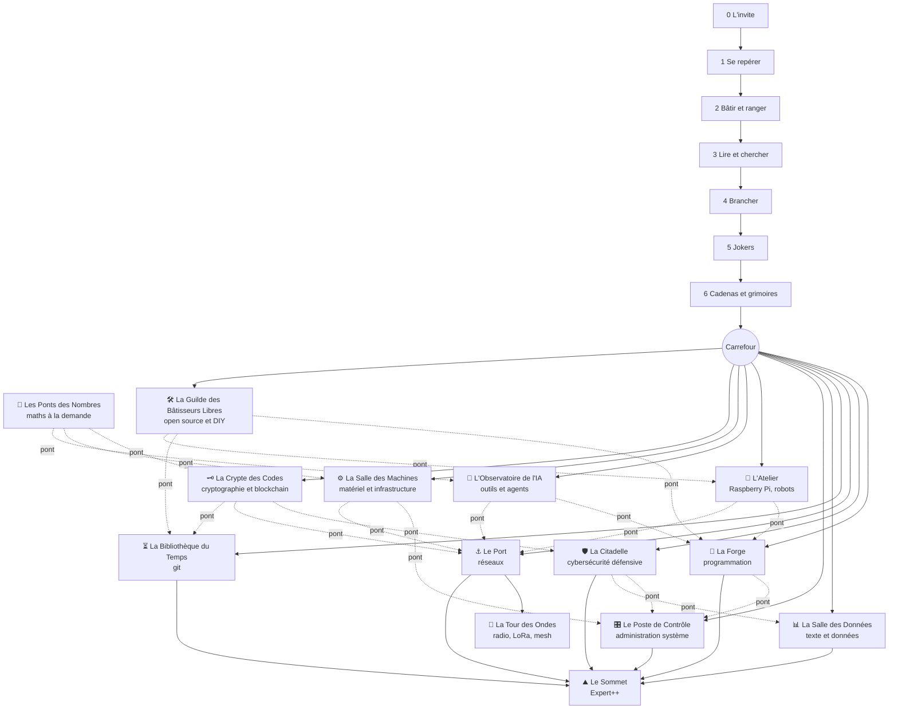

# Terminagotchi — Programme de référence du terminal (de 0 à expert++)

> Analyse et conception uniquement : aucune modification du code, rien n'est commité.
> Branche analysée : `nouveau-bestiaire` (dernier commit `e406406`, « Le monde à explorer… »). Pendant l'analyse,
> un autre agent réécrivait l'histoire (« L'éveil du Terminaworld ») : les identifiants de chapitres
> (`reveil`, `nid`, `grenier`…) et de leçons (`t0`…`t4`, `reseau0`…) sont ceux du code actuel. Le programme
> ci-dessous ne dépend pas des noms de lieux : il suffira de renommer les colonnes « lieu ».

## Sommaire

0. [Résumé](#0-résumé)
1. [Inventaire : ce qui est enseigné aujourd'hui](#1-inventaire--ce-qui-est-enseigné-aujourdhui)
2. [Le programme de référence : tronc commun (0 → 6), carte du Terminaworld, arbre des 8 mondes, Sommet](#2-le-programme-de-référence-niveau-par-niveau)
3. [Analyse des écarts (P1 / P2 / P3)](#3-analyse-des-écarts)
4. [Le parcours d'accueil proposé (de l'œuf aux fonctions)](#4-le-parcours-daccueil-proposé)
5. [Plan de simulation (personas, mesures, outillage)](#5-plan-de-simulation)
6. [Annexes : format de données commun, vérificateur statique, chantier Shell.kt](#6-annexes)
7. [Vers la référence : rigueur, protocoles réseau, Salle des Machines, comprendre l'IA, boîtes de la Citadelle, récompenses, en classe, cryptographie et blockchain, mathématiques par la pratique, illustrations des mondes, radio et LoRa, open source et DIY, VM, SQL, web, multimédia, Linux, embarqué](#7-vers-la-référence--rigueur-modules-complémentaires-et-salles-de-classe)

---

## 0. Résumé

**Ce qui existe est riche, mais c'est un « catalogue de recettes », pas encore un programme.**

- Le fil principal (10 chapitres + jardin du téléphone) fait taper **≈ 75 commandes guidées** au total. Une
  simulation sans triche sur l'XP (un enfant qui tape exactement la commande affichée) termine les
  chapitres 1 à 7 en **≈ 52 commandes** (voir §1.8). Tout le reste (quêtes, salle d'entraînement, dressage,
  CTF, donjon) ajoute de la pratique, mais **sans ordre pédagogique explicite**.
- La progression couvre bien les niveaux « se repérer / créer / lire / chercher / ranger », effleure
  les droits, les processus, les scripts et le réseau, et **ignore presque complètement** : l'usage de
  l'invite elle-même (Entrée, erreurs, ↑, Tab, Ctrl+C, `clear`), les chemins absolus/relatifs, les
  guillemets, les jokers (`*`, `?`), les redirections d'erreur (`2>`), `&&` / `||` / `$?`, les variables
  et `PATH`, les boucles et arguments de script (sur PC), `bg`/`fg`/Ctrl+Z, les outils de texte
  (`cut`, `tr`, `sed`, `awk`, `xargs`, `uniq`), les archives, `man`.
- **Le PC et Android ne racontent pas la même chose** (tuyaux et `sort` seulement sur Android, `git`
  et `sleep &` seulement sur PC, `sudo -h` contre `id`…), et le site a encore un troisième jeu de
  commandes. Il n'existe pas de source unique du programme.
- **Plusieurs épreuves de dressage demandent des commandes jamais enseignées** (`tar`, `base64 -d`,
  `sha256sum`, `tr`, `export`, `nproc`, `lsblk`, `sort | uniq -c | sort -n`, `nano`…).
- **L'accueil est incohérent** : sur PC, le premier écran affiche « Leçon 1/2 : niveau 2 requis — J'ai
  encore faim ! » et demande d'ouvrir une deuxième fenêtre de terminal ; l'œuf éclôt après 2 commandes,
  *avant* que l'histoire ne dise « viens me chercher » puis « *CRAC !* tu m'as trouvé ».

Le document propose :

- un **tronc commun en 7 niveaux** (0 « Premiers pas avec l'invite » → 6 « Cadenas et grimoires »), puis un
  **Carrefour** qui ouvre un **arbre de 8 mondes** (la Forge, la Citadelle, le Port, la Bibliothèque du Temps, la
  Salle des Données, le Poste de Contrôle, l'Atelier, l'Observatoire de l'IA) et un **Sommet** expert++ ; chaque
  monde n'exige que ses vrais prérequis, l'orientation de l'enfant est détectée pour *proposer* (jamais pour
  fermer), et les notions d'un autre monde arrivent juste à temps par des **mini-leçons ponts** ;
- **le Terminaworld = tout le système de fichiers** (la Racine `/`, le village `/home`, la salle des règles `/etc`,
  l'armurerie `/usr/bin`, le terrain vague `/tmp`, les archives `/var/log`, les lieux magiques `/dev` et `/proc`),
  visité en lecture seule, la zone d'aventure `~/terrain_terminagotchi` restant le seul lieu où l'on construit et
  détruit ;
- **à chaque étape, l'explication enfant et l'explication adulte côte à côte**, plus la phrase « dans un vrai
  terminal, c'est pareil » ;
- **33 écarts priorisés** (P1/P2/P3, effort S/M/L), un **parcours d'accueil** en 9 temps où la créature débloque
  chaque fonction, et un **plan de simulation** avec 12 personas (dont 6 qui testent l'arbre des mondes)
  exécutables sans écran (PC et JVM Android).

---

## 1. Inventaire : ce qui est enseigné aujourd'hui

### 1.1 Comment le jeu « voit » ce que tape l'enfant (3 plateformes, 3 mécanismes)

| | PC (`pc/tg/`) | Android (`app/…/fr/terminagotchi/`) | Site (`site/src/terminal.js`) |
|---|---|---|---|
| Où l'enfant tape | Dans **son vrai terminal** (bash, zsh, fish, PowerShell). La créature vit dans une **autre fenêtre** (`tg`), ou dans l'invite après `tg installer`, ou dans `tg mini` (créature + vraie ligne de commande dans la même fenêtre). | Dans le **terminal intégré** de l'appli (`TerminalActivity`), sous la créature. | Barre « visiteur@terminagotchi:~$ » en bas de chaque page (fermée par défaut). |
| Exécution | Le vrai shell de l'utilisateur. | `Shell.kt` : **un `/system/bin/sh -c` neuf par commande**, `cd` géré par l'appli, entrée standard fermée, coupure à **20 s**, `~/.tgrc` relu avant chaque commande. Avant le shell : commandes intégrées (`Commandes.kt` : `carte`, `ouvre`, `lampe`, `entrainement`, `donjon`, `ctf`, `edite`, `doom`…) et `clear`, `exit`, `aide`, `langue`, `parties`. | Rien n'est exécuté : arbre virtuel du site (pages = fichiers). |
| Ce que le jeu sait | Seulement **la ligne tapée** (lecture de `~/.bash_history`, `~/.zsh_history`, fish, PSReadLine) et l'état des fichiers ; **ni la sortie ni le code de retour**. Le dossier courant n'est connu qu'avec le crochet d'invite (`compagnon.py`, `PROMPT_COMMAND`/`precmd`). | La ligne, **la sortie** (donc les erreurs, traduites par `expliquer()`), le dossier courant. | La ligne et l'arbre virtuel. |
| Historique ↑ / Tab | Ceux du vrai shell. | Faits par l'appli : ↑ ↓ (50 entrées, **une commande rappelée par ↑ ne donne pas d'XP**), Tab (commandes du lexique + fichiers). | ↑ ↓, Tab, « tu voulais dire… », `history`. |
| Ctrl+C | Celui du vrai shell. | **N'existe pas** (coupure automatique à 20 s). | Sans objet. |
| Copier-coller | Refusé : la commande affichée contient **une lettre sosie** (cyrillique) et des espaces insécables (`plateforme.piege`) ; une ligne qui en contient « ne compte pas ». | Détection de collage (`colle`). | — |

### 1.2 Le fil principal sur PC (`histoire.py` + `lecons.py`), dans l'ordre

Contrôle : **re** = la ligne tapée correspond à un motif ; **fs** = un fichier/dossier existe (ou a disparu) ;
**ici** = le dossier courant ; **ou** = la commande doit être tapée dans tel lieu ; **réponse** = une valeur écrite
dans un fichier. « Niv. » = niveau de créature exigé pour *voir* la leçon (sinon : « J'ai encore faim ! »).
Les ailes 3 à 9 se font dans l'ordre voulu ; leur niveau exigé vaut `min(12, 5 + ailes déjà réveillées + n° de leçon)`.
Les étapes « expert » n'apparaissent qu'à partir du niveau 10.

| Ch. | Lieu (famille) | Leçon | Commandes demandées (dans l'ordre) | Contrôle | Niv. |
|---|---|---|---|---|---|
| 1 | vestibule | `t0` Où suis-je ? | `pwd` · `ls` · `cd ~` | re | 2 |
| 1 | | `reveil1` Le vieux chemin | `cd terrain_terminagotchi` · `ls` · `cd vestibule` · `ls` (l'œuf « trouvé ») | ici / re+ou | 2 |
| 1 | | `racine` Voyage jusqu'à la Racine *(nouveau)* | `cd /` · `ls` · `pwd` · `cd ~` · `cd ~/terrain_terminagotchi/vestibule` (chemin absolu) | ici / ou / ici | 2 |
| 2 | nid | `nid0` Construire mon nid | `cd ..` · `mkdir nid` · `touch nid/lit.txt` | ici / fs | 3 |
| 2 | | `debarras` Un lieu en trop | `mkdir debarras` · `rmdir debarras` · `rm -r vieille_cabane` | fs | 3 |
| 2 | | `nid1` Le garde-manger | `echo pomme > nid/repas.txt` · `cat nid/repas.txt` | fs / re | 4 |
| — | | *Exploration débloquée* (monstres) dès que `Bâtisseur` + `nid/` existent | | | |
| 3 | grenier (Sylvestres) | `grenier0` | `cd ~/terrain_terminagotchi/grenier` · `tree` (ou `ls -R`) · `mv fouillis/ours_en_peluche.txt ../nid/` | ici / re / fs | 5+ |
| 3 | | `t4` Nettoyeur | `cp nid/repas.txt nid/secours.txt` · `mv nid/secours.txt reserve.txt` · `rm reserve.txt` · *expert :* `cp -r grenier/fouillis grenier/fouillis_secours` | fs | |
| 4 | cave (Démons) | `cave0` | entrée · `whoami` · `sudo -h` (pas sous Windows) | re | |
| 4 | | `t3` Gardien | `ls -l nid` · `chmod 444 nid/repas.txt` · `echo poire >> nid/repas.txt` (doit échouer) | re / fs / re | |
| 4 | | `gardien` La visite du gardien *(nouveau)* | `cat /etc/hostname` · `ls /bin` · `ls /var/log` · `ls -l /etc/hostname` (lecture seule) | re | |
| 5 | bibliothèque (Abyssaux) | `biblio0` | entrée · `find . -name "*abysses*"` · `less …/livre_des_abysses.txt` | re | |
| 5 | | `biblio1` | `grep pomme nid/repas.txt` · `head -n 3 …` · `wc -l …` · *expert :* `grep -rn TRESOR .` | re | |
| 6 | salle des machines (Élémentaires) | `machines0` | entrée · `free -h` · `du -sh *` · `rm vieux_carton.bin` | re / fs | |
| 6 | | `systeme1` | `df -h` · `du -sh ~/terrain_terminagotchi` | re | |
| 7 | dortoir (Morts-vivants) | `dortoir0` | entrée · `ps aux` | re | |
| 7 | | `systeme2` | `sleep 300 &` · `jobs` · `kill %1` | re | |
| 8 | atelier (Constructs) | `atelier0` | entrée · `cat plan_de_travail.txt` | re | |
| 8 | | `scripts0` | `echo 'echo "Miam !"' > nid/miam.sh` · `sh nid/miam.sh` | fs / re | |
| 8 | | `scripts1` | `chmod +x nid/miam.sh` · `alias miam='sh ~/…/miam.sh'` · `miam` | fs / re | |
| 8 | | `git0`, `git1`, `git2` | `git init carnet` · `cd carnet` · `git status` · `echo "jour 1" > journal.txt` · `git add` · `git commit -m` · `echo "jour 2" >> …` · `git diff` · `git log` | fs / re | ≤ 12 |
| 9 | tour (Célestes) | `tour0` | entrée · `ping -c 3 example.com` · `ip a` | re | |
| 9 | | `reseau1` | `curl -I https://example.com` · `curl -o colis.html …` · `head -n 5 colis.html` | re / fs | |
| 9 | | `tour2` | `nslookup example.com` · `ssh -V` · *expert :* `traceroute` | re | |
| 10 | cœur (Aberrations) — après 5 ailes | `coeur0` | entrée · `rev message_brouille.txt` · `ls -a` · `cd .porte_secrete` | re / ici | 10 |
| 10 | | `coeur1` | `find ~/terrain_terminagotchi -name "fragment*"` · `cat f1 f2 f3 > coeur/coeur_repare.txt` · `chmod 444 …` | re / fs | 11 |
| 10 | | `coeur2` | `cat …/abyssor_dort.txt` · `grep -rl ABYSSOR ~/terrain_terminagotchi \| wc -l` · `echo ? > coeur/reponse.txt` | re / réponse | 12 |
| 0 | jardin (Termux seulement) | `android0…3` | `termux-toast`, `termux-vibrate`, `termux-torch on/off`, `termux-open-url`, `am start …geo:`, `am start …DIAL`, `pm list packages \| grep`, `am start …LAUNCHER`, fonction `ouvre()` dans `~/.bashrc`, `source ~/.bashrc`, `termux-battery-status`, `termux-tts-speak`, `termux-clipboard-set` | re | |

**Leçons du catalogue jamais placées dans l'histoire sur PC** : `t1` étapes 0-1 (`mkdir terrain_terminagotchi`,
`cd terrain_terminagotchi` : le jeu crée le terrain lui-même), **`scripts2`** (`echo "alias …" >> ~/.bashrc` puis
`source ~/.bashrc` : la persistance des alias n'est donc **jamais** enseignée dans l'histoire PC).

### 1.3 Le fil principal sur Android (`Histoire.kt`, `Jeu.kt`, `Arbre.kt`) : différences avec le PC

| Ch. | PC | Android |
|---|---|---|
| 1-2 | identique | identique (`pwd`, `ls`, `cd ~`, `cd ..`, `mkdir`, `touch`, `rmdir`, `rm -r`, `echo >`, `cat`) |
| 3 grenier | `tree` | `ls -R` (pas de `tree`) |
| 4 cave | `whoami`, `sudo -h` | `whoami`, `id` (pas de `sudo`) |
| 5 bibliothèque | `find`, `less`, `grep`, `head`, `wc` | `find`, `cat` (pas de `less`), `grep`, `head`, `wc` **+ `tuyaux0`** (`ls \| wc -l`, `echo … > / >>` ×3, `sort courses.txt`) **+ `tuyaux1`** (`cat … \| grep`, `sort … > triee.txt`, `cat`) |
| 6 machines | `free`, `du -sh *`, `rm`, `df`, `du` | idem **+ `uptime`, `uname -a`, `getprop ro.product.model`** |
| 7 dortoir | `ps aux`, `sleep 300 &`, `jobs`, `kill %1` | `ps`, `ps -A \| wc -l`, `date` (pas de tâches de fond) |
| 8 atelier | scripts `sh`, `chmod +x`, `alias`, puis **git** (3 leçons) | scripts `sh`, `cat`, fonction dans **`~/.tgrc`**, **`for i in 1 2 3; do …; done`**, **`if [ -f … ]; then …; fi`**, puis **créateur** (`doom`, `edite carte.txt`, `edite reglages.txt`) |
| 9 tour | `ping`, `ip a`, `curl -I/-o`, `head`, `nslookup`, `ssh -V`, `traceroute` | `ping -c 3`, `ifconfig`, `hostname`, `web example.com` (intégrée) |
| 10 cœur | identique | identique |
| 0 jardin | `termux-*`, `am`, `pm`, `.bashrc` | commandes intégrées : `lampe on/off`, `vibre 300`, `batterie`, `applis`, `ouvre parametres`, `web`, `carte tour eiffel`, `dis bonjour`, `partage`, `sms` |

Conséquence : **les tuyaux `|`, `sort`, `for` et `if` ne sont enseignés que sur Android ; `git`, `less`, `sudo`,
`&`/`jobs`/`kill`, `curl`, `nslookup` que sur PC.** Un enfant qui joue sur les deux (synchro de compte) voit
deux programmes différents ; le lexique les distingue (🔒 « existe dans un autre univers »).

### 1.4 Les contenus annexes (pratique libre)

| Module | Fichiers | Ce qui est pratiqué | Comment c'est vérifié | Ordre / prérequis |
|---|---|---|---|---|
| **Quêtes écrites** (44) | `quetes.py`, `Quetes.kt` | lettres (`cat`), cachettes (`ls -a`, `cd .xxx`), terres sauvages en lecture (`ls /`, `cat /etc/os-release`, `cat /etc/hostname`), `ps \| wc`, `less`/`more` (q32), `uptime`, `head`, `sort` (q21 « trie »), `ping localhost`, `ip`, écrire un script et le lancer, `git` 2 commits (q37), `rev > envers.txt` (q42), compter des fichiers, protéger (`chmod`) | fichiers (fs), réponses, motifs de ligne | posées quand la pièce s'ouvre ; aucune vérification que la commande a été enseignée |
| **Quêtes générées** + quête du jour | `quetes.py` | perdu (`find`), construire (`mkdir`/`touch`), copie (`cp`), compter, protéger (`chmod`), mot secret (`grep`) | fs, réponses | facile → moyen → dur selon le niveau |
| **Salle d'entraînement** (19 types, 8 familles, grades Bit → Exa) | `entrainement.py`, `Entrainement.kt`, `site/src/entrainement.js` | explorateur (`cd`, `ls`, `pwd`), bâtisseur (`mkdir`, `touch`), déménageur (`cp`, `mv`), nettoyeur (`rm`, `rmdir`, `rm -r`), lecteur (`cat`, `head`, `tail`), détective (`grep`, `find`), plombier (`>`, `>>`, `\|` avec `grep`/`wc`), cuisinier (`sh`, `chmod`, `echo >`) | résultat (fichiers, dossier courant, réponse), chrono → médaille | **seuls les exercices dont les commandes ont déjà été tapées** sont proposés (bonne idée à généraliser) |
| **Dressage** (épreuves par thème, niveaux 1-3) | `dressage.py`, `Dressage.kt` | `cat`, `find`, `mkdir`, `touch`, `cp`, `mv`, **`tar`**, `ping`, `hostname`, `ip a`, `nslookup`, `curl -o`, `ps`, `date`, `sleep … &`, `jobs`, `kill %1`, `df`, `free`, `du`, `ls \| wc -l`, `touch .nom`, `chmod 600`, **`sha256sum`**, `echo >`, **`nano` + `chmod +x`**, **`for`**, **`uname -m`**, **`nproc`**, **`lsblk`**, `grep`, `grep -c`, **`grep -v … >`**, `cp -r`, `head`, `wc -l`, `sort >`, **`sort \| uniq \| wc -l`**, **`base64 -d`**, **`sort \| uniq -c \| sort -n`**, **`cal`**, **`sort -n \| tail -1`**, **`sort -nr \| head -3 >`**, `rev >`, **`tr A-Z a-z`**, `whoami`, `uname -a`, `alias`, **`export`** | résultat, pas le texte exact ; indices « presque » | difficulté selon le nombre de captures ; **aucun lien avec ce qui a été enseigné** (en gras : jamais enseigné dans le fil principal) |
| **Envies** (6 jauges) | `envies.py`, `Envies.kt` | `sleep 10` (sieste), `rm .cache/*.tmp` (propreté, **joker `*`**), `man`, `--help`, `tg explique` (curiosité), `ls -a`, `find` (exploration) | état des fichiers, lignes | permanent |
| **Défis éclair** | `core.py` | `pwd`, `ls`, `whoami`, `date` vite | ligne | permanent |
| **CTF Android** (7) | `Ctf.kt` | `ls -a` + `cat .drapeau` ; `grep TG journal.log` (3 000 lignes) ; `ls -l` + `chmod 644` ; `find . -name "drapeau*"` ; `base64 -d` ; `rev` ; `find . -size 42c` | empreinte SHA-256 du drapeau | libre, après l'accueil |
| **CTF web** (5, site) | `site/src/worker.js` | `curl -I` (en-têtes), `robots.txt`, `curl -d` (POST), cookie modifié, JSON (`python3 -m json.tool`) | drapeau HMAC (`tg drapeau TG{…}`) | libre |
| **Donjon** (Android) | `Donjon.kt` | `cd`, `cd ..`, `ls -a`, `cat`, `mv objet …/sac/`, `chmod 755` (salle verrouillée), `cd escalier` + intégrées (`attaque`, `bois`, `equipe`, `plan`) | dossier courant, fichiers | libre |
| **Mini-terminal du site** | `site/src/terminal.js` | `ls`, `cd`, `cat`, `find`, `grep`, `tree`, `pwd`, `history`, `clear`, `help`, `sudo` (refus pédagogique), Tab, ↑ ↓, « tu voulais dire » | — | aucun parcours guidé |
| **Lexique / carnet** | `lexique.py`, `Jeu.kt` (`Regles.LEXIQUE`) | chaque commande : image + technique, exemple prêt à taper (`exemples.py`) | — | gris = pas encore goûtée |
| **`explique <cmd>`** | `explique.py`, `Explique.kt` | 49 fiches (`grand.*`), options (`-a -l -R -r -f -p -h -s -n -i -c -v -m -I -o -name -size 444 644 600 755 +x +r`…), symboles `> >> \| . .. ~ *`, voisines (`rm/rmdir`, `cp/mv`, `cat/head/less`, `ps/kill`, `touch/mkdir`, redirections) ; la 1re fois qu'une option apparaît dans une leçon : « 💡 Le -r veut dire… » | — | palier de vocabulaire (image → image + mot → mot) |
| **`cherche` / registre** | `registre.py`, `Recherche.kt` | 64 entrées + recettes (« supprimer un dossier », « arrêter un programme bloqué »…) ; `man`, `history`, `pkill`, `top`, `clear` y figurent | — | — |
| **Vocabulaire progressif** | `mots.py`, `Mots.kt` | `{dossier}`, `{processus}`, `{ram}`… : palier 0 (< niv. 7), 1 (7-11 ou 8 leçons), 2 (≥ 12 ou 14 leçons) | — | — |

### 1.5 Matrice : chaque commande, où elle est apprise, où elle sert

Légende : **H** = fil principal (n° de chapitre), **A** = seulement Android, **P** = seulement PC, **E** = salle
d'entraînement, **D** = dressage, **Q** = quêtes, **C** = CTF (Android), **W** = CTF web, **V** = envies, **X** = expliquée
par `explique` (fiche `grand.*`). « — » = absent.

| Commande / notion | Fil principal | Ailleurs | X | Remarque |
|---|---|---|---|---|
| Taper, Entrée, invite, erreurs | — | — | — | **jamais enseigné** |
| ↑ / historique / `history` | — | site (`history`), registre | — | Android : ↑ ne donne pas d'XP |
| Tab | — | Android/site (bouton), messages d'erreur « ou fais Tab » | — | jamais enseigné comme geste |
| Ctrl+C | — | astuce `rev` (ch. 10), `aide.manque.bloque` | — | n'existe pas sur Android |
| `clear` | — | aide | ✓ | — |
| `pwd` | H1 | E, défis | ✓ | |
| `ls` / `ls -a` / `ls -l` / `ls -R` | H1 / **H10** / H4 / A3 | Q01 (dès le vestibule), C, D, V, carte | ✓ | `ls -a` nécessaire **dès H2** (monstres) |
| `cd`, `cd ~`, `cd ..`, chemins | H1, H2 | E, donjon | ✓ | absolu / relatif jamais expliqués |
| `tree` | P3 | site, carte | ✓ | Android : `ls -R` |
| `mkdir` (`-p`) | H2 (`-p` : seulement dans l'aide de reconstruction) | E, D, Q | ✓ | |
| `touch` | H2 | E, D | ✓ | |
| `rmdir`, `rm`, `rm -r` | H2, H3, H6 | E, V | ✓ | `rm -f`, `rm -i` jamais |
| `cp`, `cp -r`, `mv` | H3 (+ expert) | E, D, Q | ✓ | renommer = `mv` : vu |
| `echo`, `>`, `>>` | H2, H4 | E, D | ✓ | |
| `cat`, `head -n`, `tail`, `less` | H2, H5, (P5 `less`) | E (`tail`), Q32 (`less`) | ✓ | `tail -f` jamais |
| `grep` (`-r -n -l -c -v -i`) | H5, H10 | E, D, C | ✓ | `-i`, `-v`, `-c` hors fil principal |
| `find` (`-name`, `-size`) | H5, H10 | E, C, V | ✓ | `-type`, `-exec` jamais |
| `wc -l` | H5, H10 | E, D | ✓ | |
| `\|` tuyau | **A5**, H10 (`grep \| wc`) | E, D, Q29 | ✓ | **PC : aucune leçon dédiée** |
| `sort` (`-n -r`), `uniq` (`-c`) | **A5** (`sort`) | D, Q21 | `sort` ✓, `uniq` — | |
| `rev` | H10 | C, D, Q42 | ✓ | |
| `*` (joker) | implicite H5, H6 | V (`rm .cache/*.tmp`) | symbole ✓ | jamais une leçon |
| `whoami`, `id` | H4, A4 | D | ✓ | |
| `chmod 444/644/600/755/+x` | H4, H8, H10 | C, D, donjon | ✓ | rwx, u/g/o, propriétaire : jamais |
| `sudo` | P4 (`sudo -h` seulement) | site (refus) | ✓ | |
| `free`, `du`, `df` (`-h`) | H6 | D | ✓ | |
| `uptime`, `uname`, `getprop` | A6 | D, Q33 | ✓ | |
| `ps` (`aux`, `-A`) | H7 | D, Q29 | ✓ | |
| `sleep N &`, `jobs`, `kill %1` | **P7** | D | `kill` ✓ | `bg`, `fg`, Ctrl+Z, `top` : jamais |
| `date`, `cal` | A7 (`date`) | D, défis | `date` ✓ | |
| `sh script` | H8 | E, D, Q34 | ✓ (`bash`) | shebang `#!/bin/sh` jamais |
| `chmod +x`, `./script` | P8 | E, D, Q35 | ✓ | |
| `alias` | P8 | D | ✓ | persistance `.bashrc` : jamais en PC (orpheline) |
| fonction shell, `~/.tgrc` | A8 | — | — | |
| `for`, `if [ -f ]` | **A8** | D (`for`) | — | PC : jamais |
| `export`, variables, `$VAR`, `PATH` | — | D (`export`) | — | **jamais** |
| `git init/status/add/commit/diff/log` | P8 | Q37 | ✓ | identité git non configurée → échec |
| `ping -c`, `ip a`, `ifconfig`, `hostname` | H9 | D, Q38, Q41 | ✓ | |
| `curl -I/-o` | P9 | D, W | ✓ | sans réseau : bloquant |
| `nslookup`, `traceroute`, `ssh -V` | P9 | D | ✓ | `ssh` réel : jamais |
| `tar`, `gzip` | — | D (`tar`) | option ✓ | |
| `base64`, `sha256sum` | — | C, D | — | |
| `tr`, `cut`, `sed`, `awk`, `xargs`, `tee` | — | D (`tr`) | — | |
| `man`, `--help`, `help` | — | V, registre | `man` ✗ | jamais une leçon |
| `&&`, `\|\|`, `;`, `$?`, `2>`, `/dev/null` | — (`;` dans `for` sur A8) | — | — | **jamais** |
| guillemets `' "`, échappement | implicites (H5, H8) | — | — | jamais expliqués |
| `nano` / éditeur | — | D (`nano`), aide | ✓ | Android : `edite` |
| `cron`, `ssh` réel, paquets (`apt`) | — | registre (`apt`) | `apt` ✓ | |

### 1.6 Ce que le shell Android sait faire réellement

`Shell.kt` lance `/system/bin/sh` (mksh) avec les outils **toybox** du téléphone. Conséquences pour le programme :

| Capacité | État | Détail |
|---|---|---|
| Navigation, fichiers (`ls cd pwd mkdir rmdir touch cp mv rm cat head tail grep find wc sort uniq cut tr sed xargs tee rev base64 sha256sum chmod stat`) | ✅ natif | toybox (versions courtes, messages en anglais) |
| `awk`, `tar`, `gzip` | 🟡 probable | présents sur la plupart des Android ≥ 9-11 ; **à vérifier sur appareil** |
| Système (`id whoami ps kill date cal uptime uname df du free nproc hostname ping ifconfig ip getprop`) | ✅ natif | `ps` ne voit que les processus de l'appli |
| Redirections `> >> 2> \|`, `;` `&&` `\|\|`, `$?`, jokers, `for/if/while`, fonctions | ✅ **dans une même ligne** | |
| Variables, `export`, `alias`, `cd` relatif d'un appel à l'autre | ❌ **perdus à chaque commande** | un nouveau `sh -c` par ligne ; seul `~/.tgrc` survit |
| `&`, `jobs`, `fg`, `bg`, `kill %1` | ❌ | pas de session ; un `&` laisse un orphelin |
| Ctrl+C, Ctrl+D, Ctrl+Z | ❌ | coupure automatique à 20 s |
| Entrée standard (`cat` seul, `read`, `sort` au clavier) | ❌ | stdin fermé |
| `history`, `!!` | ❌ | ↑ ↓ de l'appli seulement |
| `tree`, `less`, `more`, `man`, `sudo` | ❌ | `ls -R`, `cat` à la place |
| `git`, `curl`, `wget`, `nslookup`, `dig`, `traceroute`, `ssh`, `nano`, `python3`, `crontab` | ❌ | `web`, `edite` intégrées |
| `./script.sh` | 🟡 | dossier privé de l'appli souvent non exécutable (Android 10+) : `sh script.sh` marche toujours |

### 1.7 Ce qui n'est enseigné nulle part (avant même de parler d'expert)

1. **L'invite elle-même** : ce que veut dire `~/terrain $`, taper puis Entrée, « rien ne s'affiche = c'est réussi »,
   lire un message d'erreur, majuscules/minuscules, espaces, ↑, Tab, Ctrl+C, `clear`, `exit`.
2. **Les chemins** : `/` racine, chemin absolu vs relatif, `.` et `..`, `~` comme raccourci.
3. **Les guillemets** et les espaces dans les noms.
4. **Comment s'aider soi-même** : `--help`, `man`, `type`, `which`.

### 1.8 Mesures d'une première simulation (sans triche sur l'XP)

Script : `/tmp/claude-0/-home-claude/cfd82251-4fa5-55cd-8b51-4f0548d9aa8a/scratchpad/sim_suiveur.py` (HOME
temporaire, commandes réellement lancées avec bash, ligne ajoutée à `~/.bash_history`, puis `app.etape`, comme
`test_retours_enfants.py`, **mais sans `niveau(n)` qui donne de l'XP en douce**). L'élève virtuel tape exactement la
commande affichée ; quand la leçon est verrouillée, il tape la première idée de « J'ai encore faim ».

| Chapitre | Commandes tapées | dont « remplissage » (niveau requis) | Blocage observé |
|---|---|---|---|
| 1 réveil | 9 | 2 | Premier écran = « niveau 2 requis » ; l'œuf éclôt avant que le chapitre 1 ne commence ; `pwd` redemandé alors qu'il vient d'être tapé |
| 2 nid | 8 | 0 | — |
| 3 grenier | 9 | 0 | `cp nid/repas.txt …` tapé depuis `grenier/` : refusé ; indice correct (« se tape depuis le carrefour ») |
| 4 cave | 9 | 0 | même chose pour `chmod 444 nid/repas.txt` depuis `cave/`, **sans indice** (seule la ligne grise « 📁 à taper depuis ») |
| 5 bibliothèque | 6 | 0 | — |
| 6 machines | 6 | 0 | — |
| 7 dortoir | 5 | 0 | — |
| 8 atelier | 159 | **143** | 1) `git commit` échoue sur une machine neuve (identité git absente, `fatal:` en anglais ; seule une astuce grise le dit) ; 2) une fois l'identité réglée, la leçon suivante exige le niveau 12 : les idées « J'ai encore faim » sont toutes déjà goûtées → la même commande (`cal`) revient **143 fois** |
| 9 tour | bloqué | 0 | `curl -o colis.html https://example.com` **sans réseau** (proxy, école, avion) : l'étape `fs` ne peut jamais réussir, aucun contournement |

**Après la correction des écarts G-04 à G-08 (`3a6f9fd`)** : la même simulation, devenue un test (`pc/outils/sim_suiveur.py`,
`tests/jvm/Suiveur.kt`), finit les **10 chapitres** hors ligne et sans identité git : **75 commandes** sur PC (81 sur
Android), **0 commande de remplissage** après l'œuf (2 au réveil, l'accueil G-02), aucun blocage.

À retenir : **la partie guidée est très courte** (≈ 52 commandes pour 7 chapitres), puis on bute sur des **blocages
techniques** (réseau, git) et sur le **mur d'XP** de fin de parcours.

---

## 2. Le programme de référence, niveau par niveau

### 2.0 Principes

1. **Un tronc commun court (niveaux 0 → 6)** : ce dont tout le monde a besoin, quel que soit son goût. Environ
   90 à 120 commandes guidées, 4 à 8 séances pour un enfant de 7 ans.
2. **Un carrefour, puis un arbre de mondes** (§ 2.9) : 8 mondes avancés du Terminaworld, chacun avec ses
   paliers, ses images, ses exercices et son parallèle avec le monde réel. On y entre selon ses goûts, sans
   jamais être bloqué : les autres mondes restent ouverts et la créature propose la suite.
3. **Un « Sommet » Expert++** (§ 2.18) qui croise les mondes (scripts robustes, regex avancées, débogage).
4. **Échafaudage qui s'efface**, à chaque niveau et dans chaque monde, sur 4 crans :
   - **A. Montré** : la commande exacte s'affiche (➜ `ls -a`), comme aujourd'hui ;
   - **B. À trous** : `ls -_` + « la lettre de *all* » ;
   - **C. But seul** : « Trouve le passage secret de la cave » (+ indice sur demande : `indice`) ;
   - **D. Défi** : le résultat est vérifié, le chemin est libre (salle d'entraînement, dressage, CTF).
   Une notion n'est « acquise » qu'après une réussite au cran C ou D. Le cran A sert à la découverte.
5. **À chaque nouvelle notion, une phrase « vrai terminal »** : « Dans un vrai terminal Linux ou macOS, c'est
   pareil : … ». Sur Android, ajouter : « Ici, ton téléphone utilise un vrai shell (sh) ; sur un ordinateur, ce
   sera souvent bash ou zsh. » Sous Windows : « Dans PowerShell, la commande s'appelle … » (`C()` existe déjà).
6. **Vérifier le résultat plutôt que le texte** dès le cran B (comme le dressage et la salle d'entraînement).
7. **Le vocabulaire grandit** avec les paliers de `mots.py` (image → image + vrai mot → vrai mot).
8. **Double explication à CHAQUE étape (décision du propriétaire)** : l'explication pour l'enfant (l'image du
   Terminaworld) et, **juste à côté**, l'explication pour l'adulte (précise, technique, liée au monde réel), quel
   que soit le palier de vocabulaire. Le palier change seulement l'ordre et la taille (palier 0 : l'enfant en
   grand, l'adulte en petit dessous ou dans une colonne repliable ; palier 2 : l'inverse). Format imposé d'une
   étape :

   ```
   ── Leçon 3/6 · Les passages secrets (2/4) ─────────────────────────────
   🧒 Certains passages sont cachés : leur nom commence par un point.     │ 🧑 ls -a (--all) liste aussi les entrées dont le nom
      Regarde avec les yeux du détective !                                │    commence par « . » (fichiers cachés par convention :
                                                                          │    .bashrc, .git, .ssh). -a montre aussi . et .. ;
   ➜ ls -a                                                                │    -A les masque. Même chose sur Linux, macOS, WSL.
   🌍 Dans un vrai terminal Linux/macOS, c'est pareil : tes réglages (.bashrc, .config) sont des « passages secrets ».
   ```

   Sur un écran étroit (téléphone), les deux blocs sont l'un sous l'autre, l'adulte replié derrière « 🧑 Pour les
   grands ▸ » mais **toujours présent**. Chaque étape de `programme.json` a donc 3 clés obligatoires :
   `enfant`, `adulte`, `vrai` (+ `bravo`). Les fiches `explique` (`grand.*`, `optg.*`) fournissent déjà une base
   pour `adulte`.

### 2.0 bis La carte du Terminaworld = tout le système de fichiers (décision du propriétaire)

Le Terminaworld n'est pas seulement `~/terrain_terminagotchi` : **c'est l'ordinateur entier**, vu comme un monde.
`~/terrain_terminagotchi` reste **la zone d'aventure**, le seul endroit où le jeu fait construire et détruire.
Les lieux du système se **visitent en lecture seule** (`ls`, `cat`, `head`, `find`, `stat`) ; `sudo` n'est
**jamais** utilisé dans le jeu (il est seulement expliqué).

| Chemin | Lieu du Terminaworld | 🧒 Image | 🧑 Réalité (adulte) | Visité au niveau / monde | Règle |
|---|---|---|---|---|---|
| `/` | **la Racine** (cœur du monde) | le pied du grand arbre d'où partent tous les chemins | racine de l'arborescence unique (FHS) ; tout chemin absolu commence par `/` | 1 (`cd /`, `ls /`) | lecture |
| `/home` | **le village** | les maisons de tous les habitants | dossiers personnels des utilisateurs (`/Users` sur macOS) | 1 | lecture |
| `~` (`/home/lou`) | **ton camp de base** | ta maison à toi | `$HOME`, ton dossier personnel ; `~` est développé par le shell | 0-1 | lecture/écriture (mais le jeu n'y crée rien) |
| `~/terrain_terminagotchi` | **la zone d'aventure** | le terrain de jeu où tout est permis | bac à sable du jeu ; seules écritures du jeu | 1 → mondes | construire / détruire |
| `/etc` | **la salle des règles** | les règlements du monde | configuration système (`hostname`, `os-release`, `passwd`, `hosts`) | 3 (`cat /etc/hostname`), Port P2 (`/etc/hosts`) | lecture |
| `/bin`, `/usr/bin`, `/usr` | **l'armurerie des commandes** | là où dorment les outils | exécutables et bibliothèques ; `PATH` dit où chercher | 6 (`which ls`, `ls /usr/bin \| wc -l`), Contrôle K3 | lecture |
| `/tmp` | **le terrain vague** | on y pose des choses qui s'envolent | fichiers temporaires, vidés au redémarrage ; `mktemp` | 5, Sommet | lecture (le jeu n'écrit pas) |
| `/var/log` | **les archives** | le registre que tient le gardien | journaux système (souvent lisibles seulement par root ; `journalctl`) | Citadelle C1, Contrôle K4 | lecture (variante simulée si refusé) |
| `/dev` | **lieu magique : les portails des machines** | des portes vers l'écran, le disque, le trou noir | fichiers de périphériques ; `/dev/null`, `/dev/urandom` | 4 (`2>/dev/null`), Atelier | lecture |
| `/proc` | **lieu magique : le miroir des habitants** | un miroir qui montre ce que chaque habitant fait, en direct | pseudo-système de fichiers du noyau (`/proc/cpuinfo`, `/proc/<pid>`) | Contrôle K1-K2 | lecture |
| autres (`/opt`, `/srv`, `/mnt`, `/media`, `/boot`) | régions lointaines | brume sur la carte | rôles FHS (montages, logiciels tiers, démarrage) | Sommet | lecture |

Conséquences sur le programme :

- **`pwd` montre le chemin complet depuis la Racine** dès le niveau 1 : « `/home/lou/terrain_terminagotchi` = Racine
  → village → ton camp → zone d'aventure ». La carte qui pousse dessine le chemin de la Racine jusqu'à « ◉ tu es ici »
  (les régions système dans la brume tant qu'elles ne sont pas visitées).
- **Absolu / relatif** est enseigné au niveau 1 avec cette carte : « un chemin qui commence par `/` part de la
  Racine ; sinon, il part de là où tu es ».
- **Garde-fous** : le jeu ne valide jamais une étape qui écrit hors de la zone d'aventure ; si l'enfant tape `rm`,
  `mv`, `chmod`, `>` vers un lieu système, la créature explique « c'est un lieu à regarder, pas à toucher » (la
  plupart échoueront de toute façon : « Permission denied » = « le gardien dit non »).
- **Android** : le vrai arbre d'Android est différent (`/system`, `/data`, pas de `/home`) et le shell de l'appli
  vit dans `files/`. **`Shell.kt` doit simuler l'arbre du Terminaworld** : une vue virtuelle en lecture seule
  (`/`, `/home/<nom>`, `/etc` avec quelques fichiers (`hostname`, `os-release` fictif expliqué), `/bin` = la liste
  des commandes disponibles, `/tmp`, `/var/log` avec les journaux du jeu, `/dev/null`, `/proc` avec quelques
  entrées de l'appli) où `~` correspond au dossier de l'appli. Les commandes de lecture (`ls`, `cd`, `cat`, `pwd`,
  `find`, `tree`) passent par cette vue ; le reste part au vrai `sh` dans `~`. Le site fait déjà la même chose
  (le site vu comme un dossier `~`) : réutiliser l'idée. Effort : **L**.
- **Windows** : `C:\` = la Racine, `C:\Users` = le village ; le parcours complet est conseillé sous WSL.

**État (octobre 2026, branche `nouveau-bestiaire`)** — fait sur PC et Android :

- textes : chaque lieu a son image, son nom et sa version des grands (`lieu.*`, 14 langues) ; vocabulaire en
  3 paliers (`terme.racine`, `village`, `camp`, `chemin_absolu`, `chemin_relatif`, `systeme`), section « lieux »
  du lexique, `explique /` ;
- carte (`maison.monde`, `Maison.monde`) : la Racine en haut, les lieux du système dans la brume tant qu'ils ne
  sont pas visités, le chemin Racine → village → camp de base → zone d'aventure, « ◉ Tu es ici : <chemin absolu> »,
  la ligne de métro 🚇, la règle absolu / relatif, « on regarde, on ne touche pas » ;
- leçon **« Voyage jusqu'à la Racine »** (`racine`, fin du chapitre 1 : `cd /`, `ls`, `pwd`, `cd ~`, puis un
  chemin absolu jusqu'au vestibule) et quête **« La visite du gardien »** (`gardien`, fin du chapitre de la cave :
  `cat /etc/hostname`, `ls /bin`, `ls /var/log`, `ls -l /etc/hostname`) ; les sauvegardes existantes les reçoivent
  (migration v4) ;
- garde-fous : 1re visite d'un lieu du système = présentation enfant + grands ; écrire vers un lieu du système
  (`>`, `mkdir`, `touch`, `rm`, `mv`, `cp`, `chmod`…) → « le gardien dit non » expliqué ; écrire dans le camp hors
  de la zone d'aventure → petit rappel ; `sudo` jamais demandé ;
- **Android** : `Racine.kt` simule l'arbre (`/`, `/bin`, `/usr/bin` = les commandes de l'appli, `/etc/hostname`
  = `terminaworld`, `os-release`, `hosts`, `motd`, `/dev/null`, `/proc`, `/tmp`, `/var/log/terminaworld.log` =
  le journal du jeu, `/home/explorateur` = `~`) ; `cd`, `pwd`, `ls`, `cat`… marchent avec des chemins absolus
  et relatifs ; toute écriture hors du camp est refusée comme un vrai « Permission denied », expliquée ; la sortie
  ne montre jamais le vrai dossier de l'appli.

Reste à faire : visites des niveaux 4 à 6 et des mondes (`/dev` au niveau 4, `/tmp` au niveau 5, `/usr/bin` +
`which` au niveau 6, `/proc` au Poste de Contrôle, `/var/log` réel à la Citadelle) ; régions lointaines (`/opt`,
`/srv`, `/mnt`…) ; vue Windows (`C:\`).

Légende de faisabilité sur le téléphone : ✅ marche déjà · 🟡 à adapter (contenu ou commande intégrée) ·
❌ à ajouter dans `Shell.kt`/`TerminalActivity.kt` · ⛔ impossible sans gros chantier (mettre une variante).

### 2.1 Vue d'ensemble du tronc commun

| Niv. | Nom (Terminaworld) | En une phrase | Commandes / notions clés | Lieu actuel le plus proche |
|---|---|---|---|---|
| 0 | **Premiers pas avec l'invite** | Je sais parler au terminal | taper, Entrée, invite, erreur, ↑, Tab, Ctrl+C, `clear`, `echo` | — (à créer) |
| 1 | **Se repérer** | Je sais où je suis et j'y vais | `pwd`, `ls`, `cd`, `cd ..`, `cd ~`, `tree`, chemins | ch. 1 |
| 2 | **Bâtir et ranger** | Je crée, déplace, copie, supprime | `mkdir`, `touch`, `cp`, `mv`, `rm`, `rmdir`, `rm -r`, `-p` | ch. 2-3 |
| 3 | **Lire et chercher** | Je lis et je retrouve | `cat`, `head`, `tail`, `less`, `grep`, `find`, `wc`, `ls -a` | ch. 5, 10 |
| 4 | **Brancher les commandes** | Je relie les commandes entre elles | `echo`, `>`, `>>`, `\|`, `sort`, `uniq`, `2>`, `;`, `&&`, `\|\|` | ch. 2, 4 + Android ch. 5 |
| 5 | **Jokers et chemins secrets** | Je désigne plein de choses d'un coup | `*`, `?`, `[ ]`, `{ }`, guillemets, chemins absolus | — |
| 6 | **Cadenas et grimoires** | Je protège et je sais m'aider | `ls -l`, `chmod`, rwx, propriétaire, `sudo`, `--help`, `man`, `which` | ch. 4 |

Ensuite : le carrefour, puis les mondes (§ 2.9).

---

### 2.2 Niveau 0 — Premiers pas avec l'invite *(nouveau)*

**But** : un enfant qui n'a jamais tapé une commande sait écrire une ligne, l'envoyer, comprendre ce qui revient,
corriger une erreur, réutiliser une ligne, compléter un nom et arrêter une commande.

| Notion | Ce que dit la créature (image) | Vrai terminal | Contrôle |
|---|---|---|---|
| L'invite `~ $` | « Ce petit `$` qui clignote, c'est moi qui t'écoute. Le `~`, c'est le camp de base, là où on est. » | « Dans un vrai terminal Linux/macOS, c'est pareil : l'invite montre où tu es, puis `$` (ou `%` sur macOS) attend ta commande. » | — |
| Taper puis **Entrée** | « Écris le mot magique, puis appuie sur Entrée pour me l'envoyer, comme une lettre dans la boîte. » | « Rien ne se passe tant que tu n'as pas appuyé sur Entrée. » | ligne `echo coucou` |
| La réponse | « Ce que j'écris en dessous, c'est ma réponse. » | « La sortie s'affiche sous la commande. » | — |
| **Rien ne s'affiche = c'est réussi** | « Si je ne dis rien, c'est que tout s'est bien passé ! » | « Un terminal ne félicite pas : pas de message = pas de problème. » | `mkdir essai` puis `ls` |
| L'erreur | « Oups, je ne connais pas ce mot ! Regarde les lettres une par une. » | « `command not found` veut dire que le mot est mal écrit ou que l'outil n'est pas installé. » | taper `sl` exprès, puis `ls` |
| Majuscules, espaces | « `LS` et `ls`, pour moi ce sont deux mots différents. L'espace sépare les mots. » | « Linux distingue majuscules et minuscules. » | `LS` → erreur, puis `ls` |
| **↑ le carnet de mémoire** | « Appuie sur la flèche ↑ : je te redonne ta dernière phrase. » | « ↑ et ↓ parcourent l'historique ; `history` le montre en entier. » | rappeler `echo coucou` et l'envoyer |
| **Tab la baguette qui complète** | « Écris le début d'un nom et touche Tab : je finis le mot ! Deux fois Tab : je te montre les choix. » | « Tab complète les commandes et les noms de fichiers : les pros l'utilisent tout le temps. » | `cd ves` + Tab → `cd vestibule/` |
| **Ctrl+C le bouton STOP** | « Si je n'arrête pas de parler, appuie sur Ctrl et C en même temps : STOP ! » | « Ctrl+C interrompt la commande en cours. » | `sleep 30` puis Ctrl+C (ou `ping` sans `-c`) |
| `clear` le chiffon | « Trop de texte ? Un coup de chiffon. » | « `clear` (ou Ctrl+L) nettoie l'écran ; l'historique reste. » | `clear` |
| Ne pas coller | « Je ne mange que ce que tu tapes avec tes doigts. » | « Coller des commandes trouvées sur Internet sans les comprendre est dangereux. » | — |

- **Image** : l'œuf posé au bout de la ligne d'invite ; chaque Entrée fait un « toc » sur la coquille ; une erreur
  fait trembler l'œuf (sans le fissurer) ; Tab fait briller les lettres complétées ; Ctrl+C = panneau STOP rouge.
- **Mini-exercices** (cran A puis C) : envoyer `echo bonjour` ; provoquer une erreur puis la corriger avec ↑ et la
  flèche gauche ; compléter `vestibule` avec Tab ; arrêter `sleep 30` ; effacer l'écran.
- **Android** : ↑ ✅ (mais retirer la pénalité « pas d'XP » la première fois, voir écart G-11), Tab ✅ (bouton),
  `clear` ✅, **Ctrl+C ❌** (ajouter un bouton ⏹ qui fait `destroy()` du processus, et la touche Ctrl du clavier
  matériel), `history` ❌ (commande intégrée sur `jeu.historique`), `!!` ❌.
- **Site** : idéal pour le niveau 0 sans rien installer (le mini-terminal a déjà ↑, Tab, `history`, `clear`).
- **PC** : utiliser `tg mini` (créature et vraie ligne de commande dans la même fenêtre), voir § 4.

### 2.3 Niveau 1 — Se repérer (« camp de base, lieux, carte du monde »)

| | |
|---|---|
| **Buts** | Savoir où on est (chemin complet depuis la Racine), regarder autour, marcher vers un lieu, revenir, revenir au camp de base, visiter la Racine et le village en lecture, lire la carte. |
| **Notions** | dossier courant ; lieu = dossier ; `/` = la Racine ; `/home` = le village ; `~` = camp de base ; `..` = le lieu d'avant ; `.` = ici ; chemin **absolu** (commence par `/`, part de la Racine) et **relatif** (part d'ici) ; `~/…` = raccourci absolu ; arborescence. |
| **Commandes** | `pwd` (lu morceau par morceau : `/home/lou/terrain_terminagotchi`), `ls`, `ls /`, `ls /home`, `cd lieu`, `cd ..`, `cd ~` (et `cd` tout seul), `cd /` puis retour, `cd -` (expert), `tree` (Android : intégrée), `tree -L 1`. |
| **Images** | `pwd` = panneau « tu es ici » qui donne tout le chemin depuis la Racine ; `ls` = regarder autour de soi ; `cd` = marcher ; `cd ..` = reculer d'un pas ; `~` = camp de base ; `/home` = le village ; `/` = la Racine, le pied du grand arbre ; `tree` = carte du monde. |
| **Double explication (ex. `pwd`)** | 🧒 « Le panneau dit : Racine → village → ton camp → zone d'aventure. » · 🧑 « `pwd` (print working directory) affiche le chemin absolu du répertoire courant ; chaque `/` sépare un niveau ; `$HOME` vaut ici `/home/lou`. » |
| **Vrai terminal** | « Dans un vrai terminal Linux/macOS, c'est pareil : ton camp de base s'appelle `/home/ton_nom` (`/Users/ton_nom` sur macOS), et `~` est son raccourci. » |
| **Visuel** | La carte qui pousse (déjà faite) avec un pointillé animé du trajet de `cd` ; « ◉ tu es ici » ; un chemin absolu dessiné comme une ligne de métro depuis la racine. |
| **Exercices** | (A) `pwd`, `ls`, `cd vestibule`, `cd ..` · (A) `cd /`, `ls`, `cd /home`, `ls`, `cd ~` (visite en lecture) · (B) « va dans le grenier en une seule commande depuis la Racine » (`cd ~/terrain_terminagotchi/grenier` ou chemin absolu complet) · (C) « ramène-moi au camp de base » (contrôle *ici*) · (C) « écris le chemin complet du nid » (réponse) · (D) salle d'entraînement « explorateur ». |
| **Android** | ✅ dans `~` ; `/`, `/home`, `/etc`, `/bin` ✅ (vue simulée du Terminaworld en lecture seule, `Racine.kt`, § 2.0 bis) ; `tree` ❌ (intégrée). |
| **Existant** | ch. 1 (`t0`, `reveil1`, **`racine`** « Voyage jusqu'à la Racine » : `cd /`, `ls`, `pwd`, `cd ~`, chemin absolu), `nid0` (`cd ..`) ; absolu / relatif expliqué sur la carte et dans la leçon. Manque : `tree` sur Android. |

### 2.4 Niveau 2 — Bâtir et ranger

| | |
|---|---|
| **Buts** | Créer des lieux et des objets, les copier, les déplacer, les renommer, les supprimer en sécurité. |
| **Notions** | fichier = objet (texte = parchemin) ; extension (`.txt`) ; renommer = déplacer ; suppression définitive (pas de corbeille) ; dossier vide / plein. |
| **Commandes** | `mkdir`, `mkdir -p a/b/c`, `touch`, `cp`, `cp -r`, `mv` (déplacer et renommer), `rmdir`, `rm`, `rm -r`, `rm -i` (demande avant). |
| **Images** | `mkdir` = bâtir un lieu ; `touch` = poser un objet tout neuf ; `cp` = photocopieuse ; `mv` = déménager (ou changer l'étiquette) ; `rm` = broyeuse (rien ne revient) ; `rmdir` = démolir une cabane vide ; `-i` = la broyeuse qui demande « tu es sûr ? ». |
| **Vrai terminal** | « Dans un vrai terminal, c'est pareil : `rm` ne passe pas par la corbeille. Les grands vérifient avec `ls` avant d'effacer. » |
| **Visuel** | Photocopieuse qui crache un double ; camion de déménagement ; broyeuse avec confettis ; étiquette qui change de nom. |
| **Exercices** | (A) leçons actuelles · (B) « fais une copie de secours de `repas.txt` dans le nid » · (C) « range les 3 chaussettes dans le panier » (quête q11 existe) · (D) salle « bâtisseur », « déménageur », « nettoyeur ». |
| **Android** | ✅ partout. |
| **Existant** | ch. 2-3 (`nid0`, `debarras`, `t4`). Manque : `mkdir -p` (seulement dans l'aide de reconstruction), `rm -i`, renommer présenté comme une notion. |

### 2.5 Niveau 3 — Lire et chercher

| | |
|---|---|
| **Buts** | Lire un fichier entier ou un morceau, feuilleter un long texte, chercher un mot, retrouver un objet perdu, voir les objets cachés. |
| **Notions** | ligne ; fichier caché (nom qui commence par un point) ; recherche dans le contenu (`grep`) contre recherche de noms (`find`). |
| **Commandes** | `cat`, `head -n 3`, `tail -n 3`, `less` (espace, `/mot`, `q`), `ls -a`, `grep mot fichier`, `grep -i`, `grep -n`, `grep -r`, `find . -name "…"`, `wc -l`. |
| **Images** | `cat` = lire à voix haute ; `head`/`tail` = le début / la fin du parchemin ; `less` = feuilleter un gros livre ; `ls -a` = voir les passages secrets ; `grep` = loupe du détective ; `find` = chien pisteur ; `wc` = compteur. |
| **Vrai terminal** | « Dans un vrai terminal, c'est pareil : les fichiers de réglages sont cachés (`.bashrc`) et `ls -a` les montre. Dans `less`, on sort avec `q`. » |
| **Visuel** | Rideau qui s'ouvre sur les passages secrets (déjà sur la carte) ; loupe qui balaye les lignes et allume celles qui contiennent le mot ; chien qui suit une piste dans l'arbre. |
| **Lieux système** | 1re visite de **la salle des règles** en lecture : `cat /etc/hostname` (le nom du monde), `head /etc/os-release`, `ls /etc \| head` ; 🧑 « `/etc` contient la configuration du système, modifiable seulement par root. » |
| **Exercices** | (A) `biblio0/1` · (B) « combien de lignes a le livre ? » (réponse) · (C) « quel est le nom de ce monde ? » (`/etc/hostname`, réponse) · (C) « retrouve le livre des abysses » · (D) CTF « meule » (`grep` dans 3 000 lignes), « cache » (`ls -a`), « labyrinthe » (`find`). |
| **Android** | ✅ sauf `less` ❌ (ajouter un lecteur page par page intégré, ou dire « ici on utilise `head`/`tail` »). |
| **Existant** | ch. 5 et 10. **À avancer** : `ls -a` doit arriver ici (les monstres sont cachés dès le ch. 2). |

### 2.6 Niveau 4 — Brancher les commandes (redirections, tuyaux, enchaînements)

| | |
|---|---|
| **Buts** | Écrire dans un fichier, ajouter à la fin, envoyer la sortie d'une commande dans une autre, trier, compter, enchaîner deux commandes, mettre les erreurs de côté. |
| **Notions** | sortie standard ; sortie d'erreur ; code de retour (réussi / raté) ; un tuyau relie deux commandes. |
| **Commandes** | `echo`, `>`, `>>`, `\|`, `sort`, `sort -n`, `sort -r`, `uniq`, `uniq -c`, `wc -l`, `;`, `&&`, `\|\|`, `2>`, `2>/dev/null`, `echo $?` (expert). |
| **Images** | `>` = l'entonnoir qui verse sur le parchemin (il efface d'abord) ; `>>` = écrire en bas du parchemin ; `\|` = le tuyau entre deux machines ; `sort` = ranger par ordre ; `uniq` = chasser les doublons ; `&&` = « et si ça marche » ; `\|\|` = « sinon » ; `2>` = la boîte à plaintes ; `/dev/null` = le trou noir. |
| **Vrai terminal** | « Dans un vrai terminal, c'est pareil : les pros enchaînent des petits outils avec des tuyaux, c'est la grande idée d'Unix. » |
| **Visuel** | Animation de tuyaux qui transportent des lignes (petites briques de texte) d'une machine à l'autre ; entonnoir qui vide puis remplit le parchemin ; trou noir qui avale les plaintes. |
| **Lieux système** | **lieu magique `/dev`** : `/dev/null` = le trou noir (`ls /dev/null`, `echo test > /dev/null` est la seule écriture hors zone, sans effet) ; 🧑 « fichier spécial de périphérique qui jette tout ce qu'on y écrit. » |
| **Exercices** | (A) `tuyaux0/1` d'Android portés sur PC · (B) « combien de commandes dans l'armurerie ? » (`ls /usr/bin \| wc -l`, réponse) · (B) « combien d'objets dans le grenier ? » (`ls \| wc -l`) · (C) « liste de courses triée sans doublons dans `courses_propres.txt` » · (D) salle « plombier », dressage « données ». |
| **Android** | ✅ (tout se passe dans une même ligne). |
| **Existant** | `>` et `>>` au ch. 2 et 4 ; tuyaux et `sort` **seulement sur Android** ; `&&`, `\|\|`, `2>`, `$?` : nulle part. |

### 2.7 Niveau 5 — Jokers et chemins secrets *(nouveau)*

| | |
|---|---|
| **Buts** | Désigner plusieurs fichiers d'un coup, protéger des noms avec des guillemets, comprendre les chemins absolus. |
| **Notions** | le shell remplace les jokers **avant** de lancer la commande ; guillemets simples (« rien ne bouge ») et doubles (« les `$` marchent ») ; espaces dans les noms. |
| **Commandes** | `*`, `?`, `[abc]`, `{a,b,c}` (`mkdir salle_{1,2,3}`), `echo *.txt`, `ls -d */`, `'…'`, `"…"`, `\ `. |
| **Images** | `*` = le joker qui remplace n'importe quoi ; `?` = une lettre mystère ; `[ ]` = « au choix parmi » ; `{ }` = la fabrique en série ; guillemets = la bulle qui protège un nom. |
| **Vrai terminal** | « Dans un vrai terminal, c'est pareil, et attention : `rm *` efface tout ce qu'il y a ici. Les pros tapent d'abord `echo *` pour voir ce que le joker va attraper. » |
| **Visuel** | Le joker (carte à jouer) qui s'étire sur tous les noms qui lui ressemblent ; fabrique qui sort trois cabanes identiques numérotées. |
| **Lieux système** | **le terrain vague** `/tmp` (`ls /tmp`, en lecture) ; jokers sur la salle des règles : `ls /etc/*.conf` ; 🧑 « `/tmp` est vidé au redémarrage ; le shell développe `*` avant d'appeler la commande. » |
| **Exercices** | (A) `echo *.tmp` puis `rm .cache/*.tmp` (déjà dans les envies) · (B) « crée salle_1 à salle_5 en une commande » · (C) « supprime seulement les photos floues `photo_flou_*` » · (D) dressage « nuage ». |
| **Android** | ✅ (mksh connaît `*`, `?`, `[ ]` ; `{ }` 🟡 à vérifier sur appareil). |
| **Existant** | `*` utilisé sans leçon (ch. 5 `find -name "*abysses*"`, ch. 6 `du -sh *`, envies). |

### 2.8 Niveau 6 — Cadenas et grimoires (droits, propriétaires, s'aider soi-même)

| | |
|---|---|
| **Buts** | Lire une ligne de `ls -l`, protéger ou ouvrir un fichier, savoir à qui il appartient, comprendre `sudo`, trouver de l'aide seul. |
| **Notions** | r (lire), w (écrire), x (exécuter / entrer) ; propriétaire, groupe, les autres ; 644, 600, 755, 444 ; super-utilisateur ; documentation. |
| **Commandes** | `ls -l`, `chmod u+x`, `chmod go-r`, `chmod 600`, `chmod 755`, `stat`, `whoami`, `id`, `sudo` (expliqué, **jamais utilisé dans le jeu**), `cmd --help`, `man cmd` (`/`, `q`), `which`, `type`, `tg explique`. |
| **Images** | `chmod` = poser ou enlever un cadenas ; r/w/x = les trois clés (lire, écrire, ouvrir) ; propriétaire = « c'est à moi » ; `sudo` = la clé du gardien (on la demande à un adulte) ; `man` = le grimoire ; `--help` = la notice collée sur l'outil. |
| **Vrai terminal** | « Dans un vrai terminal, c'est pareil : `sudo` demande le mot de passe de l'ordinateur, il peut tout casser, c'est pour ça qu'on ne l'utilise qu'en sachant ce qu'on fait. » |
| **Visuel** | Trois cadenas colorés (r, w, x) pour trois personnages (moi, mon club, les autres) qui s'ouvrent/ferment selon les chiffres ; grimoire qui s'ouvre sur la bonne page. |
| **Lieux système** | **l'armurerie** : `which ls` → `/usr/bin/ls`, `ls -l /usr/bin/ls` (propriétaire root, `r-x` pour toi) ; `ls -l /etc/hostname` (« le gardien seul peut écrire ») ; essayer `touch /etc/essai` → « Permission denied » = « le gardien dit non » ; `sudo` expliqué, **jamais utilisé dans le jeu**. 🧑 « Les fichiers système appartiennent à root ; un utilisateur normal ne peut que lire et exécuter. » |
| **Exercices** | (A) `t3` · (B) « rends `coffre.txt` lisible par toi seul » (fs : mode 600) · (C) « ce fichier refuse d'être lu, répare-le » (CTF « coffre ») · (D) « trouve dans `man ls` l'option qui trie par taille » (réponse `-S`). |
| **Android** | `chmod` ✅ ; `sudo` ⛔ (garder une commande intégrée qui explique et refuse, comme le site) ; `man` ❌ (intégrée : afficher la fiche `explique` + la notice `--help` de toybox) ; `which`/`type` ✅ (`command -v`). |
| **Existant** | ch. 4 (`ls -l`, `chmod 444`, `>>` refusé) ; rwx et propriétaires jamais expliqués ; `man`/`--help` seulement dans les envies. |

**Sortie du tronc commun** : le « diplôme du camp de base » (titre + objet de nid), et l'ouverture du
**Carrefour** (§ 2.9). Le compagnon de PC propose à ce moment de « passer au vrai terminal » (`tg installer`),
voir § 4.

---

### 2.9 Après le tronc commun : l'arbre des mondes

#### 2.9.1 Le schéma



Version texte (pour l'écran de la créature) :

```
            [0]→[1]→[2]→[3]→[4]→[5]→[6]      ← tronc commun (tout le monde)
                                    │
                               ( Carrefour )
     ┌──────┬──────┬───────┬───────┼───────┬───────┬───────┐
   Forge Citadelle Port  Temps  Données Contrôle Atelier Observatoire
     └──────┴──────┴───────┴───┬───┴───────┴───────┴───────┘
                         ⛰ le Sommet (3 mondes « maîtrisés » sur 8)
```

#### 2.9.2 Les règles d'ouverture

1. **Le tronc commun est linéaire mais court.** On peut déjà *visiter* le Carrefour après le niveau 4 (en voyant
   les portes, qui affichent ce qu'il manque), mais un monde n'ouvre son **palier 1** qu'après les **vrais
   prérequis** listés pour lui (§ 2.10 à 2.17), presque toujours un sous-ensemble du tronc.
2. **Jamais de blocage** : aucun monde n'en ferme un autre ; on peut changer de monde à tout moment, l'étape
   atteinte est gardée (comme les « pas » actuels de `histoire.py`).
3. **Paliers internes** : chaque monde a 4 à 5 paliers ; le palier *n* exige le palier *n-1* du même monde, plus
   éventuellement une **mini-leçon pont** d'un autre monde (jamais un monde entier).
4. **Pas de mur d'XP** : l'accès dépend des **notions acquises** (crans C/D réussis), pas du niveau de la créature.
   Le niveau de la créature ne règle que la difficulté des défis (dressage, quêtes générées).
5. **Le Sommet** s'ouvre quand 3 mondes ont leur palier 3 ; il pioche dans tous les mondes faits.
6. Les mondes « à appareil » (l'Atelier, et une partie du Port et de l'Observatoire) ont toujours une **variante
   simulée** dans le terrain, pour ceux qui n'ont pas le matériel.

#### 2.9.3 Comment le jeu détecte l'orientation

Un **score d'attirance** par monde, calculé localement (aucune donnée envoyée), qui sert seulement à *proposer*
(jamais à fermer) :

| Signal | Exemples | Poids |
|---|---|---|
| Commandes tapées spontanément (hors leçon) | `python3`, `nano` → Forge ; `ping`, `curl`, `ip` → Port ; `ps`, `kill`, `top`, `df` → Contrôle ; `sort`, `uniq`, `wc`, `awk` → Données ; `git` → Temps ; `chmod`, `sha256sum`, `ls -la` → Citadelle | +1 par commande (plafonné par jour) |
| Exercices choisis | familles de la salle d'entraînement (« cuisinier » → Forge, « plombier » → Données, « détective » → Citadelle) | +2 |
| Activités choisies | CTF → Citadelle ; donjon et `doom`/`edite` → Forge ; collection, statistiques de la troupe → Données ; combats → Citadelle/Contrôle | +2 |
| Bestioles dressées | famille du monstre ↔ monde (Constructs → Forge, Célestes → Port, Démons → Citadelle, Morts-vivants → Contrôle, Abyssaux → Données…) | +1 |
| **Choix explicite au Carrefour** | « Qu'est-ce qui te fait envie ? » : 8 portes illustrées, on entre avec `cd forge` | décisif |
| Âge / profil déclaré (option parent) | 7-9 ans : Forge-jeux, Données-collection, Atelier simulé mis en avant ; ado/adulte : tous | ordre de présentation |

Au Carrefour, la créature dit par exemple : « Tu as beaucoup joué au donjon et tu as tapé `doom` trois fois…
La Forge te plairait ! Mais toutes les portes sont ouvertes : `ls` pour les voir, `cd` pour entrer. »
Après chaque palier fini, elle propose **2 suites** : la suivante du même monde, et un monde voisin (selon le score).

#### 2.9.4 Garder une courbe douce dans chaque monde

- Chaque palier : **1 nouvelle idée principale**, 3 à 6 étapes, la dernière au cran C ; un défi au cran D
  facultatif (dressage, quête, CTF) pour « maîtriser ».
- Le premier palier de chaque monde ne réutilise **que** le tronc commun.
- Les durées visées : palier = 10 à 20 minutes pour un enfant de 9 ans, 3 à 5 minutes pour un adulte pressé.
- Une **révision espacée** : la salle d'entraînement propose en priorité les notions vues il y a 1, 3 puis 7 jours.
- Les défis générés (quêtes, dressage) **piochent uniquement dans les notions acquises** (même règle que la salle
  d'entraînement aujourd'hui : « seuls les exercices dont l'enfant a déjà tapé les commandes »).

#### 2.9.5 La « mini-leçon pont » (juste à temps)

Quand un palier a besoin d'une notion d'un autre monde (ex. : la Citadelle a besoin de `ps` et `kill` du Poste de
Contrôle), on ne renvoie pas l'enfant là-bas : **la créature enseigne la notion sur place**, en 2 ou 3 étapes,
avec l'image du monde d'accueil, puis la marque « acquise au cran A ». Le monde d'origine la considère comme vue
(il passera directement au cran B). Format :

```
🌉 Petit détour : « les habitants qui travaillent » (ps)          ← titre du pont
   1. ps            → regarde qui travaille dans le Terminaworld
   2. ps aux | grep virus_fictif   → retrouve l'intrus
   ✔ Tu sauras tout sur les habitants au Poste de Contrôle (palier 1).
```

Liste des ponts prévus : `ps`/`kill` (Contrôle → Citadelle, Forge), `sort`/`uniq` (Données → Citadelle, IA),
variables et `PATH` (Contrôle → Forge, IA), `chmod +x` (tronc 6 → Forge), `ssh` (Port → Atelier, Contrôle),
`curl` (Port → IA, Citadelle), `find -newer` (Citadelle → Temps), `nano` (Forge → Contrôle, Atelier), `tar`
(Contrôle → Citadelle).

---

**Format commun à tous les mondes** : chaque étape de chaque palier a, comme dans le tronc, l'explication 🧒 enfant, l'explication 🧑 adulte côte à côte et la phrase 🌍 « vrai monde » (principe 8). Les tableaux ci-dessous ne donnent que l'essentiel ; `programme.json` porte les textes complets.

### 2.10 🔨 La Forge — programmation (des recettes aux programmes, puis son mini-jeu)

**Prérequis réels** : niveaux 0-4 + `chmod +x` (pont depuis le niveau 6). **Image** : une forge où l'on fabrique
ses propres outils ; un script = une recette de forge ; Python = « la grande forge des inventeurs ».
**Vrai monde** : « Les développeurs écrivent leurs outils exactement comme ça : un fichier texte, puis on le lance
depuis le terminal. »

| Palier | Buts et notions | Commandes | Visuel | Exercices (contrôle) | Android |
|---|---|---|---|---|---|
| F1 Recettes | un script = une liste de commandes ; `#!/bin/sh` ; lancer avec `sh` puis `./` | `nano`/`edite`, `echo … > recette.sh`, `sh recette.sh`, `chmod +x`, `./recette.sh` | parchemin qui s'enflamme quand on le lance | « écris une recette qui construit la cabane » (fs) | `sh` ✅ ; `./` 🟡 ; `nano` ⛔ → `edite` |
| F2 Boîtes et paramètres | variables, `$1`, `$#`, `read` | `nom=Pixel`, `echo "$nom"`, `sh salut.sh Léa` | boîtes étiquetées qui se remplissent | « `salut.sh Léa` dit Bonjour Léa » (sortie) | variables ✅ dans le script ; `read` ❌ (stdin) |
| F3 Choix et répétitions | `if`, `[ -f ]`, `for`, `while`, `$?` | `if … then … fi`, `for i in 1 2 3`, `seq` | aiguillage de train ; manège qui tourne | « crée 10 cabanes numérotées avec une boucle » (fs) | ✅ (déjà `scripts2` sur Android) |
| F4 Python depuis le terminal | lancer un programme, arguments, sortie, erreurs (`Traceback`) | `python3 --version`, `python3 jeu.py`, `python3 -c "print(2+2)"` | serpent mécanique qui sort de la forge | « fais afficher ton nom 3 fois » (sortie) | ⛔ pas de Python : variante = le Doom à construire (`edite`, `doom`) ou un mini-interpréteur intégré |
| F5 Mon mini-jeu | assembler : un jeu de devinette, un mini-donjon en dossiers généré par script | script `sh` ou Python + fichiers du terrain | le jeu de l'enfant apparaît sur la carte comme un nouveau lieu | « ton jeu se lance, tes amis peuvent y jouer » (fs + exécution) | `sh` ✅ ; Doom/`edite` ✅ |

Existant : `scripts0-2`, Q34-35, D « code », Android `createur0-2`. Manque : `$1`, `read`, `while`, Python, F5.

### 2.11 🛡 La Citadelle — cybersécurité **défensive**

**Règle d'or affichée à l'entrée** : « Ici, on défend. Toutes les attaques sont **fausses** : ce sont des
« anomalies » inventées par le jeu, sans danger, et seulement dans le Terminaworld. On n'attaque jamais que ce qui
nous appartient. » Techniquement : les « menaces » sont de **simples fichiers texte et des processus `sleep`
renommés** (`exec -a`) créés dans `~/terrain_terminagotchi/citadelle/`, jamais de code malveillant, jamais de
réseau ; tout ce que l'enfant fait reste dans le terrain (règle d'or des quêtes).

**Prérequis réels** : niveaux 0-6. Ponts : `ps`/`kill` (Contrôle), `sort`/`uniq` (Données), `tar` (Contrôle).
**Image** : une citadelle à remparts ; les anomalies sont des créatures de glitch ; les journaux = le registre du
gardien ; `sha256sum` = l'empreinte digitale d'un fichier ; une sauvegarde = le coffre de secours.
**Vrai monde** : « Les défenseurs (la blue team) font exactement ça : lire les journaux, vérifier les empreintes,
arrêter les processus suspects, restaurer les sauvegardes. »

| Palier | Attaque simulée (fictive) | Ce que l'enfant fait (vraies commandes) | Visuel / animation | Contrôle | Android |
|---|---|---|---|---|---|
| C1 Le registre du gardien | une « intrusion » laisse des traces dans `journaux/acces.log` | `tail -n 20`, `grep ECHEC`, `grep -c`, `sort \| uniq -c` | lignes rouges qui clignotent dans le registre | réponse : l'adresse qui a raté 50 fois | ✅ |
| C2 Le **virus** fictif et le **ver** | des fichiers `virus_fictif_*.glitch` se copient d'un lieu à l'autre (le jeu en ajoute un toutes les N commandes) | `find . -name "*.glitch"`, `find -newer repere`, `rm` ciblé, `ls -la` | tuiles de la carte qui se pixelisent, essaim de petits glitchs qui saute de lieu en lieu | plus aucun `.glitch` (fs) | ✅ |
| C3 Le **cheval de Troie** | `cadeau.sh` a l'air gentil mais contient `rm` d'objets du terrain (neutralisé : il n'écrit que dans un bac à sable, et seulement si l'enfant le lance) | **lire avant de lancer** : `cat`, `grep rm`, `ls -l` (bit x), `chmod -x` | cheval en bois qui s'ouvre sur des pixels corrompus | `cadeau.sh` non exécutable, non lancé | ✅ |
| C4 Les **processus suspects** / **déni de service** | des `sleep` renommés `miner_fictif`, `flood_fictif` « fatiguent » la créature (jauge sommeil) | pont `ps aux \| grep`, `kill PID`, `top -n 1` | la créature halète, nuée d'éclairs ; ils disparaissent quand on les arrête | plus de processus fictif (contrôle ps) | 🟡 processus vus par l'appli seulement ; `kill` ✅ si lancés par l'appli |
| C5 **Rançongiciel** et **fuite de données** | « Le Verrouilleur » renomme les parchemins en `.verrou` et les rend illisibles (base64 + `chmod 000`) ; un fichier `secrets.txt` est lisible par tous | sauvegarder avant (`tar czf`, pont), `sha256sum -c`, restaurer (`tar xzf`), `chmod 600` sur les secrets | cadenas rouges sur toute la carte qui sautent un à un | empreintes vérifiées, fichiers restaurés | `tar` 🟡, `sha256sum` ✅ |
| C6 **Phishing** et mots de passe | une « lettre » imite le facteur (`lettre_du_facteur.txt` avec un faux lien et une fausse adresse) | comparer avec `diff`, repérer l'adresse, `grep http` ; fabriquer une phrase de passe ; jamais donner un mot de passe | l'enveloppe se démasque, le faux facteur devient une ombre | réponse : les 3 indices du faux | ✅ |
| C7 Le pare-feu (notions) et la **cyberguerre** finale | une « vague » combine tout ce qui précède, chronométrée, avec un tableau de bord | journaux + `find` + `ps/kill` + restauration ; notion de pare-feu = « liste des portes ouvertes » (explication, `ss -tln` en lecture sur PC) | remparts, vagues de glitchs, tours qui s'allument | tous les indicateurs au vert | 🟡 (sans `ss`) |

**CTF de la Citadelle** : **blue team** (défendre son propre terrain contre une vague générée) et **red team sur
son propre bac à sable** (trouver les faiblesses de *sa* forteresse, par exemple un fichier lisible par tous ou un
script modifiable, puis les corriger), avec drapeaux `TG{…}` comme le CTF actuel. Jamais d'outil d'attaque réel,
jamais de cible extérieure.

**Lieux système** : les **archives** `/var/log` sont visitées en lecture (`ls /var/log`, `journalctl --user -n 20` ; si l'accès est refusé, c'est une leçon : « les archives sont gardées ») ; les attaques, elles, se jouent sur des journaux **simulés** dans `citadelle/journaux/`.

Existant : CTF Android (`ls -a`, `chmod`, `base64`, `find -size`), D « sécurité », « crypto », « bugs »,
CTF web (en-têtes, cookies). Manque : tout le reste (journaux, empreintes, sauvegardes, processus suspects).

### 2.12 ⚓ Le Port — réseaux

**Prérequis** : niveaux 0-4. **Image** : un port de bateaux-messagers ; une adresse IP = le numéro du quai ; DNS =
l'annuaire du port ; `ping` = l'écho du sonar ; `curl` = le facteur ; HTTP = la lettre et son enveloppe (en-têtes) ;
`ssh` = le téléporteur vers un autre monde (avec une clé). **Vrai monde** : « Ton navigateur fait la même chose
que `curl`, des milliers de fois par jour. »

| Palier | Notions | Commandes | Visuel | Exercices | Android |
|---|---|---|---|---|---|
| P1 Qui suis-je sur le réseau ? | adresse IP, `localhost`, nom de machine | `hostname`, `ip a` / `ifconfig`, `ping -c 3 localhost` | bateau qui fait l'aller-retour | Q38, Q41 | ✅ |
| P2 L'annuaire (DNS) | nom → adresse | `nslookup`, `host`, `dig` (expert), `cat /etc/hosts` | page d'annuaire qui se tourne | « adresse d'example.com » (réponse) | ❌ (intégrée `nslookup` via `InetAddress`) |
| P3 Le facteur (HTTP) | requête, réponse, codes 200/404, en-têtes, corps | `curl -I`, `curl -o`, `curl -s … \| head`, `curl -d` | enveloppe ouverte : en-tête / corps | CTF web 1-5 | ❌ (intégrée `curl` minimal via `HttpURLConnection`) |
| P4 Le téléporteur (ssh, notions) | clé publique / privée, se connecter à SA machine | `ssh -V`, `ssh-keygen` (dans le terrain), `ssh localhost` (si autorisé) ou vers un Raspberry Pi | deux portails reliés par un rayon | « fabrique ta paire de clés » (fs) | ⛔ variante racontée |
| P5 Mon premier serveur | servir une page, ports | `python3 -m http.server 8000` + `curl localhost:8000` | une lanterne s'allume au quai 8000 | « ta page répond » | ⛔ |

**Hors ligne** : chaque étape réseau a une variante locale (`localhost`, fichiers d'exemple) ; plus jamais d'étape
`fs` qui exige Internet (écart G-08).

### 2.13 ⏳ La Bibliothèque du Temps — git

**Prérequis** : niveaux 0-4 (+ `nano`/`edite` en pont). **Image** : un album de photos qui remonte le temps ;
commit = une photo avec sa légende ; branche = un monde parallèle ; fusion = réunir deux histoires.
**Vrai monde** : « Presque tous les logiciels du monde sont rangés comme ça, avec git. »

| Palier | Notions | Commandes | Visuel | Exercices | Android |
|---|---|---|---|---|---|
| T1 L'album | dépôt, état, photo | `git config --global user.name` (au début !), `git init`, `git status`, `git add`, `git commit -m` | flash d'appareil photo | Q37 | ⛔ (sans git) : variante « mini-album » intégrée ou lien vers le PC |
| T2 Remonter le temps | historique, différences, annuler | `git log --oneline`, `git diff`, `git restore`, `git show` | pellicule qu'on déroule | « retrouve ce qu'il y avait hier » | ⛔ |
| T3 Mondes parallèles | branches, fusion, conflit | `git switch -c`, `git merge` | deux chemins qui se rejoignent | « résous le conflit » | ⛔ |
| T4 Partager | dépôt distant, `.gitignore` | `git clone`, `git push` (vers un dépôt local `--bare`) | bateau du Port qui emporte l'album | — | ⛔ |

### 2.14 📊 La Salle des Données — texte et données (stats sur sa collection)

**Prérequis** : niveaux 0-4. **Image** : un laboratoire de tri : tamis (`grep`), ciseaux (`cut`), traducteur de
lettres (`tr`), moulin (`sort \| uniq -c`), la calculatrice des savants (`awk`), le copiste magique (`sed`).
**Vrai monde** : « Les analystes de données commencent souvent par ces outils pour regarder un gros fichier. »
Données : **sa propre collection** exportée en CSV (espèces, raretés, stats, dates de capture : `tg collection --csv`
à ajouter).

| Palier | Notions | Commandes | Exercices | Android |
|---|---|---|---|---|
| D1 Compter et trier | lignes, tri numérique, doublons | `wc`, `sort -n`, `uniq -c`, `head` | « mes 3 bestioles les plus fortes » (D « rétro ») | ✅ |
| D2 Colonnes | CSV, séparateur | `cut -d, -f2`, `tr`, `paste` | « combien de shiny ? » | ✅ |
| D3 Le copiste magique | remplacer | `sed 's/a/b/'`, `sed -n '1,5p'` | « corrige le nom mal écrit partout » | ✅ |
| D4 La calculatrice | champs, sommes, moyennes | `awk -F, '{s+=$4} END {print s/NR}'` | « moyenne d'attaque de ma troupe » | 🟡 `awk` à vérifier |
| D5 Les machines en chaîne | `xargs`, `tee`, regex de base | `grep -E`, `xargs`, `tee` | « rapport de collection dans `rapport.txt` » | ✅ |

### 2.15 🎛 Le Poste de Contrôle — administration système

**Prérequis** : niveaux 0-6. **Image** : la salle de contrôle d'un vaisseau : processus = habitants qui
travaillent, mémoire = le garde-manger de la maison, disque = l'entrepôt, cron = le réveil programmé, journaux =
le carnet de bord, paquets = le magasin d'outils, variables d'environnement = le sac à dos que chaque habitant
emporte, `PATH` = le carnet d'adresses des outils.
**Vrai monde** : « Les administrateurs système passent leur journée à surveiller exactement ces indicateurs. »

| Palier | Notions | Commandes | Visuel | Android |
|---|---|---|---|---|
| K1 Les habitants | processus, PID, avant-plan / arrière-plan ; **lieu magique `/proc`** (le miroir des habitants : `ls /proc/$$`, `cat /proc/cpuinfo \| head`) | `ps`, `top` (`q`), `sleep 60 &`, `jobs`, `fg`, `bg`, Ctrl+Z, `kill`, `kill %1` | fantômes qui travaillent ou dorment (dortoir actuel) | ❌ session persistante (voir § 6.3) |
| K2 Ressources | mémoire, disque, charge | `free -h`, `df -h`, `du -sh *`, `uptime`, `nproc`, `lsblk` | jauges du vaisseau | ✅ (sauf `lsblk` 🟡) |
| K3 Le sac à dos (environnement) | variables, `export`, `PATH`, `alias`, `~/.bashrc`, `source` | `echo $HOME`, `export`, `echo $PATH`, `which`, `alias`, `source ~/.bashrc` | sac à dos qui suit l'habitant ; carnet d'adresses | ❌ variables perdues ; `~/.tgrc` à présenter comme le `.bashrc` du téléphone |
| K4 Le carnet de bord | journaux | `journalctl --user -n 20`, `tail -f`, `dmesg` (lecture), journaux du jeu | pages qui défilent | 🟡 `logcat` de l'appli |
| K5 Réveils et magasin | cron, paquets | `crontab -l`, `crontab -e` (une tâche dans le terrain), `apt list --installed`, `apt search` (installer = avec un adulte) | réveil qui sonne ; rayons d'un magasin | ⛔ variante simulée |

### 2.16 🤖 L'Atelier — Raspberry Pi, robots, électronique (notions)

**Prérequis** : Forge F1 ; ponts : `ssh` (Port P4), `nano`. **Image** : un établi avec des petits robots ; GPIO =
les petites prises du robot ; capteur = l'oreille ou l'œil du robot. **Vrai monde** : « Un Raspberry Pi est un vrai
petit ordinateur Linux : tout ce que tu as appris marche dessus. »
**Variante sans matériel** : un « robot simulé » = un dossier `robot/` dont les fichiers `led`, `moteur`,
`capteur_distance` sont lus et écrits par le jeu (comme `/sys/class/gpio`), avec une animation du robot.

| Palier | Contenu | Commandes | Android |
|---|---|---|---|
| R1 Allumer une LED (simulée) | tout est fichier : écrire 1 ou 0 | `echo 1 > robot/led`, `cat robot/capteur_distance` | ✅ (simulé) |
| R2 Boucle de robot | script qui lit un capteur et agit | `while true; do …; sleep 1; done`, Ctrl+C | ✅ / Ctrl+C ❌ |
| R3 Le vrai Pi | se connecter, mettre à jour | `ssh pi@…`, `sudo apt update` (avec un adulte), `gpioset`/`pinctrl` | ⛔ |
| R4 Le robot autonome | cron au démarrage, journaux | `crontab`, `systemctl --user` (notions) | ⛔ |

### 2.17 🔭 L'Observatoire de l'IA — lancer et superviser des outils et agents

**Prérequis** : niveaux 0-6 ; ponts : `curl` (Port), variables (Contrôle), `sort`/`grep` (Données).
**Image** : un observatoire où l'on donne des missions à des robots-assistants et où l'on vérifie leur travail.
**Vrai monde** : « Aujourd'hui, des assistants et des agents d'IA se lancent depuis le terminal ; le métier,
c'est de leur donner une consigne claire et de **vérifier** ce qu'ils ont fait. » (rejoint l'idée du propriétaire :
superviser des agents qui codent.)

| Palier | Notions | Commandes (simulées dans le terrain puis réelles avec un adulte) | Android |
|---|---|---|---|
| O1 Donner une mission | une consigne = un texte ; un outil en ligne de commande lit un fichier et écrit un fichier | `cat mission.txt`, outil fictif `assistant mission.txt > rapport.txt` (script du jeu, hors ligne) | ✅ intégrée |
| O2 Vérifier le travail | relire, comparer, tester | `diff`, `grep`, `wc`, lancer les tests (`sh test.sh`) | ✅ |
| O3 Secrets et clés | une clé d'API = un mot de passe ; variable d'environnement, jamais dans un fichier partagé | `export CLE=…` (fausse), `chmod 600`, `.gitignore` | 🟡 |
| O4 Superviser un agent | journal d'actions, limites, arrêter (Ctrl+C), revue avant d'accepter | lire le journal de l'agent fictif, `git diff` de ses changements, refuser une action dangereuse (`rm -rf` proposé) | 🟡 |

### 2.18 ⛰ Le Sommet — Expert++

**Ouverture** : 3 mondes au palier 3. Pas d'image enfantine obligatoire (palier de vocabulaire 2).

| Thème | Contenu | Exemples |
|---|---|---|
| Scripts robustes | `set -euo pipefail`, guillemets partout, `trap`, `mktemp`, codes de retour, `getopts` | réécrire un script fragile proposé par le jeu |
| Regex avancées | `grep -E`, groupes, ancres, classes, `sed -E` avec captures | extraire des dates d'un journal |
| One-liners | `find … -print0 \| xargs -0`, `awk` multi-fichiers, substitution `$( )`, `<( )` | « les 5 fichiers les plus lourds du terrain » |
| Débogage | `sh -x`, `bash -n`, `shellcheck`, lire `strace -f` (notions) | trouver le bug d'un script cassé |
| Documentation | `man` sections, `apropos`, `tldr`, lire `--help` d'un outil inconnu | « apprends un outil jamais vu en 5 minutes » |
| Défis Sommet | CTF combinés, records chronométrés, défis du jour vérifiés par le site | grades Péta / Exa de la salle d'entraînement |

### 2.19 Correspondance avec l'existant (pour migrer sans casser)

| Programme | Contenu actuel réutilisé |
|---|---|
| Niveau 0 | (nouveau) + messages `term.err.*`, `core.inconnue.proche`, `aide.manque.bloque`, mini-terminal du site |
| Niveau 1 | ch. 1 (`t0`, `reveil1`, `racine`), `nid0.0`, `grenier0.1` (`tree`) |
| Niveau 2 | `nid0`, `debarras`, `t4`, `machines0.3` |
| Niveau 3 | `nid1.1`, `biblio0`, `biblio1`, `coeur0` (`ls -a`), `coeur1.0` |
| Niveau 4 | `nid1.0`, `t3.2`, `tuyaux0/1` (Android → PC), `coeur1.1`, `coeur2.1` |
| Niveau 5 | (nouveau) + envies (`rm .cache/*.tmp`) |
| Niveau 6 | `cave0`, `t3`, `gardien`, `coeur1.2` |
| Forge | `scripts0-2`, `atelier0`, `createur0-2` |
| Citadelle | CTF Android, D « sécurité/crypto/bugs », CTF web |
| Port | `tour0`, `reseau1`, `tour2`, CTF web |
| Temps | `git0-2`, Q37 |
| Données | D « données/IA/rétro », Q21 |
| Contrôle | `machines0`, `systeme1`, `dortoir0`, `systeme2`, `dortoir1`, `scripts2` (orpheline) |
| Atelier | jardin du téléphone (`android0-3`, `telephone0-2`) comme « robot » le plus proche |
| Observatoire | (nouveau) |

Les ailes de la maison (grenier, cave…) peuvent rester comme **lieux du tronc commun** (niveaux 1-6) ; les 8 mondes
sont de nouvelles régions du Terminaworld (la carte qui pousse sait déjà ajouter des régions via `biomes.json`).
Attention au nom : l'actuel chapitre « L'atelier des Constructs » (scripts, git) deviendrait la **Forge** ; le nom
« Atelier » est gardé pour les robots.
---

## 3. Analyse des écarts

Priorité : **P1** = bloque ou perd un débutant, ou contredit la demande du propriétaire ; **P2** = trou important
dans la progression ; **P3** = confort, cohérence, expert. Effort : **S** = moins d'une journée ; **M** = 2 à 5 jours ;
**L** = plus d'une semaine (PC + Android + 14 langues + tests).

### 3.1 Tableau priorisé

| # | Écart | Constat (où) | Proposition | Prio | Effort |
|---|---|---|---|---|---|
| G-01 | **Aucun tutoriel de l'invite** (taper, Entrée, erreurs, ↑, Tab, Ctrl+C, `clear`) | nulle part ; seules des allusions (`term.err.*`, astuce `rev`) | Niveau 0 (§ 2.2), PC + Android + site | P1 | M |
| G-02 | **Accueil incohérent** : premier écran PC « Leçon 1/2 : niveau 2 requis » + « J'ai encore faim » ; l'œuf éclôt au niveau 2 (2 commandes) avant que le chapitre 1 ne dise « Viens me chercher », puis « *CRAC !* tu m'as trouvé » à la fin ; `pwd` tapé pour manger puis redemandé | `app.py` `render`, `core.stage`, `histoire` `reveil`, textes `hist.reveil.*` | Parcours d'accueil § 4 : l'œuf + l'invite + 3 commandes ; l'éclosion EST la fin du niveau 0 ; supprimer le verrou d'XP des premières leçons | P1 | M |
| G-03 | **PC : deux fenêtres** (« Ouvre une deuxième fenêtre noire… ») et historique bash écrit seulement à la fermeture sans le crochet (« appuie sur o puis 3 ») | `app.py`, `compagnon.py` | Démarrer les débutants dans `tg mini` (une seule fenêtre, la créature voit sortie et dossier) ; proposer `tg installer` au niveau 6 comme « passer au vrai terminal » | P1 | M — ✅ **corrigé** (27 oct.) : au premier lancement, la créature propose de s'installer dans l'invite (Entrée = oui) puis ouvre le vrai terminal dans la même fenêtre ; tout ce qu'elle dit arrive sous chaque invite (G-38) ; `tg mini` garde un seul shell ouvert (alias, tâches, `cd -`, `&&`), avec ↑, Tab et Ctrl+C qui arrête la commande |
| G-04 | **Mur d'XP en fin de parcours** : `niveau_requis = min(12, 5 + ailes + i)` et les idées « J'ai encore faim » déjà toutes goûtées → la simulation tape `cal` 143 fois ✅ **corrigé** (`3a6f9fd`) : niveau demandé plafonné par l'XP des leçons et chapitres finis (`histoire.niveau_requis`, `Histoire.niveauRequis`) ; une commande répétée parmi les 10 dernières ne donne plus d'XP. | `histoire.niveau_requis`, `core.faim_d_apprendre` | Ouvrir les leçons selon les notions acquises (§ 2.9.2), jamais selon l'XP ; à défaut : idées non goûtées tirées du programme, ou exercice de la salle d'entraînement à la place | P1 | S |
| G-05 | **`ls -a` enseigné au ch. 10**, mais nécessaire dès le ch. 2 (monstres cachés, dressage « trouve-la avec `ls -a` ») ✅ **corrigé** (`3a6f9fd`) : mini-leçon pont « Les passages secrets » (`ls -a`, `cat .mot_secret.txt`, explication enfant + adulte) à la fin du chapitre 2 ; l'exploration s'ouvre après elle (sauvegardes v3). | `explo.debloque`, `coeur0` ; seule la quête q01 le montre | `ls -a` au niveau 3 (avant les monstres) ; débloquer l'exploration après le niveau 3 | P1 | S |
| G-06 | **Dressage : commandes jamais enseignées** (`tar`, `base64 -d`, `sha256sum`, `tr`, `export`, `nproc`, `lsblk`, `cal`, `uniq -c`, `grep -v`, `nano`, `for`) ✅ **corrigé** (`3a6f9fd`) : table `REQUIS` (PC et Android) ; une épreuve n'est tirée que si ses notions ont été rencontrées (commandes goûtées, options/symboles expliqués), sinon une autre. | `dressage.py` `E(...)`, `Dressage.kt` | Ne tirer que des épreuves dont les notions sont acquises (règle de la salle d'entraînement) ; sinon mini-leçon pont avant l'épreuve | P1 | M |
| G-07 | **`git commit` échoue sur une machine neuve** (identité absente, `fatal:` en anglais) ; seule une astuce grise le dit ✅ **corrigé** (`3a6f9fd`) : le jeu signe le dépôt `carnet` au nom de la créature (`git config` local, jamais `--global`), avec explication enfant + adulte (Android : pas de git). | `lecons.git1.2`, `quetes` q37 | Étape `git config --global user.name/email` en premier (Temps T1), indice qui reconnaît l'échec (fichier `.git/` sans commit après la commande) | P1 | S |
| G-08 | **Étapes réseau impossibles hors ligne** (`curl -o colis.html` = étape `fs`) : blocage définitif (école, proxy, avion) ✅ **corrigé** (`3a6f9fd`) : `curl -o` sans réseau → colis de secours local (leçon) / page locale (dressage), avec explication enfant + adulte (Android : `web`, sans blocage). | `lecons.reseau1.1`, `tour` | Variante `localhost`/fichier local, ou passer l'étape après 2 échecs avec explication | P1 | S |
| G-09 | **PC et Android enseignent des choses différentes** (tuyaux/`sort`/`for`/`if` seulement Android ; `git`/`less`/`sudo`/`&`/`curl` seulement PC) et le site a un 3e jeu | `histoire.py` vs `Histoire.kt`, `Arbre.kt` | Un seul fichier de programme `donnees/programme.json` lu par les 3 (§ 6.1) + test de parité | P1 | L |
| G-10 | **Pas de parallèle explicite avec le vrai terminal** : « les grands disent… » donne le mot, pas la transposition | `lec.*.bravo` | Phrase « Dans un vrai terminal Linux/macOS, c'est pareil : … » à chaque nouvelle notion (clé `vrai.<notion>`), plus la variante Android (« sh du téléphone ») | P1 | M — ✅ **corrigé** (27 oct.) : une ligne « 💻 Dans un vrai terminal… » à **chaque** étape, calculée d'après la commande (`vrai.py`, `Vrai.kt` : pareil, variante macOS, outil pas installé partout, PowerShell), 14 langues |
| G-11 | **Android : rappeler une commande avec ↑ ne donne pas d'XP** (`jeu.mange.rappel`) → décourage le geste que les pros utilisent le plus | `TerminalActivity.apresCommande` | Garder « pas d'XP de nourriture » mais récompenser le *geste* (1re fois, et en défi « refais vite la commande d'avant ») | P1 | S |
| G-12 | **Android : pas de Ctrl+C** alors qu'une astuce le conseille (`hist.coeur0.1.astuce`) ; attente forcée de 20 s | `Shell.kt`, langues | Bouton ⏹ (et Ctrl du clavier matériel) qui arrête le processus ; textes propres au téléphone | P1 | S |
| G-13 | **La partie guidée est très courte** (≈ 75 étapes, toujours au cran « commande montrée ») : aucune étape où l'enfant doit trouver seul | toutes les leçons (`➜ cmd`) | Échafaudage A → B → C → D (§ 2.0) ; chaque leçon finit par une étape « but seul » | P2 | L — 🟡 **en bonne voie** (27 oct.) : `tg placement` / `placement` (test « je connais déjà » sans aide : 4 défis, réussi → chapitre 1 validé) et le mode « défi sans aide » (`tg sansaide on`, `sansaide on`) où seule la mission est montrée (`aide` ou 3 essais ratés montrent la commande). Reste : des étapes « but seul » dans chaque leçon |
| G-14 | **Tuyaux absents de l'histoire PC** (premier `\|` au ch. 10, niveau 12) | `histoire.py` | Niveau 4 : porter `tuyaux0/1` d'Android sur PC | P2 | S |
| G-15 | **Jokers `*` utilisés sans leçon** (`find -name "*abysses*"`, `du -sh *`, `rm .cache/*.tmp`) ; guillemets jamais expliqués | ch. 5, 6, envies | Niveau 5 (§ 2.7) | P2 | M |
| G-16 | **Chemins absolus / relatifs jamais expliqués** ; blocages « à taper depuis le terrain » (ch. 3 et 4 de la simulation, et sans indice au ch. 4) | `app.lecon.depuis`, `histoire.indice` | Niveau 1 ; indice systématique quand une commande `fs` est tapée depuis un autre lieu ; ou accepter la commande de partout en vérifiant le résultat | P2 | S — ✅ **corrigé** (27 oct.) : lieu attendu calculé et montré sur la ligne ➜, résultat vérifié (G-34, G-36) |
| G-17 | **Droits survolés** : `chmod 444` (chiffres) avant rwx ; `ls -l` jamais décodé ; `sudo -h` seulement | ch. 4 | Niveau 6 (rwx, u/g/o, 644/600/755, propriétaire) | P2 | M |
| G-18 | **`&&`, `\|\|`, `;`, `$?`, `2>`, `/dev/null` jamais enseignés** | — | Niveau 4 | P2 | S |
| G-19 | **Variables, `export`, `PATH`, `.bashrc` jamais enseignés** ; leçon `scripts2` (`alias` dans `.bashrc`) orpheline sur PC | `lecons.ARBRE["Scripts"]`, `histoire.CHAPITRES` | Poste de Contrôle K3 ; replacer `scripts2` | P2 | M |
| G-20 | **Processus : pas de `fg`/`bg`/Ctrl+Z/`top`** ; Android n'a ni `&` ni `jobs` | ch. 7 | Poste de Contrôle K1 ; session persistante Android (§ 6.3) | P2 | L |
| G-21 | **Shell Android sans état** (variables, `alias`, `export` perdus à chaque ligne ; stdin fermé : `read`, `cat` seul) | `Shell.kt` | Session `sh` persistante + saisie vers stdin + Ctrl+D (§ 6.3) | P2 | L |
| G-22 | **Commandes absentes du téléphone** utilisées par le programme : `tree`, `less`, `man`, `curl`, `nslookup`, `history` | `Shell.kt` | Commandes intégrées légères (§ 6.3) ; dire clairement « sur un ordinateur, ce serait `less` » | P2 | M |
| G-23 | **`man` / `--help` jamais enseignés** (seulement des points d'envie de curiosité) ; pas de fiche `man` dans `explique` | `envies.py`, `explique.py` | Niveau 6 ; `man` intégrée sur Android | P2 | S |
| G-24 | **`explique` ne couvre pas** `tar`, `base64`, `sha256sum`, `tr`, `uniq`, `cut`, `sed`, `awk`, `xargs`, `export`, `sleep`, `jobs`, `hostname`, `which`, `history`, `man`, `source`, `cal`, `nproc` | `explique.py` (`grand.*`) | Ajouter une fiche à chaque commande du programme (test : toute commande d'une étape a une fiche) | P2 | M |
| G-25 | **Copier la commande affichée donne une commande cassée** (lettre sosie cyrillique `рwd`, espaces insécables) : un adulte qui colle dans son vrai terminal lit `рwd: command not found` sans comprendre ; lecteurs d'écran perturbés | `plateforme.piege` | Garder l'anti-collage mais dire pourquoi (« je ne mange que ce que tes doigts tapent ») quand une ligne piégée est détectée ; option d'accessibilité qui désactive le piège (sans XP pour les collages) | P2 | S — 🟡 **en partie** (27 oct.) : dans le terminal de l'enfant, « tape la commande toi-même, lettre par lettre (les espaces comptent !) ». Reste : l'option d'accessibilité |
| G-26 | **Mélange de vocabulaire** « maison / pièce / grande maison » et « Terminaworld / lieu » (docstrings, `explique.py`, `lexique.py`, clés `carte.piece.*`, titre « La Maison endormie ») | plusieurs fichiers | Glossaire unique (§ 6.1 `metaphores`) + test qui cherche les anciens mots dans les textes visibles | P2 | S |
| G-27 | **Leçons centrées sur un fichier précis** (`grep pomme nid/repas.txt` réutilisé dans la bibliothèque, loin du nid) | `biblio1` = `_ref("t2", 2)` | Exemples tirés du lieu en cours | P3 | S |
| G-28 | **Chapitre « atelier » surchargé** sur PC (scripts + alias + 3 leçons git = 6 leçons) | `CHAPITRES` | Séparer Forge et Bibliothèque du Temps | P3 | S |
| G-29 | **Windows** : parcours PowerShell partiel (pas de `sudo`, `rev`, `free`, `sleep &`) | `C()`, `win=False` | Afficher clairement « parcours Windows » et recommander WSL / Git Bash pour le programme complet | P3 | S |
| G-30 | **Pas de révision espacée** ni de mesure « notion acquise » | `entrainement.py` (seulement « vus ») | Carnet de notions (acquise au cran C/D, date) qui pilote la salle d'entraînement et les défis | P3 | M |
| G-32 | **La double explication enfant + adulte n'est pas systématique** : dans les leçons, la version technique (« Pour les grands : … ») n'apparaît qu'à partir du palier 1 et seulement pour les options nouvelles ; au palier 0 l'adulte ne voit que l'image ; les `bravo` donnent juste « les grands disent… » | `explique.nouvelles/phrases`, `app.render`, `lec.*.bravo` | Principe 8 (§ 2.0) : chaque étape a `enfant`, `adulte`, `vrai` toujours affichés (côte à côte sur PC, repliable sur téléphone) ; test : aucune étape sans les 3 clés dans les 14 langues | P1 | L — 🟡 **en bonne voie** : chaque étape de chaque leçon (PC et Android, 14 langues) a sa version des grands affichée sous la commande (« 🧑 … »), `explique` montre toujours la phrase technique ; test : `test_histoire.py` § 11, `tests/jvm/Racine.kt`. La ligne « 💻 vrai terminal » est là aussi à chaque étape (G-10, 27 oct.). Reste : l'affichage côte à côte / repliable |
| G-33 | **Le Terminaworld s'arrête à `~/terrain_terminagotchi`** : la Racine, le village, `/etc`, `/usr/bin`, `/tmp`, `/var/log`, `/dev`, `/proc` ne sont pas des lieux du jeu (seules 3 quêtes « terres sauvages » lisent `/`, `/etc/os-release`, `/etc/hostname`) ; `pwd` n'est jamais lu depuis la Racine ; sur Android l'arbre réel (`/system`, `/data`, pas de `/home`) ne correspond pas | `quetes.py` (q19, q28, q39), `Maison.kt`, `Carte.kt`, `Shell.kt` | § 2.0 bis : toute l'arborescence comme carte, visites en lecture seule aux niveaux 1, 3, 4, 5, 6 et dans les mondes ; vue simulée sur Android ; garde-fou « regarder, pas toucher » | P1 | L — 🟡 **en bonne voie** : Racine, village, camp, zone, `/etc`, `/bin`, `/var/log` sur la carte et dans 2 leçons (ch. 1 `racine`, cave `gardien`), vue simulée sur Android (`Racine.kt`), garde-fous ; voir l'état au § 2.0 bis |
| G-31 | **Les outils de test donnent de l'XP en douce** (`niveau(n)` dans `test_retours_enfants.py`, `Tutoriel.kt` aussi par endroits) : les murs d'XP et les incohérences d'accueil passent inaperçus 🟡 **en partie** (`3a6f9fd`) : `pc/outils/sim_suiveur.py` et `tests/jvm/Suiveur.kt` font les 10 chapitres sans triche (hors ligne, sans identité git) ; les anciens tests gardent `niveau(n)`. | `pc/outils`, `tests/jvm` | Personas sans triche (§ 5) dans la CI | P3 | M — 🟡 **en bonne voie** (27 oct.) : `pc/outils/personas.py` (Léa, Inès, Hugo) et le suiveur passent le code de sortie et vérifient « aucune fausse réussite » |

### 3.2 Les 10 écarts les plus importants (dans l'ordre)

1. **G-01** Aucun tutoriel de l'invite (Entrée, erreurs, ↑, Tab, Ctrl+C, `clear`).
2. **G-02** Accueil incohérent (verrou « niveau 2 requis » au premier écran, éclosion avant l'histoire).
3. **G-03** Deux fenêtres sur PC pour un enfant qui n'a jamais tapé ; utiliser `tg mini`.
4. **G-09** PC, Android et site n'enseignent pas le même programme ; pas de source unique.
5. **G-04** Mur d'XP en fin de parcours (143 commandes de remplissage dans la simulation).
6. **G-06** Dressage avec des commandes jamais enseignées.
7. **G-05** `ls -a` enseigné au chapitre 10 mais nécessaire au chapitre 2.
8. **G-07 / G-08** Blocages techniques : identité git absente, réseau absent.
9. **G-10 / G-13** Pas de parallèle explicite « dans un vrai terminal, c'est pareil » ; toujours la commande montrée, jamais d'étape « trouve seul ».
10. **G-32 / G-33** Pas de double explication enfant + adulte à chaque étape ; le Terminaworld ne couvre pas encore tout le système de fichiers (Racine, village, salle des règles…).

### 3.3 Problèmes d'ordre et sauts de difficulté (résumé)

| Où | Problème |
|---|---|
| ch. 1 | la leçon arrive après l'éclosion ; `pwd` redemandé |
| ch. 2 → monstres | exploration ouverte avant `ls -a` et `cat` de fichiers cachés |
| ch. 4 | `chmod 444` avant d'avoir compris r/w/x ; `echo poire >> …` doit échouer, mais le PC ne voit pas l'erreur (il valide sur le texte tapé) |
| ch. 5 | `find -name "*…*"` : jokers + guillemets sans explication |
| ch. 6 | `du -sh *` : joker sans explication |
| ch. 7 | `kill %1` sans avoir vu Ctrl+Z / `fg` |
| ch. 8 | 3 idées nouvelles (scripts, alias, git) d'un coup ; git bloque sans identité |
| ch. 10 | saut brutal : `grep -rl … \| wc -l` = premier tuyau sur PC, au niveau 12 |
| dressage | épreuves de niveau 3 (`sort \| uniq -c \| sort -n`) sans aucune préparation |

### 3.4 Retours des simulations de personas (27 octobre 2026) : ce qui est corrigé

Six personas honnêtes (Léa 7 ans, Tom 9 ans, Inès 12 ans, Hugo 15 ans, Sophie parent débutante, Karim expert) ont joué
sur PC et Android sans aucune XP offerte. Leurs problèmes de **pédagogie et de justesse** sont corrigés ci-dessous (les
problèmes de sécurité et de robustesse ont leur propre chantier). Les personas sont devenus des tests permanents :
`pc/outils/personas.py` (Léa, Inès, Hugo : chapitres 1 à 4 sans fausse réussite), `pc/outils/test_pedagogie.py`,
`tests/jvm/Pedagogie.kt`, et `sim_suiveur.py` / `tests/jvm/Suiveur.kt` vérifient maintenant le code de sortie.

| # | Écart | Correction (PC et Android) |
|---|---|---|
| G-34 | **Étape validée sur le texte tapé, pas sur le résultat** : `PWD`, `Ls`, `tree` absent, `ls -l nid` tapé dans la cave, `grep` au mauvais endroit, épreuves de dressage, « Bravo » après « No such file » ; le `>>` du cadenas montrait « No such file » au lieu de « Permission denied » | ✅ **corrigé** : le crochet d'invite passe le code de sortie (`tg prompt --statut=$?`), Android prend celui du shell (`Shell.code`) ; une commande ratée ne valide rien et ne donne pas d'XP ; le nom de commande doit être en minuscules ; sans code connu, les chemins tapés doivent exister depuis le dossier où la ligne a été tapée (`verif.py`, `Verif.kt`) ; l'étape `>>` attend un refus (`echoue`) ; le repas remis après un terrain effacé fait refaire `chmod 444` |
| G-35 | **Variantes justes refusées** : `ls -la`, `ls -l -a`, `ls --all`, `cat f \| grep`, `cat f \| wc -l`, `>> ./journal.txt`, `tee -a`, `pkill`, `id -un`, `host`, `wget -O`, `du -sh ..`, `cd x && ls`, `cd -` (impossible sur Android) | ✅ **corrigé** : une ligne est découpée en morceaux (`&&`, `;`), un tuyau est compris (`cat f \| grep mot` = `grep mot f`), les jokers sont développés (`cat nid/*.txt`) ; motifs élargis (`LS_L`, `LS_A`, `AJOUTE`) ; Android : `cd -` et `cd x && …` dans `Shell.kt` ; une commande juste mais différente est félicitée avec la commande attendue (`lec.indice.variante`) |
| G-36 | **Indices faux** : « pas au bon endroit » disait toujours « va dans le terrain » ; « Quel lieu réveiller ? » proposait `cd grenier` (faux depuis un repaire) ; épreuves de dressage avec le lieu sur une autre ligne | ✅ **corrigé** : le lieu attendu est **calculé** d'après les chemins relatifs de la commande (`lieu_attendu`) et montré sur la ligne ➜ elle-même (« `cd ~/terrain_terminagotchi/grenier` puis `mv …` ») et dans le 📁 ; d'abord la faute de frappe ou la casse (« fouilli » → « fouillis », « Nid » ≠ « nid »), puis le bon lieu ; `cd` raté → chemin valable de partout ; chemins absolus dans « Quel lieu réveiller ? » |
| G-37 | **Commandes montrées qui échouent là où le jeu envoie l'enfant** : `biblio1.1/1.2` (pas de 📁), `reseau1.2` (colis posé à la racine), Android `du -sh terrain_terminagotchi` | ✅ **corrigé** : 📁 calculé pour toutes les étapes ; colis de secours posé là où `curl`/`wget` a été tapé ; `du -sh ~/terrain_terminagotchi` ; test : « aucune commande montrée qui échoue là où l'enfant est » (suiveur, personas) |
| G-38 | **PC : indices, mises en garde et erreurs seulement dans la fenêtre `tg`** ; erreurs du shell en anglais ; fautes collées sans suggestion | ✅ **corrigé** : le compagnon de l'invite écrit dans le terminal de l'enfant le bravo, la nouvelle étape (texte, ➜, version des grands, vrai terminal), les indices, la mise en garde « lieu du système », le collage ; « No such file / Permission denied / Is a directory / Not a directory » expliqués en français (`verif.expliquer`) ; `cdvestibule` → `cd vestibule`, `ls-a` → `ls -a`, `cd/` → `cd /`, `PWD` → `pwd` |
| G-39 | **Un mot tapé pendant l'intro devenait le nom de l'œuf** (« Je m'appelle jouer ») | ✅ **corrigé** : un mot sur les premiers écrans fait passer à la suite ; le nom est demandé puis confirmé (« Ton œuf s'appellera … ? »), sans caractères de contrôle |
| G-40 | **Explications fausses** (« Sophie ») : `..` = « celui d'où tu viens » ; `du -s` ; `ls` « dossier vide » ; `/var/log` ; clés USB ; `/etc` « se lit librement » ; alias / fonction ; `[ -f ]` ; `-I` « Info » ; `cat` « page par page » ; `ps aux` sur téléphone ; « personne ne peut écrire » ; `sudo dnf install` dans les astuces ; `rm -i` et `cd -` conseillés sur Android | ✅ **corrigé** dans les 14 langues : `..` = le lieu parent (un cran vers la Racine), `cd -` = d'où tu viens ; « demande à un adulte (il faudra son mot de passe) » au lieu de `sudo` ; la broyeuse prudente du téléphone regarde avec `ls` |
| G-41 | **Panneaux monstre / combat / défi et écrans « Nouveau » en pleine étape** ; jargon au niveau 2 (`INT AGI FOR END`, `+END`, « Ce que je digère (Ubuntu) ») ; quête « Photocopie » avant `cp` ; `aide` inutile quand on est coincé ; histoire incohérente après l'éclosion | ✅ **corrigé** : monstres, défis éclair et présentations attendent que l'étape soit réussie ; stats et « digère » avec l'équipe seulement, `+END` à partir du palier 1 ; quêtes générées filtrées sur les leçons faites ; `aide` (PC : `tg aide`) commence par l'étape, où la taper, la commande exacte et pourquoi ; « Me voilà sorti de l'œuf ! », « Ma vieille coquille ! » |

Les écarts G-03, G-10, G-13, G-16, G-25, G-31 et G-32 ont avancé grâce à ces corrections (voir le tableau du § 3.1).
---

## 4. Le parcours d'accueil proposé

Principe : **au début, il n'y a que l'œuf, l'invite et 3 commandes.** Chaque bulle a sa version 🧑 adulte à côté (repliable sur téléphone), dès le premier écran. Tout le reste est caché (pas de jauges, pas de
stats, pas de liste « Ce que je digère », pas de journal technique) et **chaque fonction est présentée par la
créature au moment où elle devient utile**, avec une seule commande pour l'essayer.

### 4.1 Les 9 temps

| Temps | Ce que voit l'enfant | Ce qu'il fait | Ce qui se passe | Vrai terminal |
|---|---|---|---|---|
| **1. L'univers** (30 s, passable avec Entrée) | 3 images : le Terminaworld endormi, un œuf qui brille au bout d'une ligne, un clavier. Texte court lu à voix haute (option). | Entrée | « Un monde dort dans ton ordinateur. Seuls les mots tapés au clavier peuvent le réveiller. » | — |
| **2. Le nom** | l'œuf + « Comment veux-tu l'appeler ? » | taper un nom, Entrée | 1er geste de clavier, déjà réussi ; l'œuf fait « toc » | « Tu viens de faire ce que font tous les informaticiens : écrire, puis Entrée. » |
| **3. L'œuf et l'invite** | écran presque vide : l'œuf, l'invite `~ $ _`, une carte « Pour me nourrir : `pwd` `ls` `echo coucou` » | taper une des 3 | l'œuf **bouge** (vacille), bulle « Miam ! » ; si erreur : l'œuf tremble, la créature montre la lettre fausse | parallèle de l'invite (§ 2.2) |
| **4. Les gestes** | une nouvelle carte à chaque réussite : « ↑ pour retrouver ta phrase », « Tab pour finir un mot », « Ctrl+C pour dire STOP » (`sleep 30`), « `clear` pour essuyer » | les 4 gestes | **une fissure** par geste réussi (4 fissures dessinées) | « C'est pareil dans un vrai terminal. » |
| **5. L'éclosion** | animation : fissures, lumière, coquille qui tombe | — (automatique quand le niveau 0 est fini, **pas** au niveau d'XP 2) | « *CRAC !* » ; le bébé apparaît | — |
| **6. Le merci et le bilan** | la créature parle, 3 bulles max | Entrée pour continuer | « Merci ! Tu as tapé tes premières commandes. Tu as appris : écrire et envoyer (Entrée), retrouver (↑), compléter (Tab), arrêter (Ctrl+C). » | « Tout ça marche aussi dans un vrai terminal Linux ou macOS. » |
| **7. Où sommes-nous ?** | « Nous sommes au camp de base (`~`). Tape `pwd` pour lire le panneau. » | `pwd`, puis `ls` | le panneau « tu es ici » s'affiche en grand : `/home/lou` lu comme « la Racine → le village → ton camp de base » ; la carte montre la Racine au loin, dans la brume | 🧑 « `pwd` affiche le chemin absolu : ton dossier personnel `$HOME`, sous `/home`. » |
| **8. La suite** | « Il y a un vieux chemin : `terrain_terminagotchi`. On y va ? » + une seule commande | `cd terrain_terminagotchi` | début du niveau 1 ; **déblocage de la carte** (voir 4.2) | — |
| **9. Les déblocages** | au fil du tronc commun, la créature présente une fonction à la fois (tableau 4.2) | une commande pour essayer | la fonction apparaît dans l'aide et le menu | — |

Sur **PC**, ce parcours se fait dans **`tg mini`** (créature en haut, vraie ligne de commande en bas, une seule
fenêtre ; elle exécute vraiment les commandes). Au niveau 6, la créature propose : « Tu es prêt pour le vrai terminal :
`tg installer`, et je viendrai vivre dans ton invite ! » (le crochet d'invite de `compagnon.py`).
Sur **Android**, c'est déjà une seule fenêtre ; il faut seulement masquer les éléments au début et ajouter le
bouton ⏹ (Ctrl+C). Sur le **site**, le temps 3-4 peut se faire dans le mini-terminal (« essaie sans rien installer »).

### 4.2 Ordre des déblocages, chacun présenté par la créature

| Quand (notion acquise) | Fonction débloquée | Phrase de la créature (exemple) | Commande d'essai |
|---|---|---|---|
| Niveau 0 fini (éclosion) | le **lexique / carnet** (📖) | « Chaque commande apprise s'écrit dans mon carnet. » | `tg lexique` / bouton 📖 |
| 1er `cd` réussi | la **carte qui pousse** | « Regarde, la carte se dessine quand on explore ! » | `carte` |
| Niveau 1 (`cd /`) | les **régions du monde** sur la carte (Racine, village ; les lieux système apparaissent en lecture seule) | « Tout l'ordinateur est le Terminaworld ! Ici on regarde, on ne touche pas. » | `cd /` puis `ls` |
| Niveau 1 fini | les **quêtes** (lettre de bienvenue) | « Une lettre t'attend dans le vestibule. Lis-la avec `cat`. » | `cat lettre_de_bienvenue.txt` |
| Niveau 2 (`mkdir nid`) | les **envies** (faim, sommeil, propreté…) | « J'ai un nid ! Maintenant j'ai des envies : regarde. » | `envies` |
| Niveau 3 (`ls -a` + `cat`) | les **monstres sauvages** et le **dressage** | « Un bruit derrière le rideau… un passage secret ! » | `ls -a` puis `cat .monstre_…` |
| 1er dressage réussi | la **troupe / équipe** et le **guide des types** | « Elle te fait confiance ! Voici ta troupe. » | `troupe` |
| 2e bestiole | les **combats** | « Deux bestioles : elles peuvent s'entraîner ensemble. » | (combat automatique au prochain monstre) |
| Niveau 4 | la **salle d'entraînement** et les **badges** | « Une salle pour devenir rapide, sans jamais perdre. » | `entrainement` |
| Niveau 5 | les **biomes / régions** (exploration profonde) | « Avec les jokers, on peut fouiller des régions entières. » | `cd foret` … |
| Niveau 6 | le **Carrefour** (les 8 mondes), le **donjon** (Android), le **CTF** | « Toutes les portes s'ouvrent. Laquelle te tente ? » | `ls carrefour` |
| Niveau 6 | le **compte** et le **site** (recensement, CTF web, records) — avec un adulte | « Tu peux montrer ta collection au monde (si un adulte est d'accord). » | `compte` |
| Selon le monde choisi | Doom/`edite` (Forge), CTF blue team (Citadelle), statistiques de collection (Données)… | | |

Règles : **une seule nouveauté par écran** ; chaque nouveauté reste listée dans `aide` avec la date de
déblocage ; un adulte peut tout débloquer d'un coup (option « mode grand ») pour les profils pressés.

### 4.3 Ce qui change par rapport à aujourd'hui

| Aujourd'hui | Proposé |
|---|---|
| Écran plein dès le début (jauges, stats INT/AGI/FOR/END, « Ce que je digère », journal) | œuf + invite + carte de 3 commandes |
| Éclosion au niveau d'XP 2 | éclosion à la fin du niveau 0 (gestes de l'invite) |
| L'histoire « trouve l'œuf dans le vestibule » alors qu'il a déjà éclos | l'œuf est là dès le début ; le vestibule devient le début de l'exploration |
| PC : « ouvre une deuxième fenêtre » | PC : `tg mini`, puis `tg installer` au niveau 6 |
| Monstres dès le nid | monstres après `ls -a` (niveau 3) |
| Toutes les commandes du jeu listées dans `aide` | `aide` ne liste que ce qui est débloqué |
---

## 5. Plan de simulation

But : vérifier **sans écran et sans tricher sur l'XP** que le programme est cohérent (aucune notion utilisée avant
d'être enseignée), que la difficulté monte doucement, que les messages aident vraiment, et que l'arbre des mondes
ne bloque personne.

### 5.1 Les personas

Chaque persona est un **modèle de comportement** (fonction « que tape-t-il ensuite, et en combien de temps ? »).

| # | Persona | Comportement simulé | Doit essayer | Ce qu'on surveille surtout |
|---|---|---|---|---|
| 1 | **Lou, 7 ans, n'a jamais tapé au clavier** | 8 mots/min ; lit lentement (le temps de lecture compte) ; 15 % de fautes (lettres voisines, oubli d'espace, majuscule) ; oublie d'appuyer sur Entrée (ligne vide), tape le texte de la bulle au lieu de la commande ; abandonne après 5 échecs de suite (puis demande `indice`) | tout le niveau 0 ; les déblocages du § 4.2 ; un premier dressage | temps par étape ; nombre d'échecs avant réussite ; mots de jargon vus au palier 0 ; messages en anglais montrés sans traduction |
| 2 | **Malo, 9 ans, curieux, fautes de frappe** | 20 mots/min ; 25 % de fautes (`pome`, `cd..`, `sl`, `mkdir Nid`) ; tape des commandes « pour voir » (`ls /`, `rm` sans argument, `sudo`) ; suit les envies | indices « presque », reconstruction du terrain après `rm -r`, terres sauvages en lecture | qualité des indices (contient-il la bonne commande ?), aucune écriture hors du terrain, pas de blocage |
| 3 | **Inès, 12 ans, saute les explications** | ne lit que la ligne `➜` ; essaie la commande d'avant quand ça bloque ; ignore la ligne grise « 📁 à taper depuis » ; préfère les jeux (donjon, combats) | étapes à taper depuis un autre lieu ; crans B et C (sans commande montrée) | blocages (≥ 3 essais sans progrès), notions sautées (vues seulement au cran A) |
| 4 | **Sam, 15 ans, connaît un peu** | tape vite ; utilise ses propres variantes (`ls -la` au lieu de `ls -a`, `cat … \| grep`, chemins absolus, `cd -`) ; fait les étapes hors ordre | que les variantes correctes soient acceptées (contrôle par le résultat) ; choisit la **Citadelle** au Carrefour | refus injustes (bonne commande refusée), ennui (étapes trop faciles d'affilée) |
| 5 | **Claire, adulte débutante (parent)** | lit tout ; ne connaît pas l'anglais technique ; copie-colle par réflexe ; sur Windows une fois sur deux | `tg installer`, collage refusé (lettre sosie), git sans identité, réseau absent ; mode « grand » | messages incompréhensibles, impasses techniques, temps total du tronc commun |
| 6 | **Yann, développeur expert pressé** | veut aller vite et tester les limites : `rm -rf ~/terrain_terminagotchi`, `chmod 000`, fichiers énormes, noms avec espaces et accents, `:(){ :\|:& };:` est **interdit** (le harnais le remplace par un `sleep` 25 s), boucles infinies, Ctrl+C, symlinks vers l'extérieur du terrain, `cd /` puis commandes du jeu | Sommet ; anti-triche ; robustesse ; option « tout débloquer » | le jeu n'écrit jamais hors du terrain ; ne plante pas ; rend la main ; aucune étape impossible |

**Personas de l'arbre des mondes** (en plus, sur le même moteur) :

| # | Persona | Signaux d'orientation qu'il émet | Attendu |
|---|---|---|---|
| 7 | **Léo, 10 ans, ne veut que des jeux** | donjon, `doom`, combats, `edite`, refuse les leçons « sérieuses » (ignore 2 propositions sur 3) | la créature lui propose la **Forge** (mini-jeu F5) ; il n'est jamais bloqué ; les ponts (`chmod +x`) arrivent juste à temps |
| 8 | **Nora, 13 ans, attirée par la sécurité** | CTF, `ls -la`, `chmod`, dresse des Démons | **Citadelle** proposée ; ponts `ps/kill`, `sort/uniq`, `tar` enseignés sur place ; aucune action hors du terrain ; anomalies toujours fictives |
| 9 | **Hugo, 11 ans, collectionneur** | `collection`, `bestiaire`, stats de la troupe | **Salle des Données** proposée avec sa collection en CSV |
| 10 | **Zoé, 14 ans, butineuse** | change de monde tous les 2 paliers | aucune perte d'avancement ; pas de notion redemandée deux fois au cran A |
| 11 | **Max, 16 ans, robots, sans Raspberry Pi** | choisit l'Atelier | variante simulée complète ; ponts Forge/Port |
| 12 | **Ada, adulte, veut superviser des agents** | Observatoire directement après le tronc | ponts `curl`, variables, `diff` ; vérification du travail de l'agent fictif |

### 5.2 Ce que chaque persona exécute

1. Accueil (§ 4) depuis une partie neuve, sans aucune XP donnée.
2. Tronc commun complet, avec son modèle de fautes.
3. Au Carrefour : ses signaux d'orientation, puis 2 mondes (personas 7 à 12 : le leur, puis la suggestion suivante).
4. Une série de défis : 5 exercices de la salle d'entraînement, 2 dressages, 1 CTF, 3 quêtes.
5. Les « pièges » propres au persona (colonne « doit essayer »).

### 5.3 Les mesures

| Mesure | Définition | Seuil d'alerte |
|---|---|---|
| Temps par étape | temps de lecture (mots ÷ vitesse) + frappe (caractères ÷ vitesse) + essais ratés | > 3 min pour Lou sur une étape du tronc |
| Essais avant réussite | lignes tapées entre l'affichage de l'étape et sa validation | > 4 (moyenne) ou > 8 (une fois) |
| **Blocage** | 6 lignes sans progrès, ou une étape impossible (fichier attendu impossible à créer, réseau, identité git) | 0 toléré |
| Qualité des messages | après un échec : y a-t-il une bulle ? contient-elle une commande qui **ferait réussir** l'étape si on la tapait ? (le harnais la tape pour vérifier) | < 90 % de messages utiles |
| Anglais non traduit | sortie d'erreur du shell montrée sans explication (`expliquer()`, indices) | > 0 dans le tronc |
| Jargon trop tôt | mots de la liste `terme.*` au niveau « vrai mot » vus au palier 0 | > 0 |
| **Notion avant leçon** | une commande, option ou un symbole demandé (étape, épreuve, quête, CTF) qui n'est pas encore acquis selon `programme.json` | 0 toléré |
| Notions sautées | notions jamais réussies au cran C/D à la fin du tronc | liste à revoir |
| Remplissage | commandes tapées seulement pour gagner de l'XP | 0 (après G-04) |
| Frustration | score = 2 × blocages + essais ratés d'affilée + répétitions du même message + secondes d'attente forcée ÷ 10 | courbe par étape : pas de pic > 10 |
| Ennui (Sam, Yann) | étapes de suite au cran A sur des notions déjà acquises | > 3 |
| Orientation (7 à 12) | le monde proposé correspond aux signaux ; aucun monde inaccessible ; ponts déclenchés au bon moment | 100 % |
| Sécurité | fichiers créés ou modifiés hors de `~/terrain_terminagotchi` (instantané avant/après du HOME) ; processus laissés vivants | 0 |
| Double explication | étape affichée sans bloc 🧒, 🧑 ou 🌍 (dans la langue du persona) | 0 toléré |
| Lieux système | écriture tentée hors de la zone d'aventure : le message « regarder, pas toucher » apparaît ; aucune étape ne valide une écriture système | 100 % |
| Parité | mêmes étapes réussies, mêmes messages (à la langue près) sur PC et Android | écarts listés |

### 5.4 L'outillage

**Moteur commun** (`pc/outils/personas/` à créer) : un fichier par persona (`lou.py`…), un moteur qui lit
`programme.json` (§ 6.1), un rapport JSON + Markdown par persona (étapes, temps simulé, échecs, messages, alertes),
et une page de synthèse (courbe de difficulté par niveau et par monde).

**PC, 3 profondeurs :**

1. **Rapide (en processus)**, comme `test_retours_enfants.py` mais **sans `niveau(n)`** : HOME temporaire, la
   commande est lancée avec `bash -c` dans le bon dossier, ajoutée à `~/.bash_history`, puis
   `app.etape(spontane=False, defis=False, cwd=…)`. On lit l'écran avec `app.render()` (ANSI retiré) et les bulles
   dans l'état. Le prototype `sim_suiveur.py` (§ 1.8) en est le noyau ; quelques secondes par persona.
2. **Réaliste (`tg mini` dans un pseudo-terminal)** : `pexpect` (ou le module `pty` de Python, déjà présent) lance
   `python3 -m tg mini` dans un HOME temporaire, tape caractère par caractère (avec les fautes du persona), envoie
   `\r`, `\x1b[A` (↑), `\t` (Tab), `\x03` (Ctrl+C) ; on lit l'écran avec un émulateur de terminal (`pyte`) pour
   retrouver ce que voit l'enfant. C'est le seul moyen de tester le niveau 0.
3. **Vrai shell + compagnon** : `pexpect.spawn("bash", ["--rcfile", rc])` où `rc` contient le bloc de
   `compagnon.py` (`PROMPT_COMMAND` → `tg prompt`) ; on vérifie que la créature voit le dossier courant et que les
   étapes passent dans le vrai shell de l'utilisateur.

**Android (JVM, sans téléphone)** : le modèle de `tests/jvm/Tutoriel.kt` et `RetoursEnfants.kt` (`Jeu`, `Shell`,
`Commandes`, `Tour.apresCommande` avec le dossier courant). Il faut **mettre dans le dépôt les imitations
d'`android.*`** (aujourd'hui absentes : « imitations … qui ne sont pas dans le dépôt ») ou passer à des tests
Gradle avec Robolectric, pour que la CI puisse les lancer. Le persona tape dans `TerminalActivity.valider()` :
extraire la logique de `valider()` dans une classe testable (`Terminal`) qui reçoit une ligne et rend le texte
affiché ; le bouton ⏹ et ↑/Tab deviennent des méthodes de cette classe. Le shell sous JVM est `bash`, pas `mksh` :
garder `tests/scenario.sh` (émulateur + `adb shell input text`) pour un passage hebdomadaire sur un vrai Android
(et vérifier `awk`, `tar`, `{a,b}`).

**Site** : `node` + le module `terminal.js` (fonctions exportées) pour le niveau 0 « sans installation ».

**Vérificateur statique** (sans exécution, en quelques secondes, dans la CI) : voir § 6.2.

### 5.5 Déroulé conseillé

1. Écrire `programme.json` pour le tronc commun (niveaux 0-6) et le brancher sur le vérificateur statique.
2. Personas 1, 3 et 6 sur PC (profondeur 1) → corriger les P1.
3. Profondeur 2 (`tg mini`) pour le niveau 0 et l'accueil.
4. Portage JVM des mêmes personas → rapport de parité PC / Android.
5. Personas 7 à 12 quand le Carrefour existe.
6. Toutes les nuits : personas 1 à 6 en profondeur 1, la courbe de difficulté est publiée comme artefact de CI.

---

## 6. Annexes

### 6.1 Un format de données commun : `donnees/programme.json`

Une seule description lue par le PC (`histoire.py`/`lecons.py`), Android (`Histoire.kt`), le site, les tests et
les personas. Les textes restent dans `langues/xx.json` (clés).

```json
{
  "notions": {
    "ls_a": {"cmds": ["ls -a", "ls -la"], "symboles": [], "explique": "ls/-a",
             "metaphore": "passages_secrets", "vrai": "vrai.ls_a", "android": "natif"}
  },
  "niveaux": [
    {"id": "n3", "titre": "prog.n3.titre", "requis": ["n2"], "notions": ["cat", "head", "ls_a", "grep", "find", "wc"],
     "etapes": [
       {"notion": "ls_a", "cran": "A", "cmd": "ls -a", "enfant": "prog.n3.ls_a.enfant", "adulte": "prog.n3.ls_a.adulte", "vrai": "vrai.ls_a", "controle": {"re": "^ls\\s+-\\w*a"}, "lieu": "vestibule"},
       {"notion": "ls_a", "cran": "C", "but": "prog.n3.cachette.but",
        "controle": {"ici": "vestibule/.placard_secret"}}
     ],
     "debloque": ["monstres", "dressage"]}
  ],
  "mondes": [
    {"id": "citadelle", "requis": ["n6"], "ponts": {"ps_kill": "controle", "sort_uniq": "donnees", "tar": "controle"},
     "attirance": {"cmds": ["chmod", "sha256sum"], "activites": ["ctf"], "familles": ["Démons"]},
     "paliers": ["c1", "c2", "c3", "c4", "c5", "c6", "c7"]}
  ],
  "metaphores": {"passages_secrets": "meta.passages_secrets"},
  "plateformes": {"android": {"absent": ["tree", "less", "man", "git", "curl", "sudo"],
                              "remplacement": {"tree": "ls -R", "less": "cat"}}}
}
```

### 6.2 Le vérificateur statique (`pc/outils/verifier_programme.py`, à créer)

Il parcourt dans l'ordre le tronc commun, puis chaque monde, et pour **chaque** étape, épreuve de dressage, quête,
exercice et CTF :

1. découpe la commande attendue (mots, options, symboles `> >> | * ? { } && || 2> $`, guillemets) ;
2. vérifie que chaque morceau appartient à une notion **déjà enseignée** à ce point du parcours (ou à un pont
   déclaré juste avant) → sinon erreur « notion avant leçon » (G-05, G-06, G-15) ;
3. vérifie que chaque étape a ses clés `enfant`, `adulte` et `vrai` (G-32), une fiche `explique`, une métaphore et les textes dans les 14 langues
   (G-10, G-24) ;
4. vérifie la faisabilité sur chaque plateforme (`plateformes.android.absent`) et qu'une variante existe (G-09,
   G-22) ;
5. signale les étapes qui exigent le réseau, `git` configuré ou un outil à installer sans variante (G-07, G-08) ;
6. vérifie qu'aucune étape n'écrit hors de `~/terrain_terminagotchi` et que les lieux système ne sont utilisés qu'en lecture (G-33) ;
7. cherche dans les textes visibles les mots du vocabulaire abandonné (« maison », « pièce »…) (G-26).

### 6.3 Chantier `Shell.kt` / `TerminalActivity.kt` (pour suivre le programme sur Android)

| Besoin (niveau ou monde) | Proposition | Effort |
|---|---|---|
| Ctrl+C (niveau 0, Contrôle, Atelier) | bouton ⏹ + Ctrl du clavier matériel : `process.destroy()` (puis `destroyForcibly()`), message « STOP » | S |
| `history`, `!!` (niveau 0) | commandes intégrées sur `jeu.historique` | S |
| Vue simulée du Terminaworld en lecture seule : `/`, `/home/<nom>`, `/etc`, `/usr/bin`, `/tmp`, `/var/log`, `/dev/null`, `/proc` (§ 2.0 bis) | couche de chemins virtuels pour `ls`, `cd`, `cat`, `pwd`, `find`, `tree` — ✅ **fait** (`Racine.kt` + `Shell.kt` : traduction des chemins, sortie réécrite, écritures refusées et expliquées ; test `tests/jvm/Racine.kt`) | L |
| `tree` (niveau 1) | commande intégrée (même dessin que `Carte.kt`, en texte) | S |
| `less`, `more` (niveau 3) | lecteur page par page intégré (espace, `q`, `/mot`) dans la zone de sortie | M |
| `man` (niveau 6) | intégrée : fiche `explique` + `cmd --help` de toybox | S |
| `sudo` (niveau 6) | intégrée : explique la « clé du gardien » et refuse (comme le site) | S |
| Variables, `export`, `alias`, `cd -` qui survivent (niveau 4-5, Contrôle K3) | **session persistante** : un seul `sh` vivant, stdin en tube ; chaque commande envoyée suivie d'un marqueur (`printf '\001%s\001%s\n' "$?" "$PWD"`) ; lecture jusqu'au marqueur ; redémarrage propre si le shell meurt | L |
| `&`, `jobs`, `fg`, `bg`, `kill %1` (Contrôle K1) | possible avec la session persistante (`set -m` selon mksh) ; à défaut, table de tâches gérée par l'appli (`Process` gardés, `jobs`/`kill %n` intégrées) | M-L |
| Entrée standard (`read`, `cat` seul, Ctrl+D) (Forge F2) | mode « saisie pour le programme » : la ligne tapée part dans le stdin du processus en cours ; bouton Ctrl+D | M |
| `curl`, `nslookup` (Port, Observatoire) | intégrées minimales (`HttpURLConnection`, `InetAddress`) : `-I`, `-o`, `-s`, `-d` | M |
| Python (Forge F4) | ⛔ : variante Doom/`edite`, ou renvoi vers le PC | — |
| `git` (Temps) | ⛔ raisonnable : « mini-album » intégré (init/add/commit/log/diff sur des copies) ou renvoi vers le PC | L |

### 6.4 Fichiers et outils consultés

- PC : `/home/claude/depot-android/pc/tg/lecons.py`, `histoire.py`, `core.py`, `app.py`, `quetes.py`,
  `entrainement.py`, `dressage.py`, `explo.py`, `envies.py`, `explique.py`, `exemples.py`, `lexique.py`, `mots.py`,
  `registre.py`, `mini.py`, `compagnon.py`, `terrain.py`, `plateforme.py`, `langues/fr.json`.
- Android : `/home/claude/depot-android/app/src/main/java/fr/terminagotchi/Shell.kt`, `TerminalActivity.kt`,
  `Commandes.kt`, `Jeu.kt`, `Arbre.kt`, `Histoire.kt`, `Ctf.kt`, `Donjon.kt`, `assets/langues/fr.json`.
- Site : `/home/claude/depot-android/site/src/terminal.js`, `worker.js`, `i18n.js`.
- Tests : `/home/claude/depot-android/pc/outils/parcours.py`, `test_retours_enfants.py`,
  `/home/claude/depot-android/tests/jvm/Tutoriel.kt`, `RetoursEnfants.kt`, `tests/scenario.sh`.
- Simulation écrite pour cette analyse :
  `/tmp/claude-0/-home-claude/cfd82251-4fa5-55cd-8b51-4f0548d9aa8a/scratchpad/sim_suiveur.py`.


---

## 7. Vers la référence : rigueur, modules complémentaires et salles de classe

> Ajouté le 28 octobre 2026 à la demande du propriétaire : « chaque module doit être le plus juste, le plus complet,
> le plus simple et le plus poussé possible ; Terminagotchi doit pouvoir entrer dans les salles de classe pour son
> côté ludique, fun et rigoureux, et devenir une référence. »
> Cette partie complète les mondes du § 2.9 à 2.18 ; elle ne remplace rien.

### 7.0 La ligne directrice (décision du propriétaire, 28 octobre 2026)

**Le terminal est la porte d'entrée et l'outil principal de tout le jeu.** La tech et l'informatique sont au cœur de
l'expérience : chaque module, quel que soit son sujet (réseau, radio, matériel, IA, cryptographie, maths…), se
**pratique d'abord au terminal** — lancer des programmes, fabriquer et démarrer des machines virtuelles, interroger
le matériel, monter un petit serveur, compiler, mesurer. Les écrans, animations et mini-jeux **illustrent** ce que
font les commandes ; ils ne les remplacent jamais. Une notion qui ne peut pas se toucher au terminal est rattachée à
une commande qui la montre (même en lecture), ou à une simulation pilotée par des commandes.

### 7.1 La charte de rigueur (s'applique à TOUS les modules, tronc commun compris)

Une image d'enfant est un **raccourci**, jamais une erreur. Chaque notion du jeu est décrite par une **fiche
notion** dans `donnees/programme.json` (§ 6.1), avec obligatoirement :

| Champ | Rôle | Exemple (DNS) |
|---|---|---|
| `enfant` | la phrase imagée (7-9 ans) | « L'annuaire du port : tu donnes un nom, il te donne le numéro du quai. » |
| `grands` | la phrase exacte (« Pour les grands ») | « Le DNS traduit un nom de domaine en adresse IP (enregistrements A / AAAA). » |
| `vrai_terminal` | la commande réelle et ce qu'elle affiche vraiment | `host example.com` → `example.com has address …` |
| `limite_image` | **où l'image s'arrête** (dit à l'enfant au bon moment) | « Un vrai annuaire ne change pas toutes les heures ; le DNS, si (durée de vie TTL). » |
| `idees_fausses` | les erreurs fréquentes à démonter | « Internet et le Web, ce n'est pas la même chose. » |
| `sources` | la référence qui fait foi | page `man`, RFC, documentation officielle, ANSSI, CNIL |
| `relu_par` | qui a validé la fiche (rôle, date) | « enseignant NSI, 2026-11 » |

Règles :
1. **Aucune fiche sans source** ; le vérificateur statique (§ 6.2) refuse une étape dont la notion n'a pas de
   `sources` ni de `grands`.
2. **Les sorties montrées sont réelles** : chaque `vrai_terminal` est rejoué en CI sur une vraie machine Linux
   (et sur l'émulateur Android quand c'est applicable) ; si la sortie change (nouvelle version d'un outil), le test
   casse et la fiche est revue.
3. **Les unités et le vocabulaire sont justes** dès le début, même simplifiés : on dit « octet » (pas « byte » en
   français), on distingue Ko (1000) et Kio (1024) au niveau « grands », on dit « adresse IP » et pas « IP » tout
   court, « logiciel malveillant » plutôt que « virus » quand ce n'en est pas un.
4. **Relecture humaine** : un comité de relecture (enseignants de technologie, de SNT et de NSI, un administrateur
   système, un spécialiste réseau, un spécialiste sécurité, un spécialiste IA, un orthophoniste ou enseignant de
   primaire pour la lisibilité) valide chaque monde avant sa sortie ; leurs noms (avec accord) sont crédités.
5. **Les simplifications sont progressives** : un même mot revient trois fois, de plus en plus précis (enfant →
   grands → vrai terminal), et les paliers avancés « corrigent » explicitement les raccourcis des paliers simples.

### 7.2 ⚓ Le Port — compléments : les protocoles (paliers P6 à P11)

Les paliers P1 à P5 (§ 2.12) restent. On ajoute le **réseau simulé du Terminaworld** : chaque **biome est une
machine** avec son adresse (`feu.terminaworld`, 10.0.0.1 ; `eau.terminaworld`, 10.0.0.2…), la Racine est le
routeur, le camp de base est la box. Les paquets sont des **petits messagers en pixel art** qui voyagent sur la
carte : on les voit partir, être routés, se perdre, revenir. Tout est **local** (fichiers et processus du jeu,
`localhost`), jamais une vraie cible extérieure ; quand une commande réelle est utile (`ping`, `tracepath`), elle
vise d'abord `localhost` puis, avec l'accord d'un adulte, un domaine public prévu pour ça (`example.com`).

| Palier | Notion (juste et complète) | Image enfant | Commandes réelles | Mini-jeu / animation | Limite de l'image |
|---|---|---|---|---|---|
| P6 Les enveloppes dans les enveloppes | le **modèle en couches** (application, transport, réseau, liaison ; correspondance avec le modèle OSI au niveau grands) | une lettre glissée dans une enveloppe, elle-même dans un colis, lui-même dans un camion | `curl -v localhost:8000` (on lit les couches visibles) | emballer/déballer un message couche par couche, dans le bon ordre | les couches ne sont pas des objets physiques |
| P7 Les quais et les portes | **adresse IP** + **port** ; IPv4 et IPv6 ; adresses privées et publiques ; `localhost` | le numéro du quai + le numéro de la porte du hangar | `ip a`, `ss -tuln` (portes ouvertes), `python3 -m http.server 8000` puis `ss -tln` | ouvrir/fermer des portes du hangar, voir qui écoute | une machine peut avoir plusieurs adresses |
| P8 Recommandé ou carte postale | **TCP** (connexion, accusés de réception, ordre, renvoi) vs **UDP** (rapide, sans garantie) ; quand utiliser l'un ou l'autre (web vs jeu en ligne, vidéo, DNS) | la lettre recommandée avec accusé de réception vs la carte postale | `ss -t` / `ss -u`, `curl` (TCP), `host` (UDP) | course : un messager TCP qui revient chercher les paquets perdus vs un messager UDP qui file | « perdu » ne veut pas dire « volé » |
| P9 Les phares et les relais | **routage** : passerelle, table de routage, sauts, TTL ; pourquoi un paquet passe par plusieurs machines | des phares qui se passent la lumière de proche en proche | `ip route`, `tracepath localhost` puis `tracepath example.com` (adulte), `ping -c 3` et lecture du `ttl=` | guider un messager de phare en phare ; un phare éteint = un détour | le chemin peut changer à chaque paquet |
| P10 Le gardien de l'immeuble | **box**, **DHCP** (adresse distribuée), **NAT** (une adresse publique pour toute la maison), Wi-Fi / câble / 4G-5G / fibre (supports physiques, notions) | le gardien qui donne un numéro d'appartement aux nouveaux et trie le courrier de tout l'immeuble | `ip route` (passerelle), `ip neigh`, `nmcli` (lecture, PC) | ajouter des appareils dans la maison, voir le gardien leur donner un numéro | le Wi-Fi n'est pas « Internet », c'est le dernier mètre |
| P11 L'enveloppe scellée | **HTTPS / TLS** : chiffrement, **certificat**, autorité de certification, cadenas du navigateur ; ce que le chiffrement protège et ne protège pas | une enveloppe scellée à la cire avec un sceau vérifié par le notaire | `curl -vI https://example.com` (lire le certificat), `openssl s_client` (expert, lecture) | reconnaître un vrai sceau d'un faux | le cadenas prouve à QUI on parle, pas que le site est honnête |

Bonus du Port (palier libre) : **le courrier électronique** (SMTP / IMAP, notions), **le Web n'est pas Internet**,
**la latence et le débit** (mesurés avec `ping` et le temps de `curl`), **les câbles sous-marins** (carte animée).

Prérequis ajoutés : P6 après P3 ; P7-P8 après P6 ; P9 après P7 ; P10 et P11 après P9. Pont vers la Citadelle :
P7 (ports ouverts) est requis pour la boîte « Le hangar ouvert » (§ 7.5).

### 7.3 ⚙ La Salle des Machines — nouveau monde : matériel et infrastructure

**Prérequis** : niveaux 0-3 (lire et chercher). Ponts : Poste de Contrôle K2 (ressources) pour M4, Port P7 pour M6.
**Image** : la salle des machines d'un grand bateau-ordinateur, sous le camp de base. Chaque pièce de l'ordinateur
y est un personnage ou un atelier. **Vrai monde** : « Tout ce que tu tapes finit en électricité qui passe dans ces
pièces. Les techniciens et les architectes d'infrastructure connaissent cette salle par cœur. »
Visuel commun : un **ordinateur ouvert en pixel art** dont les pièces s'allument quand une commande les interroge,
et un mini-jeu **« Monte ta machine »** (glisser les pièces, vérifier qu'elles sont compatibles, démarrer).

| Palier | Notion (juste et complète) | Image enfant | Commandes réelles | Mini-jeu | Android |
|---|---|---|---|---|---|
| M1 Les organes de la machine | **processeur** (cœurs, fréquence), **mémoire vive** (rapide, effacée à l'extinction), **stockage** (disque, SSD, persistant), **carte mère**, **alimentation**, **carte graphique** ; entrées / sorties | le cuisinier (processeur), le plan de travail (mémoire), le garde-manger (stockage), la ville qui relie tout (carte mère) | `lscpu`, `nproc`, `free -h`, `lsblk`, `lspci`, `lsusb`, `cat /proc/cpuinfo \| head` | « Monte ta machine » niveau 1 | `cat /proc/cpuinfo`, `getprop ro.product.model` ✅ |
| M2 Des 0 et des 1 | **bit**, **octet**, binaire, hexadécimal ; texte = des nombres (ASCII, UTF-8) ; unités (Ko / Mo / Go et Kio / Mio / Gio) — relié aux grades Bit / Octet / Kilo… de la salle d'entraînement | des interrupteurs allumés / éteints | `echo -n A \| xxd`, `printf '%x\n' 65`, `stat -c %s fichier`, `du -h` | allumer les bons interrupteurs pour écrire son prénom | ✅ (`xxd` intégré si absent) |
| M3 Le réveil de la machine | **démarrage** : micrologiciel (UEFI / BIOS), chargeur d'amorçage, **noyau**, premier programme (`systemd` / init), session | la machine qui se réveille étage par étage | `uptime`, `dmesg \| head` (si autorisé), `systemd-analyze` (PC), `uname -r` | remettre les étapes du démarrage dans l'ordre | `uname -a` ✅, le reste raconté |
| M4 Le chef d'orchestre | **système d'exploitation** : noyau, pilotes, processus, mémoire, fichiers, utilisateurs ; logiciel libre et propriétaire, licences ; distributions | le chef d'orchestre qui donne la parole à chaque musicien | `uname -a`, `cat /etc/os-release`, `lsmod \| head` (PC), `ps`, `which` | associer chaque tâche au bon musicien | ✅ partiel |
| M5 La maison dans la maison | **virtualisation** (machine virtuelle) et **conteneurs** ; pourquoi on isole ; image, instance | une maison de poupée complète à l'intérieur de la maison | notions + `cat /proc/1/cgroup` (lecture) ; avec un adulte : `podman run --rm alpine echo bonjour` | ranger des applications dans des boîtes étanches | ⛔ raconté |
| M6 Les fermes de serveurs | **serveur**, **datacenter**, **cloud** (louer la machine d'un autre), redondance, **sauvegarde 3-2-1**, panne et reprise ; énergie et refroidissement ; **sobriété numérique** (impact environnemental, mesures simples) | une ferme où des milliers de machines-vaches donnent du lait-données, refroidies par des ventilateurs géants | `df -h`, `tar czf` (sauvegarde, pont), `sha256sum` ; calcul de la taille de sa collection | survivre à une panne : la sauvegarde 3-2-1 sauve la ferme | ✅ |
| M7 Monte ta machine (épreuve) | synthèse : choisir des pièces pour un besoin (jouer, dessiner, faire un serveur, un robot), compatibilité, budget, consommation | le grand atelier | — | épreuve finale chronométrée, drapeau `TG{…}` | ✅ |

**Contrôle** : réponses lues dans la sortie réelle (« combien de cœurs a ta machine ? ») ; la réponse attendue est
calculée par le jeu sur la même machine, donc toujours juste.

### 7.4 🔭 L'Observatoire de l'IA — compléments : comprendre l'IA (paliers O5 à O9)

Les paliers O1 à O4 (§ 2.17 : donner une mission, vérifier, secrets, superviser un agent) restent. On ajoute
**comprendre comment marche une IA**, entièrement **hors ligne** et **sur les données du jeu** (la collection de
l'enfant, les textes du jeu), pour que ce soit concret et sans compte à créer.

| Palier | Notion (juste et complète) | Image enfant | Activité (vraies commandes, données du jeu) | Limite de l'image |
|---|---|---|---|---|
| O5 Apprendre avec des exemples | **apprentissage automatique** : des exemples étiquetés → une règle ; entraînement / test ; erreur | le dresseur qui montre 20 créatures en disant « Feu » ou « pas Feu » | trier la collection (`sort`, `awk`) ; un petit « devineur de type » du jeu (`devine-type`) qui apprend sur 20 créatures et se trompe sur la 21e | l'IA ne « comprend » pas comme nous |
| O6 Les données font l'IA | **biais** : si on ne montre que des créatures de volcan, le devineur croit que tout est Feu ; qualité, quantité, représentativité | une loupe qui ne regarde qu'un coin du monde | refaire l'entraînement avec des données déséquilibrées, compter avec `uniq -c` | — |
| O7 Le devineur de mots | **modèle de langage** : prédire le mot suivant à partir de statistiques ; pourquoi il peut **inventer** (hallucination) avec assurance | le perroquet géant qui a lu toute la bibliothèque | construire une table de paires de mots avec `tr`, `sort`, `uniq -c` sur l'histoire du jeu ; générer des phrases ; voir qu'elles sonnent juste mais peuvent être fausses | les vrais modèles sont bien plus grands et plus fins, mais le principe « deviner la suite » est juste |
| O8 L'esprit critique | vérifier une réponse (sources, recoupement), **vie privée** (ce qu'on ne confie pas), droits d'auteur, deepfakes, **coût énergétique** | le détective qui ne croit rien sans preuve | un « assistant » fictif donne 5 réponses, l'enfant vérifie avec les commandes et le lexique et trouve les 2 fausses | — |
| O9 Le chef d'équipe d'agents | (suite d'O4) découper une tâche, donner des consignes claires, relire, tester, **refuser** une action dangereuse, garder la main | le capitaine d'un équipage de robots | journal d'un agent fictif, `diff`, tests, arrêt d'urgence | — |

### 7.5 🛡 La Citadelle — compléments : les **boîtes** façon Hack The Box / Root-Me, entièrement simulées

**Principe** : une **boîte** est un petit monde-piège fabriqué par le jeu dans `~/terrain_terminagotchi/citadelle/boites/<nom>/`
(Android : la vue simulée). Elle contient des lieux, des fichiers, parfois un **service local factice** (un petit
serveur du jeu sur `localhost`, arrêté à la fin). Elle se joue en **deux manches** :

1. **Manche Enquête (attaque simulée)** : trouver la faiblesse et récupérer le **drapeau d'entrée** puis le
   **drapeau du donjon** (l'équivalent « user » et « root », dans le vocabulaire du jeu).
2. **Manche Rempart (défense)** : **corriger** la faiblesse ; l'**inspecteur** du jeu rejoue l'attaque et vérifie
   qu'elle ne marche plus. La boîte n'est « maîtrisée » qu'après les deux manches.

**Règles éthiques et légales, affichées et rappelées** :
- on n'attaque **que** les boîtes du jeu, qui t'appartiennent ; jamais un autre ordinateur, un site, un réseau ;
- au niveau grands : l'accès frauduleux à un système informatique est un délit (en France, article 323-1 du
  Code pénal) ; les plateformes d'entraînement existent justement pour apprendre sans enfreindre la loi ;
- **aucun outil offensif réel**, aucun code malveillant, aucune technique utilisable contre un vrai système hors
  du terrain : les boîtes enseignent les **réflexes** (énumérer, lire, vérifier les droits, ne pas laisser de
  secrets en clair) qui servent d'abord à **défendre**.

Catégories (de Facile à Expert, chacune avec son créature-gardien et ses variantes à gagner) :

| Catégorie | Faiblesse simulée | Ce qu'on apprend à trouver | Ce qu'on apprend à corriger |
|---|---|---|---|
| Énumération | lieux et fichiers cachés, noms trompeurs | `ls -la`, `find`, `tree -a`, `file` | ranger, nommer, ne rien cacher d'important « par obscurité » |
| Droits mal réglés | fichier secret lisible par tous, script modifiable par tous | `ls -l`, `stat`, `find -perm` | `chmod`, `chown` (raconté), principe du moindre privilège |
| Secrets oubliés | mot de passe en clair dans une config, dans l'historique, dans une sauvegarde | `grep -r`, `cat ~/.historique_fictif`, `tar tzf` | coffre à secrets, `chmod 600`, rotation du secret |
| Le hangar ouvert (pont Port P7) | un service factice écoute sur un port et répond trop | `ss -tln`, `curl localhost:PORT`, `curl -v` | arrêter le service inutile, n'exposer que le nécessaire |
| Scripts trop naïfs | un script du jeu fait confiance à ce qu'on lui donne (injection **dans le bac à sable**) | lire le script (`cat`), trouver l'entrée non vérifiée | guillemets, validation, liste blanche |
| Codes secrets | encodages et chiffrements simples : base64, César, empreintes | `base64 -d`, `tr`, `sha256sum` | encodage ≠ chiffrement ; bon chiffrement ; mots de passe hachés et salés (notions) |
| Enquête numérique (forensique) | journaux, dates, fichiers modifiés après l'attaque | `grep`, `find -newer`, `stat`, `sort \| uniq -c` | journaliser, horodater, conserver les preuves |
| Ingénierie sociale | message piégé, faux facteur (C6) | repérer les indices | ne jamais donner un secret, vérifier par un autre canal |

Format technique d'une boîte (`donnees/boites/<nom>.json`, partagé PC / Android) : niveau, catégorie, prérequis
(notions), fabrication du terrain (fichiers, droits, service factice), drapeaux, indices progressifs (3 niveaux),
script de vérification de la manche Rempart, récompense (créature / variante, badge), textes en 14 langues.
Le site du recensement affiche les boîtes maîtrisées (comme les drapeaux CTF actuels), sans jamais révéler les
solutions.

### 7.6 Les mondes font apparaître des créatures (récompenses)

Apprendre fait **rencontrer** de nouvelles créatures et variantes, qu'il faut ensuite **dresser** (on ne les reçoit
pas toutes faites). Chaque monde a ses créatures attirées (selon le type de biome) et ses variantes rares :

| Monde | Types attirés | Variante rare débloquée par… |
|---|---|---|
| 🔨 La Forge | Machine, Feu | finir un palier sans indice ; le premier programme qui marche du premier coup |
| 🛡 La Citadelle | Ombre, Poison | maîtriser une boîte (deux manches) → variante **« glitch »** de son gardien |
| ⚓ Le Port | Ciel (et Foudre), Eau | un messager guidé sans perte (P9) ; le sceau vérifié (P11) |
| ⏳ La Bibliothèque du Temps | Roche, Ombre | retrouver une version perdue (`git log`, `git checkout`) |
| 📊 La Salle des Données | Eau, Glace | une statistique juste sur sa propre collection |
| 🎛 Le Poste de Contrôle | Machine, Roche | arrêter tous les processus suspects d'une vague |
| ⚙ La Salle des Machines | Machine, Roche | « Monte ta machine » réussi au premier démarrage |
| 🤖 L'Atelier | Machine, Plante | le robot simulé qui évite tous les obstacles |
| 🗝 La Crypte des Codes | Ombre, Glace | réparer la chaîne de blocs (B2) sans indice ; légendaire au bout de B6 |
| 🔭 L'Observatoire de l'IA | Ciel, Glace | trouver toutes les réponses fausses de l'assistant fictif (O8) |
| 🏋 La salle d'entraînement | tous | une série parfaite → une créature légendaire à dresser |
| ⛰ Le Sommet | légendaires | 3 mondes maîtrisés |

Règles : les rencontres débloquées s'ajoutent au tirage normal (elles ne le remplacent pas) ; les variantes rares
gardent un **tirage au hasard** (on les rencontre plus souvent, on ne les reçoit pas) ; tout reste **hors ligne** et
vérifiable par le site comme les autres dressages.

### 7.7 Terminagotchi en classe

Objectif : qu'un enseignant puisse l'utiliser **demain matin**, sans compte, sans installation compliquée, sans
données personnelles, et en sachant exactement ce que ses élèves apprennent.

| Besoin | Proposition |
|---|---|
| **Mode classe** | l'enseignant crée une classe sur le site (sans adresse mail d'élève) ; les élèves rejoignent avec un code de classe et un **pseudonyme** ; aucune donnée personnelle d'élève (CNIL / RGPD des mineurs) ; données effaçables à la fin de l'année |
| **Tableau de bord enseignant** | notions acquises par élève et par classe (crans A à D), étapes où la classe bloque, temps passé ; export CSV ; jamais de classement public des élèves |
| **Séances clés en main** | une **fiche enseignant** par palier : objectif, durée (45 / 55 min), prérequis, déroulé, questions d'oral, trace écrite à imprimer, prolongements débranchés (activités sans ordinateur) |
| **Correspondance avec les programmes** | tableau indicatif par palier (à faire valider par des enseignants avant publication) : technologie et sciences numériques au collège, **SNT** en seconde (Internet, Web, données, informatique embarquée), **NSI** en première et terminale (architecture matérielle et systèmes d'exploitation, réseaux et routage, sécurisation des communications), cadre de compétences numériques **CRCN / Pix** |
| **Projection** | mode grand écran (police agrandie, contraste fort) pour faire la séance au tableau |
| **Postes de l'école** | version PC sans installation (`python3 terminagotchi.pyz`), fonctionnement **hors ligne**, terrain de jeu isolé dans le dossier de l'élève ; version navigateur envisagée (le terminal du site) pour les salles sans Python |
| **Accessibilité** | police adaptée à la dyslexie (option), palettes pour daltoniens, sons désactivables, compatibilité lecteur d'écran sur le site, rythme sans pression de temps (les chronos sont facultatifs en classe) |
| **Évaluation** | les crans A-D existants, des **défis de classe** (toute la classe contre une vague de la Citadelle), un **certificat de monde** imprimable |
| **Validation** | comité de relecture (§ 7.1), **classes pilotes** volontaires, mesure avant / après (petit test de positionnement, déjà présent : `placement`) |
| **Confiance** | code public, pas de publicité, pas d'achat, pas de collecte inutile ; page « Pour les enseignants et les parents » sur le site |

### 7.8 Ordre de mise en œuvre proposé (après les priorités en cours) — remplacé par le § 7.14

1. **Charte de rigueur** : format `programme.json` avec les champs du § 7.1, vérificateur statique, rejeu des
   sorties en CI — sur le tronc commun d'abord (c'est ce que tout le monde joue).
2. **Récompenses par monde** (§ 7.6) : rapide, motive toutes les suites.
3. **Le Port P1 → P11** avec le réseau simulé du Terminaworld (biomes = machines).
4. **La Citadelle C1 → C7** puis les **boîtes** (3 boîtes Faciles d'abord : Énumération, Droits, Secrets).
   4 bis. **La Crypte des Codes** : cryptographie K1 → K8, puis blockchain B1 → B6.
5. **La Salle des Machines M1 → M7** avec « Monte ta machine ».
6. **L'Observatoire O1 → O9**.
7. **Mode classe** et fiches enseignant, en parallèle de la recherche de relecteurs et de classes pilotes.
8. Les autres mondes (Forge, Temps, Données, Contrôle, Atelier) au même niveau d'exigence, puis le Sommet.

Chaque monde suit le même cycle : fiches notions → étapes PC et Android → tests automatiques → simulations de
personas (§ 5) → relecture humaine → sortie.

### 7.9 🗝 La Crypte des Codes — nouveau monde : cryptographie et blockchain

> Ajouté le 28 octobre 2026 à la demande du propriétaire. Monde à part entière (la cryptographie est trop vaste
> pour tenir dans un palier de la Citadelle) ; la Citadelle et le Port s'y appuient par des ponts.

**Prérequis** : niveaux 0-4 (brancher les commandes : `|`, `>`). Ponts : Citadelle C5 (empreintes) ↔ K3 ;
Port P11 (HTTPS) ← K6 ; Bibliothèque du Temps (git utilise des empreintes) ← K3 ; Forge F2 (boucles) → B4.
**Image** : une crypte souterraine sous la Racine, gardée par des créatures-sphinx, pleine de coffres, de sceaux et
de grimoires codés. **Vrai monde** : « Chaque fois que tu vois un cadenas dans ton navigateur, que tu déverrouilles
ton téléphone ou que tu envoies un message, la cryptographie travaille pour toi. »

Toutes les activités se font **hors ligne**, sur des fichiers du terrain, avec de vrais outils (`base64`, `tr`,
`sha256sum`, `openssl`, `gpg` sur PC ; équivalents intégrés sur Android quand l'outil manque).

#### Partie A — la cryptographie

| Palier | Notion (juste et complète) | Image enfant | Commandes réelles | Mini-jeu / animation | Limite de l'image / idée fausse |
|---|---|---|---|---|---|
| K1 Cacher n'est pas chiffrer | **encodage** (base64, hexadécimal) : tout le monde peut le défaire ; ≠ **chiffrement** (il faut une clé) ; stéganographie (notions) | écrire en langue des signes : ce n'est pas secret, c'est juste une autre écriture | `echo bonjour \| base64`, `base64 -d`, `xxd` | démasquer 5 messages « secrets » qui ne sont qu'encodés | « base64 protège mes mots de passe » → faux |
| K2 Les codes anciens | **substitution** (César, ROT13), **Vigenère** ; **analyse de fréquences** (pourquoi ils sont cassés) | la roue de César en pixel art | `tr 'a-z' 'd-za-c'`, `tr 'a-z' 'n-za-m'`, `fold -w1 \| sort \| uniq -c \| sort -rn` | casser un message en comptant les lettres | un code « inventé maison » est presque toujours cassable |
| K3 Les empreintes | **fonction de hachage** (SHA-256) : même entrée → même empreinte, un caractère change tout (effet avalanche), impossible de revenir en arrière ; intégrité ; collisions (notions) ; MD5 et SHA-1 dépassés | l'empreinte digitale d'un fichier | `sha256sum`, `sha256sum -c`, `echo -n a \| sha256sum` puis `b` | changer une lettre et voir toute l'empreinte changer | une empreinte n'est pas un chiffrement : on ne la « déchiffre » pas |
| K4 Les mots de passe | stockage **haché et salé**, fonctions lentes (bcrypt, Argon2 — notions), **attaque par dictionnaire**, longueur > complexité, **phrase de passe**, gestionnaire de mots de passe, double authentification | le gardien qui ne connaît pas le mot de passe, seulement son empreinte | `openssl passwd -6` (sel visible), `sha256sum` d'une liste de mots, `wc -l` | trouver en 1 seconde les mots de passe faibles d'une fausse base, voir que les phrases de passe résistent | « un mot de passe compliqué et court est plus sûr » → faux |
| K5 Le coffre à une clé | **chiffrement symétrique** (AES) : une même clé ferme et ouvre ; clé vs mot de passe (dérivation de clé) ; le problème : comment partager la clé ? | le coffre dont les deux amis ont un double de la clé | `openssl enc -aes-256-cbc -pbkdf2 -in parchemin.txt -out parchemin.enc`, puis `-d` | enfermer un parchemin, le donner à la créature qui l'ouvre | sans la clé, ce n'est pas « difficile », c'est **infaisable** en pratique |
| K6 Le cadenas ouvert | **chiffrement asymétrique** : paire clé publique / clé privée ; **échange de clés** (Diffie-Hellman, l'analogie du mélange de peintures) ; **signature** numérique ; **certificats** (pont P11) | des cadenas ouverts distribués à tous : n'importe qui peut fermer la boîte, seul toi as la clé | `gpg --gen-key` (dans un dossier du terrain), `gpg -e`, `gpg -d`, `gpg --sign` / `--verify` ; `openssl genpkey` (grands) | mélange de peintures animé : la couleur secrète commune sans jamais l'envoyer | la clé **privée** ne se donne jamais, même à un ami |
| K7 Le hasard | importance de **l'aléa** (clés, sels), pseudo-hasard vs vrai hasard | le dé pipé contre le vrai dé | `head -c 16 /dev/urandom \| xxd`, `openssl rand -hex 16` | deviner le « hasard » d'un générateur mal fait | un hasard prévisible casse le meilleur chiffrement |
| K8 Demain | **ordinateurs quantiques** et cryptographie post-quantique (notions, sans exagération) ; chiffrement de bout en bout ; métadonnées | — (palier de vocabulaire, grands) | lecture guidée | quiz « vrai / faux / on ne sait pas encore » | — |

#### Partie B — la blockchain (après K3 et K6)

Construite **à la main, dans le terminal**, pour comprendre sans mystère : chaque bloc est un fichier, chaque lien
est une empreinte. Le **réseau simulé du Terminaworld** (§ 7.2, les biomes = machines) sert de réseau de nœuds.

| Palier | Notion (juste et complète) | Image enfant | Commandes réelles | Mini-jeu / animation | Limite / idée fausse |
|---|---|---|---|---|---|
| B1 Le grand registre | **registre** (journal de faits) ; pourquoi on veut qu'il soit infalsifiable et partagé | le grand livre du village où l'on note qui a donné quoi | `cat registre.txt`, `echo "…" >> registre.txt` | — | un registre n'est pas forcément une blockchain |
| B2 La chaîne d'empreintes | **bloc** = données + empreinte du bloc précédent ; modifier un ancien bloc casse toute la suite | des maillons : chaque maillon porte l'empreinte du précédent | `sha256sum bloc1 > lien` ; script du jeu `chaine-verifie` ; l'enfant modifie un vieux bloc et voit la chaîne se briser | la chaîne qui se brise maillon par maillon | — |
| B3 Plusieurs copies | **registre distribué** : chaque nœud (biome) a sa copie ; **consensus** : la majorité fait foi | les 9 biomes gardent chacun une copie du livre | `diff` entre les copies des biomes, `sha256sum` des copies | un biome tricheur est démasqué parce que sa copie diffère | la majorité peut aussi se tromper (attaque des 51 %) |
| B4 La preuve de travail | **minage** : trouver un nombre (nonce) qui donne une empreinte commençant par des zéros ; difficulté ; **coût énergétique** ; autre méthode : preuve d'enjeu (notions) | chercher la bonne clé parmi des milliers, au hasard | une boucle `for n in $(seq 1 100000)` + `sha256sum` (difficulté réglée pour durer quelques secondes) ; `time` | voir le temps exploser quand on ajoute un zéro | miner ne « crée » pas de valeur par magie |
| B5 Les signatures des échanges | **transactions signées** (pont K6) : seul le propriétaire de la clé privée peut donner | le sceau personnel en bas de chaque ligne | `gpg --sign`, `gpg --verify` sur des lignes du registre | une fausse ligne sans sceau valide est rejetée | perdre sa clé privée = tout perdre |
| B6 Les applications | comment fonctionnent techniquement les **crypto-monnaies**, les **NFT** et les **contrats intelligents** (tableau ci-dessous) ; registre partagé sans autorité centrale vs base de données classique ; tout ce qui est inscrit reste lisible | la vitrine des inventions du registre | lecture guidée, petites démonstrations sur le registre du terrain | « Comment ça marche ? » : relier chaque application aux briques construites (B1-B5) | « blockchain = anonyme » → faux techniquement : les adresses sont publiques |

**Le registre du recensement** : en épreuve finale (B6), l'enfant vérifie avec ses propres commandes un **registre
chaîné** que le jeu tient de son parcours (chaque étape réussie = un bloc portant l'empreinte du précédent). C'est
l'idée, chère au propriétaire, d'un parcours **prouvable** : on ne la présente pas comme une crypto-monnaie, mais
comme un **carnet de bord infalsifiable** que l'enfant sait lui-même contrôler.

**Règles** : aucune vraie crypto-monnaie, aucun portefeuille, aucun achat, aucun minage réel sur la machine (le
« minage » du jeu est volontairement minuscule et s'arrête seul).

**Décision du propriétaire (28 octobre 2026) — explication technique uniquement** : la blockchain et ce qui s'en
approche (crypto-monnaies, **NFT**, jetons, contrats intelligents) est **expliqué techniquement**, illustré par
l'exemple construit dans le terminal : *comment ça fonctionne*, pas *ce qu'il faut en penser*. Le jeu ne donne ni
avis ni éducation financière, et n'implémente aucune de ces fonctionnalités : aucune monnaie, aucun jeton, aucun NFT,
aucun portefeuille, aucune vente, aucun achat. Le palier B6 devient donc purement technique :

| Sujet | Ce qu'on explique (fonctionnement) | Lien avec ce qui a été construit |
|---|---|---|
| Crypto-monnaie | une transaction = une ligne signée « telle adresse transfère tant à telle adresse » ; une **adresse** est dérivée d'une clé publique (une empreinte) ; le solde n'est stocké nulle part, il se **recalcule** en relisant la chaîne | B2 (chaîne), B5 (signatures), K3 (empreintes) |
| NFT | un **jeton** identifié par un numéro unique, inscrit dans un registre, associé à un propriétaire (une adresse) ; il contient en général un **lien** vers l'objet (image, fichier), pas l'objet lui-même | B1 (registre), K3 |
| Contrat intelligent | un **programme** enregistré dans la chaîne, exécuté de la même façon par tous les nœuds ; ses règles s'appliquent toutes seules ; une fois inscrit, il est difficile à modifier | B3 (consensus), Forge (programmes) |
| Consensus | preuve de travail et preuve d'enjeu : deux façons de décider quel bloc est ajouté | B3, B4 |

La seule règle de prudence gardée est technique : **la clé privée ne se communique jamais** (c'est ce qui permet de
signer, K6 / B5).

**Créatures** : la Crypte attire les types **Ombre** et **Glace** ; variante rare à rencontrer quand la chaîne de
B2 est réparée sans indice, et une légendaire « gardienne du registre » au bout de B6.

**Classe** : correspondances indicatives (à valider) avec la sécurisation des communications et le chiffrement en
NSI, les mathématiques (arithmétique modulaire pour César et Diffie-Hellman).

**Ordre** : ce monde se place dans le § 7.8 juste après la Citadelle (étape 4 bis), puisque ses paliers K1-K4
servent aux boîtes « Codes secrets ».

### 7.10 🔢 Les Ponts des Nombres — les mathématiques par la pratique, toujours à portée de main

> Ajouté le 28 octobre 2026 à la demande du propriétaire : intégrer les mathématiques par la pratique, **sans
> jamais bloquer** un joueur qui ne connaît pas la notion. « Il faut laisser la possibilité de dire *je ne connais
> pas cette partie en mathématiques*, et le jeu doit avoir derrière une base mathématique, basique et poussée, pour
> l'apprendre et répondre aux questions. »

#### 7.10.1 Le principe : un pont, jamais un mur

- Toute étape d'un monde qui utilise une notion mathématique la **déclare** dans sa fiche (`maths: ["modulo", …]`).
- Avant l'étape, la créature demande simplement : « Tu connais le **reste d'une division** ? » avec trois réponses :
  **oui** · **un peu** · **pas du tout**. Le joueur peut aussi taper à tout moment `maths` (ou `tg maths`) ou
  `je ne connais pas`.
- « Pas du tout » ou « un peu » ouvre un **Pont des Nombres** : une mini-leçon de 3 à 8 minutes, puis on revient
  exactement où on était. Rien n'est perdu, rien n'est fermé.
- Les ponts suivent le **graphe des prérequis** : si le joueur ne connaît pas le modulo, le jeu vérifie qu'il connaît
  la division ; sinon il commence par elle. On descend aussi loin que nécessaire (jusqu'au comptage s'il le faut).
- Le jeu **retient** les notions acquises (crans A-D comme pour le terminal) et ne repose plus la question ;
  la salle d'entraînement propose des rappels espacés.
- Les mathématiques se font **avec le terminal** dès que c'est possible : `echo $((17 % 5))`, `bc`, `seq`, `awk`,
  `sort -n`, `factor`, et en pixel art (la roue de César = l'horloge du modulo ; les interrupteurs = le binaire).

#### 7.10.2 La base mathématique du jeu (hors ligne)

Chaque notion est une **fiche** au même format que la charte de rigueur (§ 7.1) — `enfant`, `grands`,
`vrai_terminal`, `limite_image`, `idees_fausses`, `sources`, `relu_par` — plus :
- `prerequis` (autres notions), `niveau` (indicatif : primaire, collège, lycée, supérieur) ;
- 3 **exemples résolus** pas à pas ;
- un **générateur d'exercices** (nombres tirés au hasard, correction automatique, explication de l'erreur typique) ;
- une **animation** pixel art quand elle aide (partage de bonbons pour la division, horloge pour le modulo…).

Le joueur **pose ses questions** avec `maths <mots>` (ex. `maths pourquoi on met un exposant`) : la recherche
utilise le même moteur hors ligne que le lexique des commandes (synonymes, racines, 14 langues) et renvoie la fiche
la plus proche, ses exemples et un exercice. **Pas d'IA qui invente** : chaque réponse vient d'une fiche vérifiée.
(Évolution possible, à décider plus tard : une aide en ligne facultative, toujours appuyée sur les fiches.)

Les notions, regroupées par îlots (tout est relié par des ponts sur la carte) :

| Îlot | Notions (de basique à poussé) | Utilisées par |
|---|---|---|
| Les nombres | comptage, numération et position des chiffres, nombres négatifs, comparaison, ordre de grandeur | tout le jeu |
| Les opérations | addition, soustraction, multiplication, **division euclidienne** (quotient et **reste**), priorités, parenthèses | Forge, Données, Crypte |
| Puissances et bases | puissances, puissances de 2 et de 10, **binaire**, **hexadécimal**, conversions, unités (Ko / Kio) | Salle des Machines M2, Crypte K1 |
| Proportions | proportionnalité, **pourcentages**, échelles, vitesses et débits | Port (débit, latence), Machines (énergie) |
| Statistiques | effectifs, **moyenne**, **médiane**, étendue, fréquences, histogrammes | Données, Observatoire O5-O6, Crypte K2 (fréquences des lettres) |
| Probabilités | hasard, probabilité simple, **dénombrement** (combien de mots de passe possibles), loi des grands nombres (notions) | Crypte K4, K7, B4 ; tirages du jeu |
| Logique | vrai / faux, **ET / OU / NON**, tables de vérité, conditions | Forge (`if`, `&&`, `||`), Salle des Machines (portes logiques) |
| Arithmétique | multiples, diviseurs, **nombres premiers**, décomposition (`factor`), **PGCD**, **modulo** (« l'horloge »), **puissance modulo** | Crypte K2, K6 (Diffie-Hellman, RSA en notions) |
| Fonctions et croissance | fonction, tableau de valeurs, **croissance linéaire / exponentielle**, **logarithme** (« combien de fois doubler ») | Crypte B4 (difficulté), K4 (force d'un mot de passe), Port P9 (TTL) |
| Algorithmes | suite d'instructions, boucle, **complexité** (pourquoi certains problèmes sont trop longs), recherche, tri | Forge, Données, Crypte |
| Graphes | sommets, arêtes, **chemin le plus court**, arbre (l'arborescence des dossiers est un arbre !) | Tronc commun (carte), Port P9 (routage) |
| Géométrie et repères | coordonnées, pixels, distances, symétries | Carte, biome, Atelier (robot) |
| Vers l'IA (poussé) | vecteurs, distance entre deux points, **moyenne pondérée**, idée de « pente » et de minimum (descente de gradient en image), matrices (notions) | Observatoire O5-O7 |

#### 7.10.3 L'exemple de bout en bout (Crypte, K6 Diffie-Hellman)

1. La créature : « Pour ce coffre, on utilise le **modulo**. Tu connais ? » → « pas du tout ».
2. Le graphe vérifie la **division euclidienne** : « Tu sais partager 17 bonbons entre 5 amis ? » → « oui ».
3. Pont « Modulo » : l'horloge à 5 cases en pixel art, `echo $((17 % 5))`, 3 exemples, 5 exercices générés.
4. Pont « Puissance modulo » (même méthode), puis retour au coffre : le mélange de peintures, puis les vrais nombres.
5. Au niveau grands, la ligne « Pour aller plus loin » cite le théorème et la source ; la fiche est notée acquise.

#### 7.10.4 Rendu : le monde et les illustrations

- **Sur la carte du Terminaworld** : chaque monde avancé a son lieu dessiné et animé, cohérent avec l'illustration
  de l'intro (la Racine au centre). La **Crypte des Codes** est sous la Racine : un escalier s'ouvre entre les
  racines du camp de base quand le monde se débloque ; les **Ponts des Nombres** sont des passerelles de pierre
  lumineuses entre les îlots, qui s'allument à chaque notion acquise.
- **Illustrations à produire** : la liste complète et à jour est le **§ 7.15** (catalogue des illustrations).
- Ces visuels sont générés et contrôlés comme les variantes (fond uni, détourage, planche de validation envoyée au
  propriétaire avant intégration).

#### 7.10.5 Place dans l'ordre de mise en œuvre (§ 7.8)

Les Ponts des Nombres se construisent **au fil de l'eau** : chaque monde livré apporte les fiches maths dont il a
besoin (et leurs prérequis), en commençant par la Crypte (division, modulo, puissances, probabilités) et la Salle
des Machines (binaire, hexadécimal, unités). La recherche `maths <mots>` et le graphe des prérequis sont faits une
fois, en même temps que la charte de rigueur (étape 1).

### 7.11 📡 La Tour des Ondes — la radio, LoRa et les réseaux maillés (quartier du Port)

**Prérequis** : Port P7 (adresses et ports), Salle des Machines M2 (unités). **Image** : une tour sur la falaise
au-dessus du port, avec des antennes qui vibrent en couleurs selon la fréquence. **Vrai monde** : « Ton téléphone
parle en même temps en Wi-Fi, Bluetooth, 4G et GPS : ce sont des ondes, chacune sur sa bande. »

| Palier | Notion (juste et complète) | Commandes réelles | Mini-jeu / animation | Matériel |
|---|---|---|---|---|
| W1 Les ondes | fréquence (Hz), longueur d'onde, amplitude, portée vs débit vs énergie ; atténuation (murs, distance) | `nmcli dev wifi list` (canal, signal), `iw dev`, `iwconfig` | onde animée dont on règle la fréquence ; un mur qui l'affaiblit | aucun |
| W2 Le spectre | Wi-Fi 2,4 / 5 / 6 GHz, Bluetooth, 4G / 5G, GPS, FM, LoRa (868 MHz en Europe) ; bandes libres et bandes réservées | `bluetoothctl` (scan), `rfkill list`, `nmcli radio` | ranger chaque technologie sur la règle du spectre | aucun |
| W3 Parler loin avec peu | **LoRa** : modulation à étalement de spectre, longue portée, très faible débit et énergie ; LoRaWAN (passerelles) vs maillage direct | lecture guidée + calculs avec `bc` (temps d'émission d'un message) | le petit message qui traverse la vallée | aucun |
| W4 Le maillage (mesh) | **réseau maillé** : chaque appareil relaie les autres, pas d'antenne centrale ni d'Internet ; nombre de sauts, redondance ; projets ouverts **Meshtastic** et **MeshCore** | le **réseau simulé du Terminaworld** en mode mesh : `mesh-envoie feu "bonjour"`, `mesh-coupe glace`, `mesh-route` (commandes du jeu) | éteindre des nœuds et voir le message trouver un autre chemin | aucun |
| W5 Le vrai réseau maillé | installer et piloter un nœud Meshtastic en ligne de commande | `pip install meshtastic` (avec un adulte), `meshtastic --info`, `meshtastic --sendtext "bonjour"`, `meshtastic --nodes` | carte des nœuds de la classe / du quartier | carte ESP32 LoRa (~30 €) |
| W6 Écouter le ciel | radio logicielle (**SDR**) : capter et décoder des signaux en **réception seulement** (capteurs météo, avions, radio FM) | `rtl_test`, `rtl_fm`, `rtl_433`, `dump1090` | les avions qui apparaissent sur la carte du Terminaworld | clé SDR (~30 €) |

**Règle technique affichée** : écouter les signaux publics est libre ; **émettre est réglementé** (bandes, puissance,
temps d'émission). Le jeu n'émet jamais lui-même ; en W5, on reste dans la bande libre 868 MHz et ses limites.
**Lien** : l'œuf physique (ESP32) pourra parler LoRa en maillage avec les autres œufs (projet de fin, § 7.17).
**Créatures** : Ciel / Foudre ; variante rare « onde » quand le message passe malgré 3 nœuds coupés.

### 7.12 🛠 La Guilde des Bâtisseurs Libres — open source et DIY (au bord de la Forge)

**Prérequis** : niveaux 0-4 ; ponts : Bibliothèque du Temps (git) pour G4. **Image** : une guilde d'artisans qui
partagent leurs plans sur un grand mur. **Vrai monde** : « La plupart des logiciels qui font tourner Internet sont
libres : n'importe qui peut lire leur code, l'améliorer et le partager. Terminagotchi aussi. »

| Palier | Notion | Commandes réelles | Activité |
|---|---|---|---|
| G1 Le libre | logiciel libre / open source, les 4 libertés, licences (GPL, MIT, Creative Commons pour les images) ; libre ≠ gratuit | `cat LICENSE`, `dnf info` / `apt show` (lire la licence), `ls /usr/share/licenses` | retrouver la licence de 5 logiciels installés |
| G2 Lire du vrai code | explorer un projet réel | `git clone` de **Terminagotchi lui-même**, `tree -L 2`, `grep -rn "faim"`, `less` | « Trouve où ta créature décide qu'elle a faim » |
| G3 Compiler | du texte au programme : compilateur, binaire, bibliothèques | `gcc bonjour.c -o bonjour && ./bonjour`, `make`, `file bonjour`, `ldd` | compiler et lancer son premier programme C |
| G4 Contribuer | signaler un bug, proposer une traduction, corriger un texte ; branche, commit, demande de fusion | `git switch -c`, `git diff`, `git commit` (pont Temps) | corriger une vraie faute dans un fichier de langue du jeu ; contributions retenues **créditées** dans le jeu (créature « contributeur ») |
| G5 Fabriquer des objets | **DIY matériel** : impression 3D par le code, fichiers STL | `openscad -o piece.stl piece.scad`, `head piece.stl` | générer une petite pièce (porte-clé de sa créature) |
| G6 Redonner vie | **reconditionner un vieux PC** : préparer une clé USB Linux, installer, mettre à jour ; sobriété numérique | `lsblk`, `dd` / `cp` vers la clé (avec un adulte, vérification du bon disque), `sha256sum` de l'image | « un PC sauvé » (certificat) |

**Créatures** : Machine / Plante ; variante rare « artisan » à la première contribution acceptée.

### 7.13 Compléments de mondes existants (tous au terminal)

| Où | Ajout | Commandes réelles |
|---|---|---|
| Salle des Machines M5 → **M5 bis « Ta propre machine virtuelle »** | créer, démarrer, se connecter, casser sans risque, détruire et recréer une VM ; conteneur jetable ; instantanés | `podman run --rm -it alpine sh`, `podman ps`, `qemu-img create`, `virt-install` (avec un adulte), `virsh list`, `virsh snapshot-create` |
| Salle des Données → **D-SQL « La base de données »** | tables, lignes, colonnes, requêtes `SELECT / WHERE / ORDER BY / COUNT / GROUP BY / JOIN` sur **sa propre collection** de créatures | `sqlite3 collection.db`, `.tables`, `.schema`, `SELECT nom FROM creatures WHERE type='Feu';` |
| Port + Forge → **« Ton site web »** | HTML, CSS, servir une page, la voir dans le navigateur, la publier (notions d'hébergement) | `nano index.html`, `python3 -m http.server 8000`, `curl localhost:8000` |
| Forge → **« L'atelier multimédia »** | images, sons, vidéos en ligne de commande | `convert`/`magick` (GIF animé de sa créature), `ffmpeg -i … -ss … -t …`, `sox -n bip.wav synth 0.3 sine 440`, `exiftool` (métadonnées, pont vie privée) |
| Poste de Contrôle → **« Linux de A à Z »** | distributions, installation (en VM d'abord), paquets, mises à jour, services, utilisateurs | `cat /etc/os-release`, `dnf` / `apt` (avec un adulte), `systemctl status`, `useradd` (dans une VM) |
| Atelier → **« L'embarqué et le temps réel »** | microcontrôleur vs ordinateur, capteurs, temps réel ; ESP32 / Arduino programmés depuis le terminal | `arduino-cli compile / upload`, `screen /dev/ttyUSB0 115200`, `esptool.py` |

### 7.14 Ordre de mise en œuvre mis à jour (remplace le § 7.8)

1. Charte de rigueur + `programme.json` + vérificateur + rejeu des sorties en CI ; recherche `maths` et graphe des
   prérequis (§ 7.10).
2. Récompenses par monde (§ 7.6, 7.11, 7.12).
3. Le Port P1 → P11 avec le réseau simulé du Terminaworld (biomes = machines).
4. La Citadelle C1 → C7, puis les boîtes (Faciles d'abord). 4 bis. La Crypte des Codes K1 → K8, B1 → B6.
5. La Salle des Machines M1 → M7 avec la VM réelle (M5 bis).
6. La Tour des Ondes W1 → W4 (sans matériel), puis W5-W6.
7. La Guilde des Bâtisseurs Libres G1 → G6.
8. L'Observatoire de l'IA O1 → O9.
9. Salle des Données (dont SQL), Forge (dont site web et multimédia), Contrôle (dont Linux de A à Z), Temps,
   Atelier (dont l'embarqué), puis le Sommet.
10. Mode classe et fiches enseignant, en parallèle (relecteurs, classes pilotes).

Pour chaque monde : fiches notions (et fiches maths liées) → étapes PC et Android → tests → simulations de personas
→ relecture humaine → illustrations (entrée du monde, gardiens, animations) → sortie.

### 7.15 🎨 Catalogue des illustrations à produire

> Même style que l'intro et les créatures : pixel art 16-bit façon SNES, contours sombres, couleurs vives. Scènes
> en 16:9 ; personnages et objets sur fond uni (magenta, vert ou bleu selon les couleurs du sujet), détourés.
> Chaque lot est envoyé au propriétaire en **planche de validation** avant intégration. Statut : ✅ fait · 🟡 à
> refaire · ⬜ à faire. Les fichiers validés vont dans `donnees/illustrations/`.

#### A. L'intro et le camp de base

| # | Illustration | Statut |
|---|---|---|
| A1 | Le Terminaworld vivant (la Racine au centre, les 9 biomes autour) — `monde.png` | ✅ |
| A2 | Le Terminaworld endormi (même vue, gris, petite lumière verte au pied de l'arbre) — `dort.png` | ✅ |
| A3 | Le camp de base : nid au centre, ordinateur branché aux racines, feu, sac, panneau — `camp2.png` (version endormie calculée par le jeu) | ✅ |
| A4 | Le Terminaworld vu en carte du jeu (vue de dessus, chaque monde à sa place, brume sur les lieux non découverts) | ⬜ |

#### B. L'entrée de chaque monde (une scène 16:9 par lieu, et sa vignette pour la carte)

| # | Lieu | Ce qu'on doit voir | Statut |
|---|---|---|---|
| B1 | Le Carrefour | une place au pied de la Racine avec toutes les portes des mondes et leurs symboles | ⬜ |
| B2 | 🔨 La Forge | atelier de forgerons-programmeurs, enclumes et parchemins de code lumineux | ⬜ |
| B3 | 🛡 La Citadelle | forteresse à remparts, tours de guet, glitchs qui rôdent au loin | ⬜ |
| B4 | ⚓ Le Port | port de bateaux-messagers, quais numérotés, phares, annuaire géant | ⬜ |
| B5 | 📡 La Tour des Ondes | tour sur la falaise au-dessus du port, antennes qui vibrent en couleurs, ondes visibles | ⬜ |
| B6 | ⏳ La Bibliothèque du Temps | bibliothèque aux étagères infinies, livres-versions reliés par des fils | ⬜ |
| B7 | 📊 La Salle des Données | grande salle de tri, cristaux-tableaux, colonnes de chiffres lumineux | ⬜ |
| B8 | 🎛 Le Poste de Contrôle | salle de contrôle d'un vaisseau, jauges, habitants-processus au travail | ⬜ |
| B9 | ⚙ La Salle des Machines | salle des machines sous le camp : processeur-cuisinier, mémoire-plan de travail, disques | ⬜ |
| B10 | 🤖 L'Atelier | établi avec petits robots, cartes électroniques, LED | ⬜ |
| B11 | 🔭 L'Observatoire de l'IA | observatoire où des robots-assistants reçoivent des missions | ⬜ |
| B12 | 🗝 La Crypte des Codes | crypte sous la Racine, sphinx gardiens, coffres, sceaux, grimoires codés ; l'escalier qui s'ouvre entre les racines du camp | ⬜ |
| B13 | 🛠 La Guilde des Bâtisseurs Libres | guilde d'artisans, grand mur de plans partagés, imprimante 3D, vieux PC réparés | ⬜ |
| B14 | 🔢 Les Ponts des Nombres | îlots reliés par des passerelles de pierre qui s'allument | ⬜ |
| B15 | 🏋 La salle d'entraînement | gymnase, cibles, tableau des grades Bit → Exa | ⬜ |
| B16 | ⛰ Le Sommet | sommet au-dessus des nuages d'où l'on voit tout le Terminaworld | ⬜ |

#### C. Les gardiens et créatures des mondes (fond uni, 5 stades quand c'est une créature à dresser)

| # | Sujet | Statut |
|---|---|---|
| C1 | Le gardien de chaque monde (un par lieu B2 à B16) | ⬜ |
| C2 | Les sphinx de la Crypte et la légendaire « gardienne du registre » | ⬜ |
| C3 | Les variantes rares débloquées par les mondes (« glitch », « onde », « artisan »…, § 7.6) | ⬜ |
| C4 | La créature « contributeur » de la Guilde | ⬜ |
| C5 | Les anomalies de la Citadelle (glitchs, virus fictif, cheval de Troie, « le Verrouilleur ») | ⬜ |

#### D. Les boîtes de la Citadelle (une vignette par boîte)

| # | Sujet | Statut |
|---|---|---|
| D1 | Énumération, Droits mal réglés, Secrets oubliés, Le hangar ouvert, Scripts trop naïfs, Codes secrets, Enquête numérique, Ingénierie sociale | ⬜ |

#### E. Les animations pédagogiques (petites séquences d'images)

| # | Animation | Module | Statut |
|---|---|---|---|
| E1 | Messagers-paquets qui voyagent, se perdent, sont routés de phare en phare | Port P6-P9 | ⬜ |
| E2 | Lettre recommandée (TCP) contre carte postale (UDP) | Port P8 | ⬜ |
| E3 | Le gardien de l'immeuble (box, DHCP, NAT) | Port P10 | ⬜ |
| E4 | L'enveloppe scellée et le sceau vérifié (HTTPS) | Port P11 | ⬜ |
| E5 | Ondes de fréquences différentes, mur qui les affaiblit ; règle du spectre | Tour des Ondes W1-W2 | ⬜ |
| E6 | Message LoRa qui saute de nœud en nœud, nœuds qu'on éteint | Tour des Ondes W4 | ⬜ |
| E7 | Ordinateur ouvert dont les pièces s'allument ; « Monte ta machine » | Salle des Machines M1, M7 | ⬜ |
| E8 | Interrupteurs binaires ; la machine qui se réveille étage par étage | Salle des Machines M2-M3 | ⬜ |
| E9 | La maison dans la maison (machine virtuelle, conteneur) ; la ferme de serveurs | Salle des Machines M5-M6 | ⬜ |
| E10 | Roue de César ; horloge du modulo ; mélange de peintures (échange de clés) | Crypte K2, K6 ; Ponts des Nombres | ⬜ |
| E11 | Chaîne de blocs qui se brise maillon par maillon ; copies des 9 biomes | Crypte B2-B3 | ⬜ |
| E12 | Le devineur de type et le perroquet géant (modèle de langage) | Observatoire O5-O7 | ⬜ |
| E13 | Cadenas r/w/x pour moi, mon club, les autres | Tronc commun, niveau 6 | ⬜ |
| E14 | Les couches réseau : enveloppe dans enveloppe dans colis | Port P6 | ⬜ |
| E15 | Le partage de bonbons (division et reste) | Ponts des Nombres | ⬜ |
| E16 | La pièce 3D qui sort de l'imprimante ; le vieux PC qui reprend vie | Guilde G5-G6 | ⬜ |

#### E bis. La créature sur le bureau (PC et Android)

| # | Animation | Statut |
|---|---|---|
| EB1 | Marche, assise, sommeil, étirement, bâillement, réaction au clic, cœur, mange — stade bébé de chaque espèce de départ, puis les autres stades | ⬜ |

#### F. Le site et la présentation

| # | Sujet | Statut |
|---|---|---|
| F1 | Bannière de la page de présentation (Terminaworld + œufs), version large et version téléphone | ⬜ |
| F2 | Une image par monde pour la page « ce que le jeu enseigne » (reprend B2 à B16) | ⬜ |
| F3 | Visuels de la page « Pour les enseignants et les parents » | ⬜ |

**Ordre de production** : A4 et B1 (la carte et le Carrefour), puis, pour chaque monde, ses visuels B, C, D, E
**juste avant** son développement (ordre du § 7.14 : Port et Tour des Ondes, Citadelle, Crypte, Salle des Machines,
Guilde, Observatoire…). Les illustrations avancent chaque jour en parallèle des variantes.
